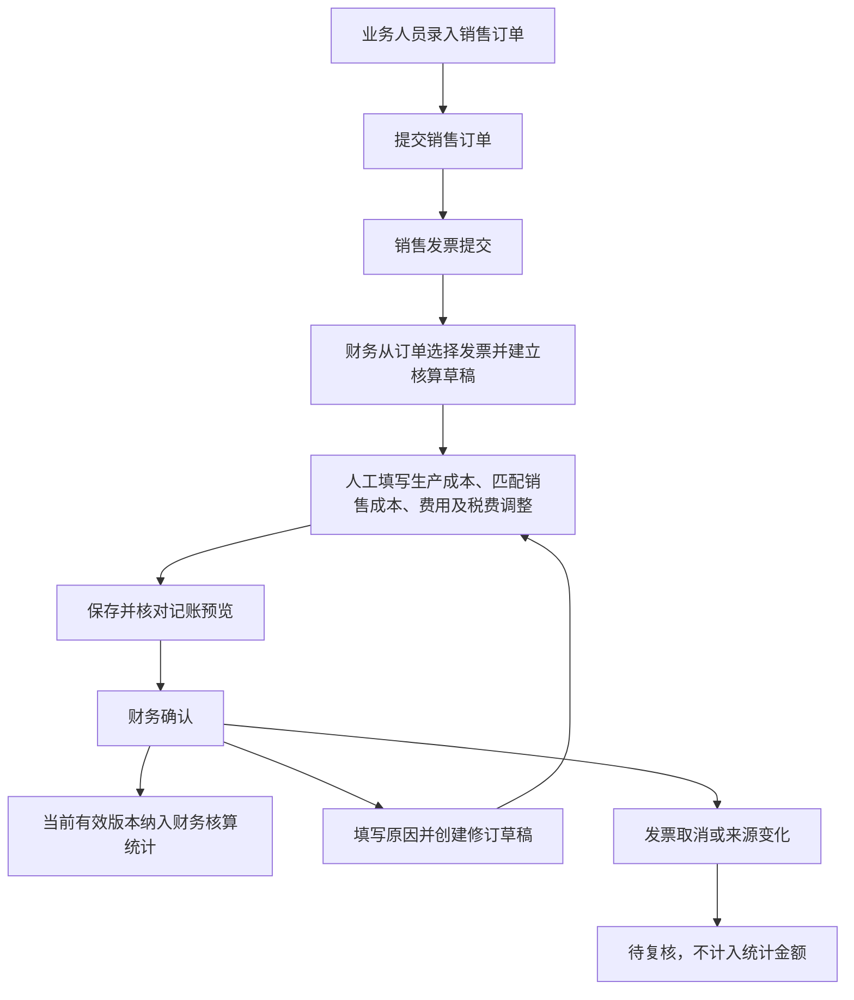

# 销售订单开票后财务核算：实施记录

日期：2026-10-23。对应方案：`86-sales-order-finance-manual-accounting-and-permissions-plan.md`。

## 已实现业务流

业务角色不能读取订单成本、毛利和税费预览相关敏感字段；接口、旧成本报表和导出也执行财务权限检查。财务角色仍须具备原订单、发票的记录访问权限。本次兼容既有 Accounts / China Finance 财务角色，并新增 Sales Order Finance Reader、Sales Order Finance Editor；不因增加财务角色而授予订单基础访问权。

一份核算关联一个订单与一张发票，支持分批开票及一张发票对应多个订单。按实际发票产品行取收入和数量，多订单税费分摊处理舍入尾差。未完成成本与明确确认的零成本分开处理；只有完整且有效的确认版本计入统计。毛利使用未税收入减匹配销售成本，其他费用另算管理利润。

确认后禁止直接修改；修订确认替代旧版本，保留历史。客户端不能伪造确认标志绕过确认接口。财务核算独立保存，不回写旧生产成本，也不产生正式总账分录或改变销售发票税费。

## 文件和调用链

以下路径相对 `development/frappe-bench/apps/`。

| 模块 | 文件 | 变更与调用关系 |
| --- | --- | --- |
| 订单入口 | `china_finance/china_finance/public/js/sales_order_finance_accounting.js` | 展示记录、选票建草稿、跳转统计 |
| 核算服务 | `china_finance/china_finance/services/sales_order_finance_accounting.py` | 来源校验 → 草稿 → 确认 → 修订；提供预览、取消失效和来源快照校验 |
| 权限服务 | `china_finance/china_finance/services/sales_order_finance_permissions.py` | 校验财务角色、订单/发票权限及列表查询范围 |
| 自动建议 | `china_finance/china_finance/services/sales_order_finance_cost_sources.py` | 精确关联交货行与库存流水提供成本建议，财务显式采纳 |
| 数据与表单 | `china_finance/china_finance/china_finance/doctype/sales_order_finance_accounting*/` | 新增主表、产品子表、税费子表；主表脚本提供确认、修订、建议及预览 |
| 汇总报表 | `china_finance/china_finance/china_finance/report/sales_order_finance_accounting_summary/` | 按公司统计有效确认版本；草稿和待复核仅显示状态 |
| 权限初始化 | `china_finance/china_finance/setup/sales_order_finance_accounting.py` | 角色、订单及订单行敏感字段第8权限级；冲突检测 |
| 安装与事件 | `china_finance/china_finance/setup/install.py`、`hooks.py` | 追加初始化、JS、核算权限钩子和发票取消钩子 |
| 原记账预览 | `china_finance/china_finance/services/sales_order_finance_preview.py`、`public/js/sales_order_finance_preview.js` | 保留接口，增加权限检查 |
| 原订单前端 | `client_akivision/client_akivision/public/js/sales_order_delivery.js` | 限制成本按钮和布局，避免前端重新显示敏感区域 |
| 原字段权限 | `client_akivision/client_akivision/utils/sales_product_field_permissions.py` | 订单成本使用财务角色及第8级；保留产品/仓库既有逻辑 |
| 原成本刷新 | `client_akivision/client_akivision/utils/sales_order_production_cost.py` | 限制公开刷新入口，避免初始化移除字段权限；内部自动成本链保留 |
| 原导出 | `client_akivision/client_akivision/utils/sales_order_export.py` | 兼容财务角色，保留原导出接口及字段校验 |
| 原成本报表 | `client_akivision/client_akivision/client_akivision/report/sales_order_production_cost_and_margin/` | 增加财务角色校验，原查询口径保留 |
| 回归测试 | `china_finance/china_finance/tests/test_sales_order_finance_accounting.py` | 计算、越权、来源变化、修订和统计回归 |

受影响范围为销售订单财务区域、成本报表与导出、新核算表单及新统计报表。原销售订单提交、开票、库存和正式总账处理未改写。

## 当前自动化边界

第一阶段以人工核算为主。自动建议仅使用能精确关联的交货单行及已记账库存流水，采用前展示原值与建议值，须明确选择并填写原因；不覆盖已确认版本。

项目/生产工单自动取数尚未接入。当前记录保留项目来源，后续需确定产品、项目、生产工单的可靠关联和分摊口径，再追加来源适配分支；不能将项目或工单总成本直接当作当前开票成本。

## 验证与部署结果

- 定向回归共12项通过：4项计算/角色测试和8项事务测试，含客户端伪造确认、版本修订、来源变化、取消、多订单/部分开票、销售越权和报表有效金额校验。
- 本次修改文件的差异空白检查通过；测试使用事务回滚的源单据，不生成实际总账或库存记录。
- 站点 `aki_test.localhost` 已执行新增 DocType/Report 定向同步、权限初始化及清缓存。
- 完整 migrate 被已有初始化配置阻断：`china_finance.setup.templates.ensure_company_mappings` 引用不存在的公司“西安分公司”。未修改该无关配置，不能将本次定向同步描述为完整迁移成功。
- 迁移前已生成数据库备份：`sites/aki_test.localhost/private/backups/20261023_072213-aki_test_localhost-database.sql.gz`（容器 bench 内）。
- 本轮浏览器自动验收未完成：宿主无 Node 命令；服务端测试不等于页面验收。上线前仍需以实际业务账号、财务账号检查订单区域、核算表单和报表展示。

## 预期可见效果

业务人员订单页不展示财务敏感区，也无法通过相关接口或导出读取；财务在已开票订单通过“财务核算”入口填报、确认、修订和统计。历史缺数据可手填，成本未完善不显示为已确认利润。后续接入可靠来源时仍经财务审核采纳。
