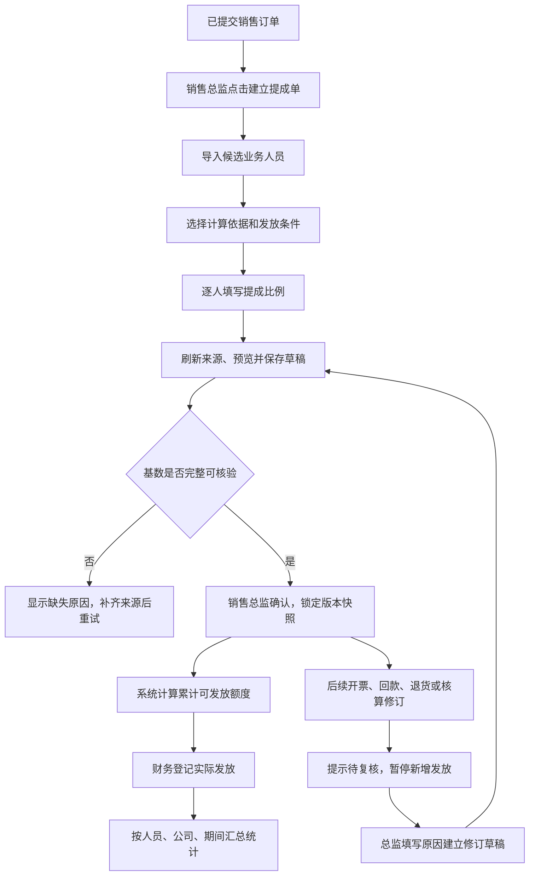

# 销售订单提成管理方案

日期：2026-10-23。

状态：已按本方案完成第一期实现，具体文件、调用链路和验证结果见[实施记录](./89-sales-order-commission-management-implementation.md)。本方案描述目标口径，实施记录注明的首期边界优先于尚未落地的后续设想。

## 1. 目标与约定

新增独立的“销售提成单”，销售总监选择计算依据、填写各业务人员的提成比例并确认；系统计算提成，财务核对可发放金额并登记发放，销售总监通过列表与汇总报表统计。

已交流确定：

- 计算依据可选择：订单未税金额、已开票未税金额、实际回款金额、财务确认毛利、手工指定基数。
- 提成比例由销售总监制定，普通业务人员不能修改。
- 一张订单可有多位业务人员，每人独立设置提成比例。
- 计算依据与发放条件分开设置。
- 优先新增功能分支，不改写已有销售、开票、回款及财务核算接口。

以下具体口径是本方案的建议默认值，不是对现有系统行为的描述；实施时应按该口径配置并验收。回款取数无法可靠关联订单的，不猜测归属，由财务补录有凭据的分配记录。

## 2. 现有代码与复用边界

本次已核对当前 Bench 源码，相关位置如下，路径均相对仓库根目录：

| 现有位置 | 已有能力 | 本次复用方式 |
| --- | --- | --- |
| `development/frappe-bench/apps/client_akivision/client_akivision/utils/sales_order_fields.py` | `custom_sales_person`、客户负责人默认值、空销售团队填充和业务员归属校验 | 只读订单负责人、团队作为候选人员，不修改现有默认和校验逻辑 |
| `development/frappe-bench/apps/client_akivision/client_akivision/utils/order_record_permissions.py` | User → Employee → Sales Person 映射，订单归属与权限过滤 | 复用人员映射；提成权限另建服务，不扩大订单访问范围 |
| `development/frappe-bench/apps/erpnext/erpnext/selling/doctype/sales_order/sales_order.json` | 原生 `commission_rate`、`total_commission`、`sales_team` 等字段 | 保持现状，不回写、不叠加到新提成统计 |
| `development/frappe-bench/apps/erpnext/erpnext/selling/doctype/sales_team/sales_team.json` | 团队贡献比例及佣金率 | 可导入候选人员，不将贡献比例直接当作本次提成比例 |
| `development/frappe-bench/apps/china_finance/china_finance/services/sales_order_finance_accounting.py` | 开票后财务核算、有效确认版本、来源快照与修订 | 新增只读来源适配，按订单取有效确认毛利；不改原确认接口 |
| `development/frappe-bench/apps/china_finance/china_finance/services/sales_settlement.py` | 原销售结算流程 | 不修改，仅在后续回款适配时核对真实结算与收款链路 |
| `development/frappe-bench/apps/china_finance/china_finance/hooks.py`、`setup/install.py` | 现有表单脚本、权限及安装迁移扩展点 | 追加本功能注册，保留已有配置与事件列表 |

独立建单原因：原生团队字段不覆盖本次五种计算依据、总监确认、发放资格、历史修订和发放台账。两套数据不自动同步；新页面和报表标明“销售提成管理口径”，避免与原生佣金混算。

## 3. 业务流



第一期从订单按钮或提成列表手工创建，不在订单提交事件中自动建单，不阻塞订单原流程。销售总监能在提成列表查看、筛选和逐单维护，后续再考虑批量设置比例。

## 4. 计算依据与金额口径

### 4.1 可选计算依据

| 选项 | 建议取数及规则 | 缺失或异常处理 |
| --- | --- | --- |
| 订单未税金额 | 已提交订单的本位币未税净额，使用折扣后金额 | 订单取消禁止新确认；负金额须复核 |
| 已开票未税金额 | 按 `sales_order + so_detail` 精确关联已提交发票行，汇总本位币未税净额；已提交退货发票按符号冲减 | 不以整张多订单发票金额代替；无有效发票显示待开票 |
| 实际回款金额 | 财务确认、已落到本订单的有效累计回款，减退款/撤销 | 未分配预收不直接算本订单回款；归属不明确显示待分配 |
| 财务确认毛利 | 汇总本订单各发票当前有效财务核算版本的 `base_gross_profit`，复核来源快照和有效键 | 任一相关有效发票待核算/待复核时阻止确认，不把缺失当零 |
| 手工指定基数 | 总监填本位币金额及原因/附件说明 | 服务端要求原因；不伪装为自动取数 |

第一期所有提成统一使用订单所属公司的本位币，不在同一金额中混加不同币种。订单、发票按各自原本位币字段取数；回款使用财务分配记录上的本位币金额并留存原币、汇率和来源凭据。跨公司汇总只给分组结果，不给跨币种总金额。

“实际回款金额”另有含税口径选择：

- 默认“含税实收”：按财务已确认的实际归属本订单回款计提，页面明确标识。
- 可选“折算未税回款”：必须提供各发票及其订单行的明确回款分配。按对应含税应收与未税净额比例折算；多税率、部分回款按明细处理，不能统一除以1.13。
- 退款、汇兑损益、核销、折让不自动等同现金回款；付款手续费按实际分配口径单列，不冒充客户回款。
- 毛利缺失与已确认零毛利必须区分。净毛利为负时，默认本版计提基数下限为零；若过去已计提/已发放，则仍产生负向调整和待追回金额，不能抹掉历史超发。

### 4.2 个人比例

每行业务员提成：`计提基数 × 个人提成比例 ÷ 100`，按本位币精度舍入。

例如基数100,000元，甲2%、乙1%，分别计提2,000元和1,000元，总提成3,000元。这里2%和1%不是对总提成池的分配比例，因此不要求合计100%；每人比例限制为0～100%，同人不能重复。总比例大于100%默认禁止确认。

不自动套用原生 `sales_team.allocated_percentage`。如以后增加“提成池×贡献比例”模式，应单独新增计算分支，不能改变本模式含义。

### 4.3 发放条件

| 条件 | 累计可发放额度 |
| --- | --- |
| 确认后可发放 | 当前有效版本累计计提额 |
| 全额回款后可发放 | 已确认累计净回款达到应收阈值时为累计计提额，否则为零 |
| 随回款比例发放 | 累计计提额 × 回款完成比例，比例限制在0～1 |

回款完成比例默认使用含税净回款 / 当前订单净含税应收基准；基准由有效订单金额及退货、折让核对确定，并存快照。分子分母必须是同公司、同本位币、同一含税范围；分母为零或负数需财务复核，不除零。

如果计算依据已是“实际回款金额”，选择“随回款比例发放”会重复折算，第一期禁止该组合；可选“确认后可发放”或“全额回款后可发放”。

累计已发放 = 已确认发放记录 − 已确认追回记录。

- 本次可再发放 = `max(累计可发放额度 − 累计已发放, 0)`。
- 尚未具备发放条件金额 = `max(累计计提额 − 累计可发放额度, 0)`。
- 待追回金额 = `max(累计已发放 − 当前有效累计可发放额度, 0)`，单独展示，不用负的“可发放”混淆。

## 5. 新增数据模型

建议均归属 `china_finance` App，不直接修改 ERPNext 核心 DocType。

### 5.1 销售提成单：`Sales Commission Sheet`

一张销售订单对应一条提成方案版本链；每个订单最多一个当前有效确认版本，同时最多一个待处理草稿，修订复用该草稿。暂不按月重复建立独立累计单，否则容易重复计提。

| 分组 | 主要字段 |
| --- | --- |
| 来源 | `company`、`sales_order`、`customer`、`company_currency` |
| 规则 | `basis_type`、`receipt_tax_mode`、`release_condition`、`manual_basis`、`manual_reason` |
| 计算 | `basis_amount`、`receipt_amount`、`receivable_baseline`、`receipt_ratio`、`commission_total` |
| 版本 | `status`、`previous_version`、`active_key`、`revision_reason` |
| 审计 | `source_snapshot`、`source_hash`、`confirmed_by`、`confirmed_on`、`confirmed_date` |
| 明细 | `sales_people`，关联提成明细子表 |

生命周期状态：草稿、已确认、已替代、待复核、已作废。发放进度（未发放/部分发放/已发放/待追回）由台账计算，与生命周期分开。

确认版本保留金额、规则和来源快照，禁止直接改比例、人员或基数。来源变化只标记复核，不原地覆盖确认金额。修订确认后替代上一版本，使用唯一有效键和订单行锁防止并发双确认。

### 5.2 提成明细：`Sales Commission Sheet Item`

字段：`sales_person`、`employee`、`beneficiary_user`（确认时解析并校验）、`commission_rate`、`commission_amount`、`remark`。稳定业务身份以 `sales_person` 为主，人员停用不删除历史归属。

候选默认来自订单 `custom_sales_person` 与 `sales_team` 去重，不默认带入原生佣金率。总监可以指定额外参与人，但要填写原因且不能借此修改原订单归属。登录用户映射歧义时不开放个人查询，由管理员修正人员映射。

### 5.3 提成资金分配：`Sales Commission Receipt Allocation`

第一期为回款计算和回款发放提供可审计输入，字段包括公司、销售订单、来源类型及凭据、来源明细标识、可分配本位币金额、本次订单分配金额、对应发票/订单行、未税折算金额、日期、状态及确认信息。

财务负责维护和确认，销售总监只消费确认结果。已关联明确收款凭据的，所有订单累计分配不得超过该凭据有效金额；服务端锁定来源分配额度并校验重复。凭据无法自动解析时走“人工核实”分支，必填原因与附件，并在报表显示其来源性质。

零阶段不改原收款单结构，不向 Payment Entry 或原结算接口回写。第二期再逐个加入 Payment Entry、付款对账/分配、退款等只读来源适配；已核实分配仍须防重复。历史数据不自动推断分配。

### 5.4 提成发放记录：`Sales Commission Disbursement`

单条对应一名业务员的一次发放或追回，字段包括 `company`、`sales_order`、`commission_sheet`（当时有效版本）、`sales_person`、`direction`、正数金额、实际日期、支付凭据、附件、经办人、确认人及幂等键。

修订后按“公司＋订单＋业务员”汇总全版本已发放，不能只统计最新子表行，否则会重复发放。移除某业务员时其历史支付和待追回仍保留。

发放记录仅用于管理台账，不生成工资、付款单或总账，也不证明银行实际支付成功；财务在实际支付后登记。已确认台账不能删除或覆盖，错误采用关联原记录的冲销记录处理，保留原支付证据。

## 6. 权限设计

建议新增专用角色，不把现有 `Sales Manager` 自动等同本次提成审批人。

| 使用者 | 权限 |
| --- | --- |
| `Sales Commission Manager`（销售总监） | 在已有公司和订单授权范围内建立草稿、设置依据及比例、确认/修订、查看提成汇总 |
| `Sales Commission Finance`（提成财务） | 查看授权范围的提成、维护回款分配、核对资格、确认发放及追回；不能代总监修改比例 |
| 业务人员 | 仅通过“我的提成”专用报表查看自己的计提、可发放、已发放和待追回结果 |
| Administrator | 安装、配置及问题处理，普通岗位不用此账号操作 |

普通业务人员不授予原始提成单读权限：只过滤父表无法隐藏同张单上的其他人子表明细。个人接口/报表由服务端按当前用户映射过滤人员，仅返回本人结果，不返回全表后靠前端隐藏。

毛利依据还涉及财务数据边界：

- 销售总监获得提成确认权限，不自动获得生产成本、税费或原财务核算单阅读权。
- 财务先建立/批准毛利基数快照；总监使用该快照定比例。原财务权限接口不放宽，也不借提成入口返回成本组成。
- 毛利基数本身也是敏感数据；获准使用该依据的总监需被明确授权查看该基数，普通业务人员仅见个人提成结果，不见毛利基数及比例，避免反推毛利。
- 来源发票或财务核算单的链接仅对有原单据阅读权限的用户输出。服务端内部取数如需受控绕过权限，仅限经过公司/订单/角色授权的基数快照服务，返回白名单字段，不提供通用查询能力。

新增 DocType 的列表、单据、REST、报表和导出使用同一权限服务；查询聚合与自定义 SQL 不能仅依赖前端按钮权限。默认不启用普通用户 Data Import，原始表导出限明确授权的总监/财务；我的提成导出仅本人白名单字段。

## 7. 计划新增与修改的文件

下表均为实施计划，本次未创建或修改业务文件。缩写 `CF` = `development/frappe-bench/apps/china_finance/china_finance/`。

| 文件/目录 | 方式 | 计划修改的代码职责 |
| --- | --- | --- |
| `CF/china_finance/doctype/sales_commission_sheet/` | 新增 JSON/Python/JS/__init__ | 主表结构；控制器保存校验、确认后锁定；表单依据选择、预览、确认和修订按钮 |
| `CF/china_finance/doctype/sales_commission_sheet_item/` | 新增 | 个人提成子表；不混用原销售团队表 |
| `CF/china_finance/doctype/sales_commission_receipt_allocation/` | 新增 | 订单回款分配、财务核实和冲销校验 |
| `CF/china_finance/doctype/sales_commission_disbursement/` | 新增 | 发放/追回记录、凭据和不可变台账 |
| `CF/services/sales_commission.py` | 新增 | 草稿、计算、确认、修订、有效版本锁和来源快照 |
| `CF/services/sales_commission_sources.py` | 新增 | 五种计算依据的分支、来源完整性检查、毛利快照白名单和回款分配读取 |
| `CF/services/sales_commission_payments.py` | 新增 | 发放资格计算、台账确认、幂等和超额防护 |
| `CF/services/sales_commission_permissions.py` | 新增 | 专用角色、公司/订单范围、个人投影及导出权限 |
| `CF/public/js/sales_order_commission.js` | 新增 | 订单“提成管理”入口及本人结果入口，不改现有销售按钮逻辑 |
| `CF/china_finance/report/sales_commission_summary/` | 新增 JSON/Python/JS/__init__ | 总监/财务汇总，按公司、人员、订单和期间筛选 |
| `CF/china_finance/report/my_sales_commission/` | 新增 JSON/Python/JS/__init__ | 仅本人结果；不输出基数、他人行或敏感来源信息 |
| `CF/setup/sales_commission.py` | 新增 | 幂等角色和必要索引初始化，检查已有权限及字段冲突 |
| `CF/hooks.py` | 小幅追加 | Sales Order JS、新 DocType 权限钩子；必要的来源失效事件只作追加，不覆盖现有处理器 |
| `CF/setup/install.py` | 小幅追加 | 安装/迁移时调用新初始化函数，保留既有顺序及行为 |
| `CF/tests/test_sales_commission.py` | 新增 | 计算依据、金额精度、缺失、修订和来源覆盖测试 |
| `CF/tests/test_sales_commission_permissions.py` | 新增 | 人员隔离、角色、公司、直接REST、导出与毛利泄露回归 |
| `CF/tests/test_sales_commission_payments.py` | 新增 | 回款额度、分批发放、追回、重复请求和并发校验 |
| `docs/08-reference/index.md` | 文档增量 | 登记本方案及后续实施记录 |

原 `client_akivision` 负责人、订单权限、导出接口以及 ERPNext 核心文件预计不修改。若开发发现无法只读复用，先在新模块增加适配分支；确需修改旧代码时应补充具体原因与兼容测试。

## 8. 计划接口与调用链

以下为新模块内部/公开方法的建议签名；只读方法默认GET，改变状态的方法限定POST，参数及最终返回契约在实施时固定。金额必须由服务端重算，不能信任前端传来的结果。

```text
订单页面 sales_order_commission.js
  → get_commission_context(sales_order)                 [仅授权信息]
  → create_commission_draft(sales_order)                [POST，幂等]
  → 新销售提成单表单
      → preview_commission(name)                       [只读，不保存]
          → assert_commission_permission(...)
          → sources.get_basis_context(...)
              → 订单未税金额 / 发票关联行
              → 财务批准毛利快照 / 已确认回款分配 / 手工基数
          → calculate_commission(...)
      → 标准保存接口 → 控制器校验并服务端重算
      → confirm_commission(name, modified)             [POST]
          → 校验总监权限、锁订单、检查modified
          → 重读来源、校验快照和完整性
          → 固化来源、人员与比例、设置唯一有效键
      → create_commission_revision(name, reason)       [POST]

财务回款分配表单
  → confirm_receipt_allocation(name, modified)          [POST]
  → 锁来源额度、校验公司/凭据/归属/重复与累计分配

财务发放表单
  → get_release_context(commission_sheet)
  → confirm_disbursement(name, modified)               [POST]
      → 锁订单及受益人额度、重查当前有效版本/来源
      → 累计额度减全版本已发放 → 检查幂等 → 确认记录

新统计报表 / 我的提成
  → 服务端授权与范围过滤
  → 当前版本计提 + 全版本发放台账 + 来源有效性校验
  → 汇总 / 白名单导出
```

确认标志必须是服务端内部不可伪造的上下文，不能依赖客户端可传入的 `flags` 布尔值。确认与修订在同一事务内切换有效键，失败回滚；发放与追回按受益人串行检查额度，避免两个请求同时通过校验后超发。

来源变化检测采用“打开/报表/发放前重新校验”作为正确性底线。第二阶段再追加事件提示以改善及时性；不能因为未收到事件而继续依据过期快照支付，也不自动改总监已经确认的比例。

## 9. 汇总口径与预期页面

### 9.1 销售提成单

顶部显示订单、客户、公司、计算依据、基数、来源完整性与发放条件；明细为“业务人员｜提成比例｜提成金额｜备注”。提供“刷新预览、确认、创建修订、查看发放记录”按钮，按权限和状态显示。

修改来源、依据或比例会使未保存预览失效；确认前服务端再次校验。未核算、未分配、来源过期不能以0元替代，不允许确认或新增发放。

### 9.2 销售提成统计

支持公司、业务员、客户、订单、生命周期、发放进度、订单日期、确认期间和发放期间筛选。显示累计计提、累计可发放、累计已发放、本次可再发放、尚未满足条件及待追回。

区分存量与期间发生额：

- 当前累计：只取每订单有效版本，不累加旧版本。
- 期间计提变动：首版确认计提全额，修订确认记“本版减前版”差额；按确认日期汇总，可为负。
- 期间实际发放：按支付台账实际日期汇总净发放；不将该期间重新确认的累计金额全部当新增提成。
- 草稿、待复核、已作废和已替代版本不贡献当前可支付计提；已发放历史保留。待复核显示冻结前金额及复核状态，暂停新增发放，避免历史支付凭空消失。
- 默认“当前累计”不宣称为任意历史时点余额；历史期末快照报表留到后续实现。

### 9.3 示例

订单未税100,000元，含税113,000元，甲2%、乙1%；选择订单未税基数、随回款比例发放。

| 阶段 | 累计计提 | 累计可发放 | 累计已发放 | 本次可再发放 |
| --- | ---: | ---: | ---: | ---: |
| 已确认，未回款 | 3,000 | 0 | 0 | 0 |
| 已核实回款56,500元 | 3,000 | 1,500 | 0 | 1,500 |
| 实际登记发放1,500元 | 3,000 | 1,500 | 1,500 | 0 |
| 已核实全部回款 | 3,000 | 3,000 | 1,500 | 1,500 |

若甲改为1.5%，总累计计提修订为2,500元，不能再新增一笔2,500元当作新增计提；本次调整为−500元，支付继续扣除之前已发金额。

## 10. 受影响模块和保持兼容的方式

| 模块 | 影响 | 兼容策略 |
| --- | --- | --- |
| 销售订单 | 新增提成入口，读取负责人和金额 | 不加必填，不阻塞提交，不改旧接口参数/响应 |
| 人员与销售团队 | 提成人员候选及登录映射 | 不改原团队、不反写贡献比例/原生佣金 |
| 财务核算 | 只读有效毛利基数 | 不放宽原财务接口权限，不改变毛利或重复扣提成 |
| 开票/退货 | 读取有效发票行、退货冲减和来源状态 | 不改变发票金额、税额和正式账务 |
| 回款/结算 | 新增独立财务分配台账 | 不改原收款及对账接口；自动适配分期做 |
| 发放/工资/总账 | 新增管理发放台账 | 不自动生成付款/工资/分录；避免重复支付 |
| 报表/导出 | 新增总监汇总与个人报表 | 不改旧报表统计口径，原生佣金不叠加 |

当前财务毛利不减本模块提成。若未来需要“扣提成后管理利润”，应新增独立展示指标并明确费用口径，不改现有毛利公式。

## 11. 小增量实施顺序

1. 新增提成主/子表、权限服务与五种基数计算分支。订单/开票直接只读取数，毛利走财务授权快照；回款分支先用独立人工核实分配，不虚构自动关联。
2. 加入草稿、总监确认、修订、快照、来源复核和订单入口；只新增接口。
3. 加入回款分配确认、发放/追回台账、额度锁及汇总/个人报表，形成第一期完整管理闭环。
4. 完成权限、计算、并发、退货与页面验收后启用；历史订单仅在授权用户主动建单时读取，不批量补造提成或支付记录。
5. 第二期单独增加原生回款/对账自动适配、批量操作、来源变化通知；工资和正式财务付款集成另立方案。

部署通过新增 DocType 同步和幂等安装函数实施；先备份，在目标站点验证依赖。已有文档87记录完整迁移曾被不存在的“西安分公司”配置阻断，实施时应复核该环境问题，不将本功能与无关公司配置修复混在一起。

停用时撤销入口和相关操作授权，保留历史表与台账，不删除财务记录；不得停用原订单、发票或回款功能。

## 12. 验收标准

- 五种依据均能选择；同订单多人个人提成按各自比例计算，比例不混同贡献分摊。
- 分批发票和多订单发票只取正确关联行；税、折扣、红字和外币换算口径一致。
- 财务核算缺失/失效、回款未分配时显示原因，不能当作零基数确认。
- 同订单最多一个有效版本；重复建单、重复确认、过期时间戳、客户端伪造状态被拒绝。
- 退货、取消、回款撤销、毛利修订触发复核；发放前兜底检测，不覆盖历史。
- 修订只影响计提差额，已支付按订单及人员跨版本累计；移除人员不清除支付历史。
- 分批发放、重复请求、并发发放及多订单分配不超额；追回和冲销可追溯。
- 业务员只能见本人结果；通过直接URL、REST、报表、导出均拿不到他人行、毛利基数和成本明细。
- 总监只能处理授权范围且不能修改支付记录；财务不能修改提成比例，新增提成权限不扩大原订单/发票权限。
- 期间计提为版本差额，期间支付为实际支付发生额；不同币种不混合合计。
- 原订单创建/提交、原生佣金、开票、结算、库存、财务核算和总账流程回归不变。

实施验收结果见实施记录。第二期自动回款适配、来源变化事件通知、历史期末快照、工资及正式付款集成仍未实施。
