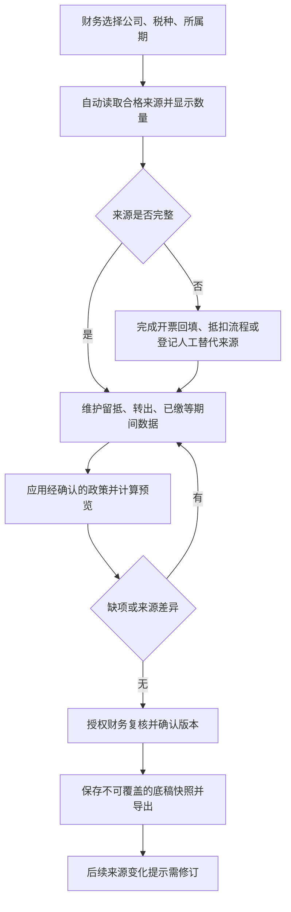

# 税费计算表缺失数据排查与增量修复方案

状态：待实施方案。本轮仅只读排查并生成文档，未修改业务代码、单据或数据库。

## 1. 结论及排查范围

排查日期：2026-10-23。核查站点：`aki_test.localhost`；目标公司：`阿基视觉（东莞）`；目标所属期：`2026-10`。

当前显示不完整有两个主要原因：**源业务数据未形成，以及计算功能尚未完成**。不是配置一个会计科目或刷新页面就能补齐。

| 现场核查项 | 结果 | 对页面的影响 |
| --- | --- | --- |
| 目标公司当月已提交 Sales Invoice | 4 张 | 这是销售业务发票，不等于中国税务发票，不直接参与本表汇总 |
| 当月已提交、非作废销项 China Tax Invoice | 0 张 | 销项汇总返回 0.00，不能据此认定已核实零申报 |
| 当月状态为 Deducted 的抵扣批次 | 0 个 | 进项汇总返回 0.00，不能据此认定没有可抵扣业务 |
| 全站 China Tax Invoice | 1 张：目标公司、2026-09-07、已提交进项蓝票 | 不属于当月销项；收票也不代表已完成抵扣 |
| 全站抵扣批次 | 0 个 | 进项抵扣流程尚未产生本表要求的批次来源 |
| VAT 其余七行 | 后端固定返回 None | 前端显示 `--`，没有补录入口 |
| 另外六类税表 | 仅定义行项目，所有值为 None | 还没有查询数据及计算公式 |

站点存在两个独立 Company：`阿基视觉（东莞）`、`阿基视觉（东莞）有限公司`。取数按精确公司名称隔离；不能因名称相近自动合并。此次汇总查询未发现另一公司税票及抵扣批次，但今后应提醒核对公司选择。

上述为查询时点数据，不代表外部税务平台没有发票，也不代表历史导入已完整。4 张销售发票是否均需开具税票，应逐张核对开票要求、申请和回填状态，不能仅按数量认定漏开。

## 2. 代码证据与具体问题

以下应用内路径以 `development/frappe-bench/apps/china_finance/china_finance/` 为根。

### 2.1 取数及计算

`services/tax_calculation.py`：

- `get_tax_calculation(company, period, tax_type="VAT")` 是只读入口，期间只接受 YYYY-MM。
- `_vat_calculation()` 销项按公司、开票日期、已提交、方向为销项、非作废税票汇总 `tax_amount`。
- 进项仅按公司、抵扣日期和 `status='Deducted'` 批次汇总，不直接取采购发票或已收到的进项税票。
- SQL 使用 `COALESCE(SUM(...), 0)`，无记录与有效记录金额恰好为零均显示为 0。
- 进项转出、上期留抵、免交、预缴、应交、期末留抵、应补缴均为空；VAT 始终返回 `Incomplete`、`is_estimate=True`。
- `_incomplete_calculation()` 为附加税、印花税、工会经费、企业所得税、水利建设基金、残保金返回空行，无实际计算。

### 2.2 页面及来源跳转

`china_finance/page/china_tax_calculation_sheet/china_tax_calculation_sheet.js`：

- 页面只有查询、刷新、打印和 CSV，没有维护、保存、确认或修订入口。
- 所有非空值都按 Currency 展示，税率和人数的单位不合适。
- 销项来源跳到 China VAT Ledger，但没有带销项方向及排除作废条件；台账默认查询可能与计算汇总口径不同。
- 抵扣来源跳转传入 `deduction_period=YYYY-MM`，实际字段是 Date，应使用当月起止日期范围并限定 Deducted。
- 后端虽返回 `source_filters`，页面跳转未直接复用统一来源条件。

`china_finance/report/china_vat_ledger/china_vat_ledger.py` 默认仅限制公司、日期、已提交；方向和发票状态仅在收到过滤条件时生效。不能为修复钻取而静默改变所有旧台账查询的默认口径。

### 2.3 已有流程与配置的边界

- `services/tax_invoice_request.py` 已有销售发票创建申请、生成税票草稿、`feedback_tax_invoice()` 回填号码日期并提交税票的流程。只有符合取数条件的已提交税票才进入销项行。
- `services/input_tax_deduction.py` 已有查验、创建批次、勾选、确认抵扣流程。Draft、Selected 均不进入已抵扣汇总。
- 抵扣候选查询以 `invoice_date <= deduction_period` 判断截止日期。若操作时使用月初日期，可能不包含当月后续发票；实施前应确认现有日期语义，优先新增税表入口的月末截止适配，不直接修改旧接口语义。
- `China Tax Account Mapping` 配置公司、进销项、会计科目、生效区间，服务税务与会计科目映射；不提供期间税基、留抵、工资、人数或适用税率，不能替代税费底稿。
- 销售订单上的税费预估、生产成本、毛利及提成不是公司申报底稿的直接来源，不将订单税费简单相加后冒充申报金额。

已有 [83 号七类税表规划](./83-china-finance-seven-tax-worksheets-optimization-plan.md) 描述了完整目标；其中“现状”是此前代码快照，与本次排查已有差异。本方案以当前代码为准。该规划中的政策、调整、快照及独立计算器文件在当前应用文件检索中未发现，不能视为已经上线。

## 3. 推荐业务流及预期操作

财务进入现有“中国财务 → 税费计算表”，先看到缺项和来源数量；点击“维护本期数据”打开独立底稿。每行展示单位、来源方式、来源记录数、核实状态和依据。无源数据提示“尚无来源，请补录或核实为零”，不能直接显示成已确认零。

前期可人工录入经核实的期间数据及附件；后期项目、生产工单或其他模块形成可靠数据后，仅接入来源适配器。项目/工单主要用于成本追溯，是否可作具体税种税基须另外确认。

自动取数与人工替代同一项目时必须二选一，不叠加。切换来源保留历史值、原因和差异；手工“调整”是单独授权的增减项，不得混同整项替代。财务明确确认的 0 是有效输入，未填写是缺失。

确认底稿不自动申报、不自动生成总账、不改变发票/抵扣状态；复核完成后的下一步为财务申报与对账，实际缴税依据另行登记，供附加税等使用。

## 4. 小增量实施拆分

### A：先修可解释性和来源一致性

1. 保留旧查询接口签名及现有返回字段；增加行级 `source_count`、`source_state`、`unit`、`missing_reason` 等可选元数据。
2. 保留金额字段兼容性；旧数值 0 可保留，但新页面必须同时显示“无来源/待核实”，与已核实零区分。
3. 抵扣钻取使用月份日期范围和 Deducted 条件。销项钻取传方向及新增可选“排除作废”过滤，报表旧默认行为保持不变。
4. 按金额、百分比、人数格式化；缺项提示到具体项目。未实现税种明确显示“尚未接入计算”。

此阶段只修显示和追溯，不宣称七税种已具备计算能力，也不生成虚构业务数据。

### B：新增财务期间底稿，先打通 VAT

复用 83 号文档命名，新增政策规则、期间调整、底稿快照及明细四类 DocType。草稿维护先落期间调整记录，确认时冻结计算结果及其明细。

- `China Tax Policy Rule`：公司、地区、税种、纳税人类型、期间类型、生效区间、政策依据、税率/优惠及确认人；重叠或缺失规则不自动套默认值。
- `China Tax Worksheet Adjustment`：公司、税种、所属期/起止日、项目代码、单位、数值、来源方式（补录/替代/调整）、业务依据、附件及修改历史。同项有效来源必须唯一。
- `China Tax Worksheet Snapshot`、`China Tax Worksheet Line`：确认版本、来源指纹/记录引用、规则版本、各行数值、缺项/差异、复核人和时间、前一版本。
- 新服务提供查询维护数据、保存草稿、预览、确认、修订入口；写接口限定 POST，校验角色、公司授权、单据权限、字段白名单、单位、期间及并发版本。
- 新计算分支仅在公司政策和输入齐备时启用；无配置仍走旧不完整分支。保留 `Incomplete`，扩展 `Calculated`/`Confirmed` 等状态并同步升级页面判断，不能将所有非 Incomplete 状态一律视为已确认。
- 确认后记录不可覆盖；修订生成新版本。源单据或政策变化时，旧快照仍可查，当前页面提示“来源已变化，待重新复核”。上期留抵默认仅接上期已确认快照，首次启用需财务录入凭据；跨期修订提示后续受影响期间。

VAT 首批仅覆盖经财务确认的常规一般纳税人分支。例：销项 10,000、进项 6,000、上期留抵 1,000、转出 500，在无减免、预缴及其他特殊事项的限定条件下，净额为 3,500，应纳 3,500、期末留抵 0。该示例不是所有业务的通用申报公式。

减免、预缴的适用位置、可抵扣范围及应补退额必须由具体政策分支确定，不能将所有项目直接相减。小规模纳税人、特殊计税及不支持的场景单独分支，未支持时保持不完整。

### C：逐税种增加来源及计算器

| 税种 | 首期可维护的依据 | 自动接入条件及计算边界 |
| --- | --- | --- |
| 附加税费 | 实缴增值税/消费税、缴款凭据、归属期 | 使用政策规定的实际缴纳税基，不能直接把 VAT 应纳值代入 |
| 印花税 | 应税凭证、税目、金额、日期 | 逐税目应用税率并去重，不对全部销售额统一计税 |
| 工会经费 | 经确认工资基数及期间 | 确认工资口径和工资/会计来源后接入，不预设统一比例 |
| 企业所得税 | 累计利润、调整、亏损、已预缴及依据 | 按公司季度/年度累计口径计算，不累加月度累计数 |
| 水利建设基金 | 地区适用计费基数、政策依据 | 按地区和生效期判断适用及减免 |
| 残保金 | 上年度工资、平均人数、安置证明等 | 明确年度口径及政策，不能取当月人数替代 |

阶段 C 每个税种独立交付验收；维护入口可以先提供，但无计算器/无政策不得展示正式计算结果。季度和年度能力通过新增期间查询接口提供，原 YYYY-MM 查询约束保持；旧页面增加期间选择后调用新入口。

## 5. 拟修改文件、代码内容及调用链

下列为实施清单，**本轮没有创建或修改这些业务文件**。

| 文件（应用根相对路径） | 拟改内容 | 阶段 |
| --- | --- | --- |
| `services/tax_calculation.py` | 保留旧入口，增加来源诊断及新计算分支委派 | A/B |
| `china_finance/page/china_tax_calculation_sheet/china_tax_calculation_sheet.js` | 单位、缺项、准确钻取；维护弹窗、版本和复核按钮 | A/B |
| `public/css/china_tax_calculation_sheet.css` | 缺项、来源及复核信息样式 | A/B |
| `china_finance/report/china_vat_ledger/china_vat_ledger.js`、`.py` | 新增可选排除作废过滤，兼容旧默认值 | A |
| 新增 `services/tax_calculators/sources.py` | 来源数量/金额/条件统一，避免计算与钻取口径偏离 | A/B |
| 新增 `services/tax_worksheet.py` | 保存、预览、确认、修订，权限与并发校验 | B |
| 新增 `services/tax_calculators/policies.py`、`vat.py` | 规则解析、VAT 支持分支、缺项校验 | B |
| 新增 `china_finance/doctype/china_tax_policy_rule/` | JSON、控制器及必要表单配置 | B |
| 新增 `china_finance/doctype/china_tax_worksheet_adjustment/` | 人工维护数据与凭据、审计权限 | B |
| 新增 `china_finance/doctype/china_tax_worksheet_snapshot/`、`china_tax_worksheet_line/` | 快照、行明细、来源及版本 | B |
| 新增 `services/tax_calculators/{surcharge,stamp_duty,union_dues,corporate_income_tax,water_fund,disability_fund}.py` | 六税种各自实现，不塞入旧 VAT 分支 | C |
| 新增 `tests/test_tax_worksheet.py` 等测试文件 | 取数口径、计算边界、权限、版本及兼容性测试，依项目测试约定落位 | A/B/C |

新增 DocType 后按 Frappe 应用迁移机制同步；旧记录不回填成“已核实”，不更改 ERPNext 核心文件。若需要唯一索引及初始化权限，实施时再增加对应迁移文件并登记，不使用迁移脚本造税额。

查询调用链：页面 → 原 `get_tax_calculation` → 请求/公司校验 → 来源适配器 → 旧分支或已配置计算器 → 结果及来源状态 → 页面/CSV/打印。

维护调用链：维护弹窗 → 新保存接口 → 写权限及公司/版本校验 → Adjustment → 新预览接口 → 政策与来源 → 计算结果。确认接口再次校验当前数据、权限及来源指纹 → Snapshot/Line；不能直接信任浏览器传来的计算结果。

现有销项业务链：Sales Invoice → 开票申请 → 审批 → 税票草稿 → 回填发票号码/日期并提交 → VAT 销项来源。

现有进项业务链：进项税票提交 → 查验 → 抵扣批次 Draft → Selected → Deducted → VAT 进项来源。沿用旧状态机，不由税表自动点击抵扣。

## 6. 受影响模块及权限

- 直接影响：税费计算表页面、来源钻取、导出打印、新增财务底稿及政策管理。
- 关联核查：销售开票申请/回填、进项抵扣、VAT 台账、税账核对；复用原业务接口，不改变其默认状态和提交流程。
- 总账、结账、工资、人事、项目及生产工单仅作为后续候选来源。本次不增加结账阻断，不调整提成和销售订单业务。
- 普通销售无底稿读写权限；财务维护与确认分别配置授权。审计角色只读；按钮隐藏之外，服务端必须同样拦截。沿用既有财务角色体系，不默认扩大某个角色的写入或确认范围。
- 公司隔离贯穿查询、保存、附件、明细和导出；新增来源查询须明确是公司级税务授权范围，不能仅靠前端过滤或无校验的 get_all。
- 历史值、操作者、时间、原因可追溯；确认后修订留痕。快照须保存可重现的来源摘要，不能只存易变化的链接。

## 7. 验收标准与预期效果

1. 当前现场数据仍不会凭空出现税额，但能准确提示销项 0 张、已抵扣 0 批，以及待补录项目；不会显示成已核实零申报。
2. 已提交非作废销项才入选；草稿、取消、进项、跨公司、跨期不入选；有效红票按其既有金额符号处理并核对冲红口径。
3. 抵扣仅统计 Deducted，跨期开票按抵扣期间归属；来源明细金额合计与页面一致，月末及闰年边界正确。
4. 财务可以保存明确的 0、非零及依据；空值仍提示缺项；替代来源与自动来源不重复累计。
5. 支持的 VAT 场景能从补录到预览、确认、导出完整走通；不支持场景保持缺项提示。留抵、无应纳、负差额及金额精度有边界测试。
6. 税率显示百分比、人数显示人数，CSV/打印附公司、真实起止期、来源方式、缺项警告、复核状态和版本。
7. 普通销售调用写接口或跨公司访问被拒绝；审计不可维护/确认；并发保存、重复确认、来源变更均有测试。
8. 旧查询参数/返回字段及旧报表默认结果保持兼容；旧开票、抵扣、总账接口无行为回归。
9. 六个后续税种逐个验收其适用政策、依据、公式和期间，不能以“页面有数字”作为完成标准。

## 8. 实施前需要明确的配置

财务需确认：实际核算公司、纳税人类型、主管地区、各税申报频次、适用政策及生效时间、期初留抵、已缴/预缴凭据、历史税票是否完整，以及谁可维护/谁可确认。上述缺项不妨碍阶段 A，但应阻止缺乏依据的正式结果确认。

推荐先完成 A，再实施 B 的常规 VAT 闭环，最后按公司实际需要逐个推进 C。现场数据治理与代码修复并行：有真实票据的补齐原流程，暂不具备完整来源的由授权财务登记可追溯的人工依据；不因修复页面而自动提交历史税票。
