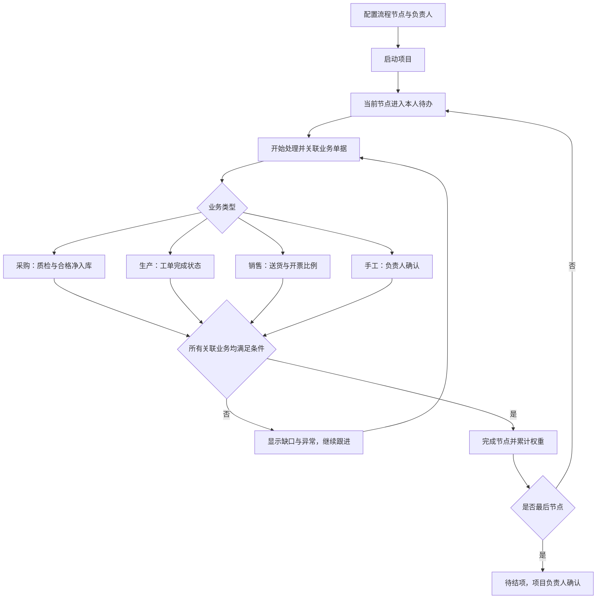
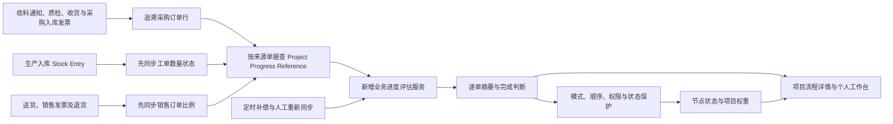

# 项目工作台与业务驱动节点完成方案

日期：2026-10-20  
状态：方案讨论稿；本次仅新增文档，不修改业务代码、数据库结构或现有配置。

## 1. 目标与范围

在项目“流程进度”的节点上增加关联 User 的负责人，新增项目工作台，按当前登录用户展示待办。采购、生产、销售节点按照实际业务履约情况完成，不再以单据提交或开始下一节点代替业务完成。

已确认业务口径：采购展示质检、入库，入库完成才算采购业务完成；生产工单完成才算完成；销售同时检查送货比例、开票比例。单据型节点自动完成，不另设“提交完成时间”。手工事项保留负责人手工完成入口。

第一期采用串行节点、每节点一个主负责人。不新增审批引擎，不改变采购、生产、销售原有完成规则、库存账、财务账或老接口返回结构。项目最终结项暂建议由项目负责人确认，此项是方案建议，并非已确认需求。

## 2. 现状及问题

现有核心：`development/frappe-bench/apps/client_akivision/client_akivision/utils/project_progress.py`。

1. 项目节点存于 Project.custom_project_progress_items，子表为 Project Progress Item；无负责人字段。completed_by 是操作记录，不能用作负责人。
2. 关联单据存于 Project Progress Reference。其 Draft / Completed / Cancelled 主要对应单据草稿、提交、取消；这里的 Completed 不是履约完成。
3. `_get_reference_completion` 要求所有关联记录为 Completed；随后 `_update_row_status` 只将节点置为“待交接”。
4. `start_progress_step` 开始下一节点时，`_finish_previous_open_step` 将前一节点标记已完成。前一节点在进行中或延期也可走此入口，可能绕过业务条件。
5. 手工入口标记“已完成”实际上进入待交接；最后节点需另点完成项目。
6. 关联单据后续同步可能覆盖已完成节点状态。当前主要校验项目写权限，未按负责人校验。
7. 项目实际进度为已完成节点权重之和；不等于订单收货或开票比例。保留这一区分。

## 3. 核实的数据来源

以下是代码核实结果，不表示已经对全部历史业务数据逐笔核账。路径均相对于 `development/frappe-bench/apps/`。

| 内容 | 实际来源 | 用法与注意事项 |
| --- | --- | --- |
| 项目节点与绑定 | client_akivision/.../utils/project_progress.py；Project Progress Item / Reference | 沿用关联关系；业务查询必须限定节点已绑定的单据，不能把同项目全部订单混算 |
| 采购收料通知 | client_akivision/.../utils/purchase_quality_flow.py；Purchase Receiving Notice 及明细 | 通知的 purchase_order、明细 purchase_order_item 关联采购订单；received_qty 表示通知到货量，不等于合格入库 |
| 采购质检 | Quality Inspection.custom_purchase_order / custom_receiving_notice；custom_purchase_quality_items 子表 | 子表 Purchase Quality Inspection Item 含 purchase_order_item、inspection_qty、accepted_qty、rejected_qty；兼容历史单行 custom_purchase_order_item |
| 采购入库 | Purchase Receipt Item.purchase_order_item / purchase_order；父单 docstatus、is_return | 已提交有效明细的合格 qty 按订单行汇总，采购退货净额冲减；不得把 received_qty 当合格量 |
| 直接开票入库 | Purchase Invoice.update_stock；明细 po_detail | 标准采购进度支持此路径；按实际库存更新、单位换算与退货规则纳入合格净入库，避免遗漏或重复统计 |
| 标准采购比例 | Purchase Order.per_received | 标准 Purchase Receipt 状态更新使用 received_qty，现有自定义流程又将其设为合格量加不合格量，因此仅作辅助展示，不能独立决定合格入库完成 |
| 工单完成 | Work Order.status / qty / produced_qty / process_loss_qty | ERPNext get_status 将生产数量加过程损耗达到计划数量视为 Completed；Closed、Stopped 不视为完成 |
| 生产入库摘要 | client_akivision/.../utils/work_order_completion.py | 已有 get_receipt_status、_sync_work_order；Stock Entry 提交/取消后同步工单数量状态。可复用内部逻辑，保留权限检查，不重复造完成口径 |
| 销售送货与开票 | Sales Order.per_delivered / per_billed / docstatus / status | 使用系统现有比例，不另按金额或数量重算两套口径；开票比例不是收款比例 |
| 下游事件 | Purchase Receipt、Purchase Invoice、Stock Entry、Delivery Note、Sales Invoice、Quality Inspection | 从明细追溯来源订单/工单，再找到项目节点；不能要求下游单据也手工绑定节点 |

源码依据：ERPNext `stock/doctype/purchase_receipt/purchase_receipt.py` 的 status_updater；`manufacturing/doctype/work_order/work_order.py` 的 get_status；自定义 `purchase_quality_flow.py`、`work_order_completion.py`；`hooks.py` 的相关单据事件。

## 4. 新完成规则

### 4.1 采购订单

同时展示：订单提交状态、收料通知、待检/检验完成情况、合格数量、不合格数量、合格净入库数量、入库进度与异常。

完成条件：订单已提交且未取消；每个应入库订单行的合格净入库量达到其应入库量；必检部分满足现有质检规则。合格与退货数量统一换算到订单行同一计量单位，按字段精度比较，不能用一个固定容差适用所有物料。不同物料、不同单位的数量不直接相加计算总体比例；总体可显示“已完成行数/应入库行数”，百分比另以明确的权重口径展示。

质检分批累计，按订单行及收料批次追溯，不能只取最新一张检验单，也不能把同一批检验和入库量重复累加。已退回的不合格历史批次保留展示，但不永久阻塞后续补货完成；尚未处置的不合格批次显示异常。草稿检验/入库不计入已完成量。历史缺少质检关联的必检记录标记“数据待核实”，不自动认定通过。

例：订单100件，到货100件，合格80件、不合格20件，合格入库80件：节点仍进行中；不合格退回并补货合格入库20件后，净合格入库达到100件才满足完成。采购开票、付款不作为该节点完成门槛。

非入库服务、供应商直送、少收关闭等不适用普通入库判断：显示“需确认完成口径”，不因 Closed 或收货比例而自动通过；第一期提供有权限、有原因和审计记录的例外处理。默认普通库存采购路径自动判断。

### 4.2 生产工单

以已提交工单的 `status == Completed` 为完成依据，展示计划数量、已生产数量、过程损耗、生产入库摘要。保留现有“已生产量 + 过程损耗达到计划量”的工单规则，不把“生产合格数量必须等于计划量”悄悄加成新门槛。

若现有生产摘要发现数量不同步，标记数据异常并由后台重算核实；未确认前不新增自动完成。若业务以后要求损耗必须补产，应作为独立需求修改工单规则。

### 4.3 销售订单

订单已提交且有效，`per_delivered >= 100` 且 `per_billed >= 100`，按字段精度比较。界面同时显示两个比例，不合并为模糊平均值。

送货100%、开票60%：待开票；送货70%、开票100%：待送货；两者100%：业务完成。不检查收款。skip_delivery_note、服务订单、零金额订单、手工关闭等特殊路径进入明确的例外处理，不擅自将送货缺失当作100%。

### 4.4 节点汇总与其他单据

同一节点绑定多张有效业务单据时，逐张采用对应规则，全部完成才自动完成节点；显示“完成张数/总张数”。零关联单据不得自动完成。取消关联不静默忽略，提示补绑或由项目负责人确认解除，避免无意减少业务范围。

新增规则只覆盖采购订单、生产工单、销售订单；BOM、采购申请等其他单据保留“提交后待确认”规则，不能误称为业务履约完成。手工节点由节点负责人确认，填写说明。

## 5. 状态、负责人及时间

建议新增 Project.custom_progress_mode：旧交接模式 / 业务完成模式。历史项目默认旧模式，不批量重置原状态；新建项目启用新模式。历史项目显式切换前预览负责人缺失、未达业务完成的已完成节点及权重，确认后迁移并留痕。

节点新增 responsible_user（Link User，仅启用的系统用户）、completion_basis（Legacy / Business Fulfillment / Manual Confirm / Document Confirm）、business_summary（只读简述）。优先复用原 actual_started_on、actual_completed_on、completed_by、last_synced_on，不新增提交完成时间。

业务模式流程：待开始 → 进行中 → 已完成。延期优先作为计算标记展示，兼容既有延期状态；旧模式继续使用待交接。项目暂停/取消时不自动推进节点，但可更新只读业务摘要；恢复后重新核实。

前置节点完成后，下一节点成为可处理待办，但不自动记实际开始时间。用户点击开始才记开始时间。下游业务先行发生时展示已具备业务条件，待前置解锁再评估完成，不允许完成后节点反向替前节点补完成。首节点也需项目已启动才能推进。

actual_completed_on 记录系统确认条件满足的时刻，不使用可倒填的单据 posting_date，也不使用下一节点开始时间冒充完成时间。业务自动完成的 completed_by 不伪装成负责人；新增完成来源（自动/人工/例外）并在审计记录保存触发单据、事件、执行用户。自动事件无可靠人员身份时不强行填负责人。

已完成节点遭退货、取消或业务比例下降：保留原完成记录，标为业务异常，不静默回退、不级联重置后续节点；项目负责人确认退回时填写原因，保留前后状态与完成历史。已结项项目也显示异常，不自动重开。

## 6. 项目工作台预期效果

```text
项目工作台    [我的待办] [全部待办：仅管理员可见]
待处理 3     进行中 5     已逾期 2     业务异常 1

项目     节点       负责人   计划完成     当前业务进展             操作
A项目    物料采购   张三     10-23        质检完成；合格入库80%    查看明细
B项目    生产加工   张三     10-24        工单进行中；完成60/100   查看工单
C项目    销售交付   张三     10-25        送货100%；开票60%        查看订单
D项目    资料整理   张三     10-26        手工事项                 完成节点

展开A项目：PO-001 → 收料通知 → 质检合格80/不合格20 → 入库80/100
普通用户仅显示“我的待办”；管理员可切换“全部待办”并按负责人筛选。
```

已完成单独筛选；未来未解锁节点单独展示；暂停、取消项目不混入可执行待办。逾期卡片为待办子集，不与其他卡片简单求和。业务摘要查看不直接赋予业务单据权限，无权用户不展示单据敏感数据。

工作台权限明确为：除管理员外，所有用户（包括项目负责人、Projects Manager、Projects User）只能查看 responsible_user 等于当前登录用户的节点。即使拥有某项目的读写权限，也不能在工作台查看他人的节点。管理员按 Frappe 的 Administrator 账号或 System Manager 角色识别，可查看全部节点；查看范围不自动赋予业务单据操作权限。

所有工作台列表、统计卡片、搜索、详情及导出（如提供）均在后端使用同一权限范围。非管理员不能通过修改负责人、项目、节点 ID 或分页参数越权；详情只返回本人节点及其有权访问的业务数据，不返回同项目其他人的节点。工作台中的项目链接仍按项目原有权限处理，本规则不修改项目表单原有可见范围。

负责人由有项目管理权限的用户分配、转派；已启用节点必须有负责人。负责人可处理本人节点，并受项目参与权限约束；禁止仅靠前端过滤授权。第一期对无项目权限的分配明确报错并引导添加项目成员，不自动授予整项目写权限。新增节点操作接口实行最小授权，不能要求所有节点负责人都获得项目全部字段写权限。

工作台直接查询节点和绑定关系，不另建 Task/ToDo 作为第二份状态来源。通知可后续接入。

## 7. 业务流程与数据流程





调用链：原生单据提交/取消及来源关联变更 → 原业务状态更新完成 → 新增事件适配器 → 解析来源订单/工单集合 → 找到节点 → 业务评估 → 状态服务 → 项目汇总。不要只监听订单 on_update：ERPNext 的 db_set 更新比例不一定触发该事件。

优先在原事务正常结束后入队，任务读取已提交数据并对节点加锁/版本校验；回滚不执行刷新。任务幂等、按项目/节点去重、并发重复提交只完成一次。关联移除或来源变更需要同时刷新旧、新节点；下游一单对应多个订单时逐一追溯。

新增定时补偿只扫描新模式活跃项目及待核实异常，分页重算；保留旧每日计划进度计算。页面读取不写状态，无需等待全量重算，显示最后同步时间。

## 8. 计划修改文件与新增分支

下列均为后续实施计划，本次未改动。路径相对 `development/frappe-bench/apps/client_akivision/`；`...` 表示 `client_akivision` Python 包。

| 文件 | 计划变动 |
| --- | --- |
| `client_akivision/utils/project_progress.py` | 增加模式分支；旧模式原逻辑保留；新模式禁止下一节点开始代替前一节点完成；项目汇总纳入新模式状态约束 |
| 新增 `client_akivision/utils/project_business_progress.py` | 采购、生产、销售业务评估；统一精度、例外和摘要结构；不修改原单据状态 |
| 新增 `client_akivision/utils/project_progress_events.py` | 下游单据追溯、提交后刷新、取消与关联变更、批量补偿 |
| 新增 `client_akivision/utils/project_workbench.py` | 工作台分页查询、负责人校验、开始/手工完成/异常处理的新接口 |
| `client_akivision/client_akivision/doctype/project_progress_item/project_progress_item.json` | 负责人、完成依据、摘要、完成来源及异常字段 |
| `client_akivision/client_akivision/doctype/project_progress_reference/project_progress_reference.json` | 保留原 status 含义；必要时新增业务状态、业务检查时间等快照，不复用 Completed 表达履约完成 |
| `client_akivision/public/js/project_progress.js` | 负责人列、逐单进度、按模式显示按钮；新模式去除易误解的“提交即完成”文案 |
| `client_akivision/public/js/project_progress_reference.js` | 分开展示单据提交状态与业务执行状态 |
| 新增 `client_akivision/client_akivision/page/project_workbench/` 下 JSON、JS、Python 文件 | 项目工作台页面、列表、筛选与详情 |
| `client_akivision/hooks.py` | 追加事件适配器和补偿任务，保留既有处理器顺序；生产同步后才评估工单 |
| 新增幂等 schema patch；`client_akivision/patches.txt` | 添加字段及页面、默认旧模式；不全量改写老项目状态 |
| 新增 `client_akivision/utils/test_project_business_progress.py`、`test_project_workbench.py` | 完成口径、状态保护、事件追溯和权限测试 |

菜单入口沿用系统现有项目导航配置机制，实施时定位实际配置文件后追加“项目工作台”，不批量重建导航。第一期不在流程模板预设具体人员，实际项目配置负责人，避免模板带入离职或无权限用户。

建议新增接口：`get_my_project_nodes`、`get_node_business_progress`、`start_assigned_node`、`complete_manual_node`、`refresh_node_business_progress`、`resolve_node_business_exception`。具体参数和返回结构在实施时固定；老接口地址、参数及旧模式响应保持兼容，新增字段采用可选方式。

## 9. 影响范围与交付顺序

直接影响：项目表单流程、项目进度汇总、项目操作权限、新工作台。间接读取：采购通知/质检/入库、工单与生产入库、销售送货/开票。原模块账务和库存计算不改变，新增事件只用于项目进度同步。

1. 新增负责人和模式字段、只读业务评估服务，先核对样本结果。
2. 新增工作台和项目逐单业务进度展示。
3. 在新模式启用自动完成及下游事件同步，补充异常处理、审计和定时补偿。
4. 验证通过后，由项目负责人选择迁移历史项目。回退可关闭新模式/入口，保留字段与日志，不删除历史数据。

## 10. 验收标准

- 非管理员（含项目负责人和 Projects Manager）在工作台列表、统计、搜索、详情及导出中只能查看本人节点；篡改参数也不能查询或处理他人节点。Administrator / System Manager 可查看全部节点，业务单据操作仍校验原有权限。
- 采购仅提交订单不完成；合格入库80%、不合格20%不完成；补货后净合格入库满足才完成。分批质检、重复物料行、退货、直接开票入库不漏算、不重复算。
- 工单提交不完成；生产入库推动工单 Completed 后完成节点；损耗按原工单规则展示和判断，数据不一致显示异常。
- 销售送货100%且开票60%不完成，两者100%才完成；不以收款代替开票。
- 多单据有任一未完成则节点不完成；零单据、取消单据、少收关闭不被静默自动通过。
- 下一节点开始不能绕过前置完成；并发、重复事件只完成一次；页面读取不修改状态。
- 单据取消/退货后出现业务异常并保留完成历史，不静默重开已结项项目。
- 下游单据未绑定项目节点但来源订单已绑定，仍能正确刷新；单据一次关联多订单、解除旧关联均刷新正确。
- 暂停项目不推进；旧模式项目继续按原流程运行，原接口兼容。

## 11. 实施前需最终确认的建议

普通采购按“合格净入库足额”自动完成；工单遵从现有 Completed（含过程损耗）；销售双比例100%；这些作为本方案主线。

尚需确认：最后节点完成后是否直接完成项目，还是保留项目负责人结项；特殊非库存/直送/零金额业务的例外权限和审批方式。默认先采用“负责人确认结项、特殊业务人工留痕处理”，不为少数特殊路径修改原业务接口。
