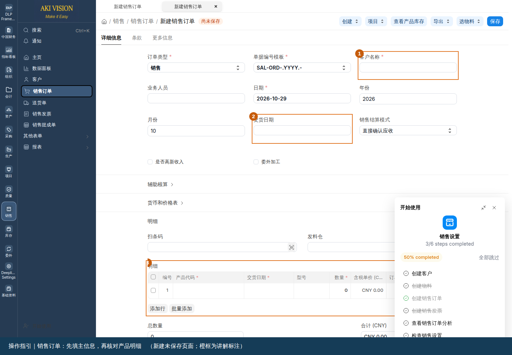
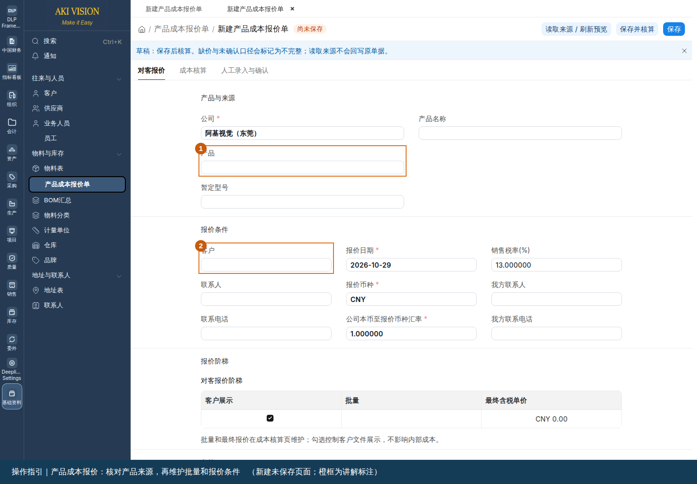
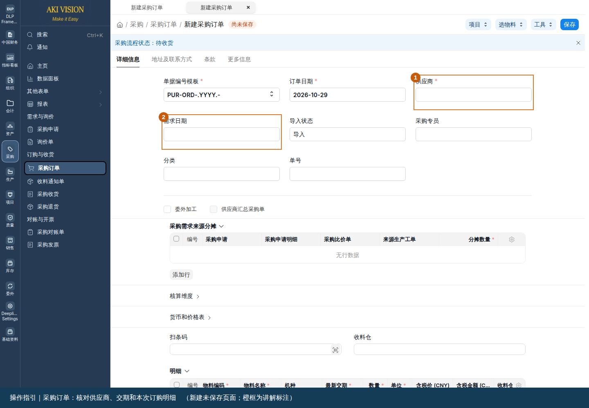
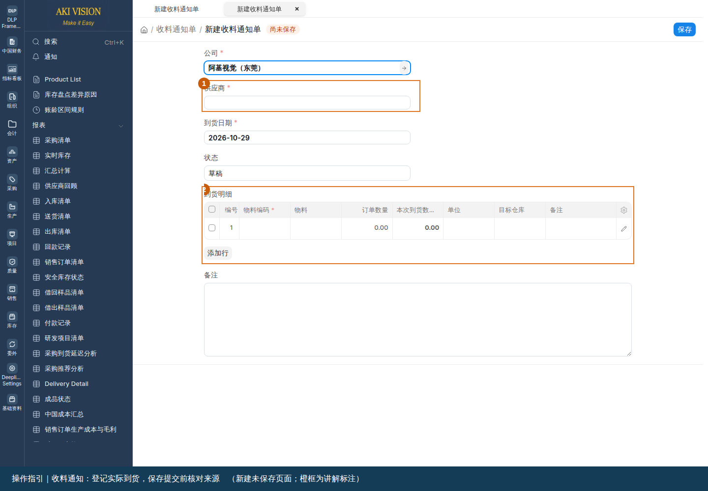
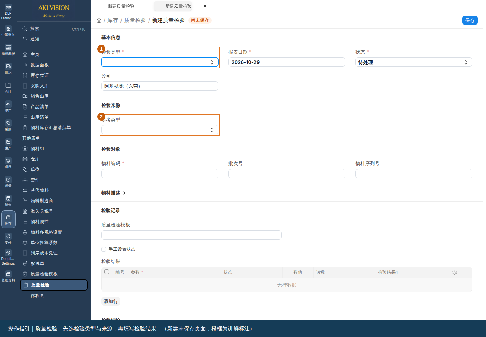
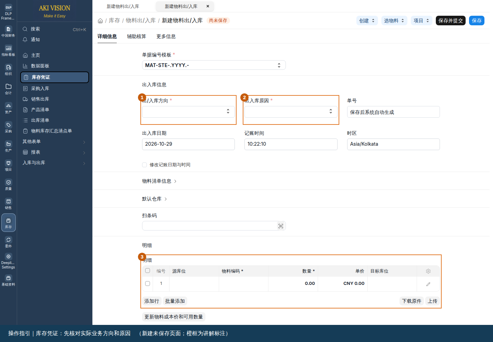
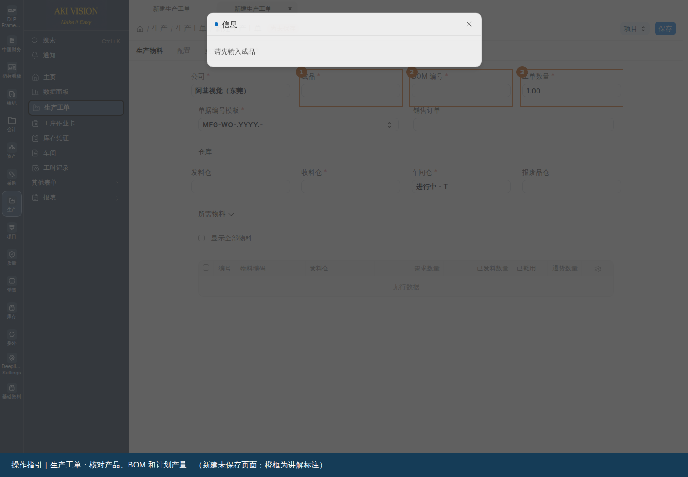
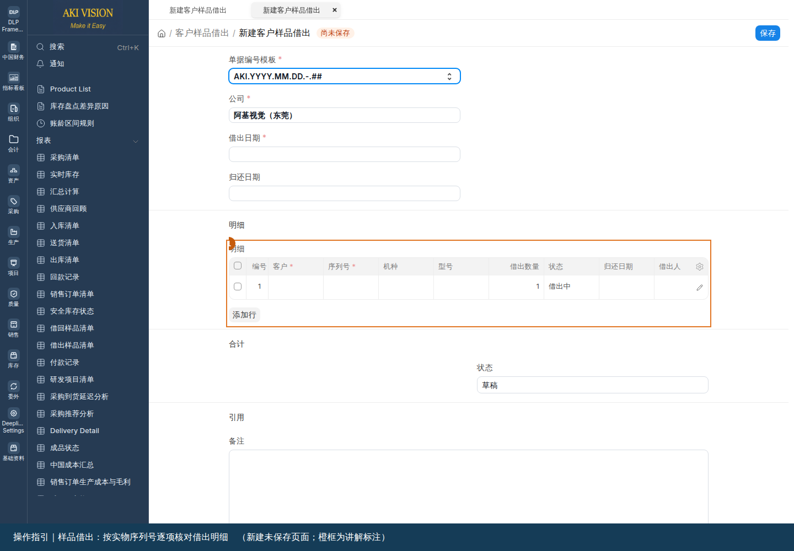

# aki_erp 各业务模块操作手册

[返回手册目录](README.md)｜[共同操作](01-新手入门与日常操作.md)｜[完整流程](04-完整业务流程与岗位交接.md)

本册按业务岗位分模块。各节均包含用途、入口、操作和完成检查。若页面无所述按钮，先检查权限、单据状态和启用范围，再联系支持人员；不需要自行调整系统设置。

## 目录

1. 基础资料
2. 客户与业务跟进
3. 销售订单与交付
4. 产品成本报价
5. 采购申请、询比价与供应商报价
6. 采购订单与到货跟踪
7. 收料、质量检验与采购退货
8. 库存、调拨、盘点与呆滞库存
9. BOM 与工程图纸
10. 生产工单、领料、工序与完工
11. 项目、研发、任务与工时
12. 样品借出、借入与归还
13. 销售提成
14. 业务表单总表、报表与经营看板
15. 账号、待办与岗位权限
16. 零星采购与 OA 申请
17. 海外成本及外部系统扩展

财务和税务详见独立的 [03 财务与税务操作手册](03-财务与税务操作手册.md)。

## 1. 基础资料

**谁使用：** 各岗位查询；指定资料维护人员新建和修改。

**入口：** “基础资料”工作区，或搜索客户、供应商、物料表、计量单位、仓库、地址、联系人。

### 1.1 客户和供应商建档

1. 按全称、简称和税号先搜索，确认没有重复记录。
2. 新建客户或供应商，填写名称、分类等当前页面要求的内容。
3. 在对应地址、联系人记录中维护资料，并关联到客户或供应商。
4. 客户的业务人员、结算条件，以及供应商的交易与付款信息，按公司核实结果维护。
5. 保存，重新打开，检查名称、联系方式和关联是否正确。

**完成检查：** 业务单据中能够选中正确对象；地址和联系人属于该对象。银行账号变更由授权人员独立复核，不凭聊天消息直接改。

### 1.2 物料和销售产品

1. 搜索型号、编码和名称，核对规格、单位和类别。
2. 新增时由资料维护人员确认编码、库存单位、采购或销售用途、序列号及检验要求等配置。
3. 采购人员在物料供应商明细中核对供应商及其价格规则；价格规则的币种、单位、有效期和数量阶梯应齐全。
4. 销售人员从“销售产品”入口选对外产品，核对其与实际物料的映射。
5. 保存后在相关业务单据中试选，确认关联到同一个产品。

销售产品展示与内部物料展示可能因岗位而不同。看不到采购价、成本或毛利时，先核对岗位权限。

**常见错误：** 同名不同规格选错；把一箱当一件；仅新建价格规则却未关联到物料供应商行。缺资料先补资料，不在订单上临时拼出新名称。

### 1.3 仓库、单位与储位

确认所属公司、仓库用途和负责人。原料仓、成品仓、在制仓、借出仓、待退仓各有用途，不能为了提交成功随意互换。

“储位（Bin）”在系统中用于查询物料与仓库的库存汇总，不等同于现场货架位置，也不用于手工改库存数。库存变化应由实际出入库单据产生。

## 2. 客户与业务跟进

**谁使用：** 销售、销售负责人。

**入口：** 客户；若已启用，可从 CRM 工作区进入线索（Lead）、商机（Opportunity）和报价单（Quotation）。

1. 接到客户需求后先查客户，确认负责人和联系方式。
2. 需要跟进潜在客户时，在已启用的线索或商机中记录需求、预计产品、时间及跟进情况。
3. 确认规格、数量、交期、价格及付款条件，保留邮件、合同或确认附件。
4. 需要正式报价时创建报价单；涉及成本测算，先走第 4 节。
5. 客户接受后，通过可用的来源创建功能生成销售订单，或新建并核实关联，避免重复录入同一订单。

**完成检查：** 客户需求有依据，报价和订单版本一致，下一次跟进有负责人。外部 CRM 是否同步，以第 17 节的启用情况为准，不将本地客户建档当作外部同步成功。

## 3. 销售订单与交付

**谁使用：** 销售录单、负责人审核，仓库办理交付，财务办理结算及收款。

**入口：** 销售工作区；搜索销售订单（Sales Order）、销售送货单（Delivery Note）。

### 3.1 创建销售订单

看图操作（下面的完整步骤继续适用）：

1. 先选择客户名称，再填写交货日期。
2. 向下查看“明细”，逐行核对产品、数量及含税单价。
3. 核对后点右上角“保存”；提交和审批按下文办理。

准备客户确认依据、产品规格、数量、税价口径、交期和结算方式。

1. 从已确认报价或销售订单列表新建。
2. 选择客户、公司、业务人员、订单日期和要求交期。
3. 选择销售产品或物料，核对对应关系、数量和单位。
4. 填写价格、税率、币种、适用仓库和结算条件；检查含税与未税金额。
5. 保存，逐行对照客户确认依据；按权限提交或交审核。
6. 记下单号并检查备货结果，将交期与缺口交给仓库或生产。

### 3.2 查看备货草稿

系统存在按可分配库存形成送货相关草稿、按缺口及生产条件形成工单草稿的辅助功能。草稿不是已发货或已开工。

1. 打开已提交订单，查看提示及关联的送货、工单记录。
2. 有库存的部分核对仓库、分配数量和已生成草稿。
3. 缺口部分核对生产数量、有效 BOM 和交期，交生产复核。
4. 没生成时先看原始提示，检查已有草稿、仓库和 BOM；不要马上新建相同业务。
5. 确需使用“重新生成备货草稿”或“一键创建销售送货单”时，由授权人员先核对已有记录及剩余数量，再操作一次并检查结果。

旧提示中可能出现“草稿拣货单”字样，应打开实际生成单据判断，不据此再重复新建一套出库记录。

### 3.3 分批送货

1. 从订单关联入口打开现有送货草稿，或按页面功能创建销售送货单。
2. 核对客户、来源订单、物料、出库仓、本次数量；批次或序列号管理的物料核对实物身份。
3. 仓库按公司实物交接制度拣取、复核和发运，授权人员按要求提交对应单据。
4. 检查送货单状态、库存流水及订单累计交付数量。
5. 留存签收或交付依据，告知销售剩余数量及计划。

**完成检查：** 本次出库和实物一致，来源订单正确，累计交付未重复。订单 10 件、本次 4 件，余量应继续跟进 6 件。

### 3.4 客户对账与结算交接

按客户及期间整理送货记录、退货、价格差异和签收依据。客户确认后交财务核对对账单及销售结算。具体操作见财务册第 3 节。已对账、已结算、已开票、已收款分别检查，不互相代替。

### 3.5 客户退货

先确认原送货、退回物料、本次退回数量和质量处理意见。由授权岗位使用实际启用的退货功能关联原单，仓库核验实物，财务办理对应红字、退款或应收调整。不能只把原订单数量改小，也不能用普通入库掩盖客户退货来源。

## 4. 产品成本报价

看图操作（下面的完整步骤继续适用）：

1. 先确认所报产品及本次报价采用的资料来源。
2. 按下文顺序维护批量、成本依据及报价条件。
3. 对客发送前复核导出范围，避免发送内部成本。

**谁使用：** 获授权的报价、工程及财务人员；销售只使用授权的对客报价结果。

**入口：** “产品成本报价单（Product Cost Quotation）”；可从基础资料相关入口查找。

**准备：** 产品、有效 BOM、供应商价格、预计批量、制造工时费率、项目投入和分摊依据。没有正式产品时，按页面支持方式填写暂定型号并明确估算依据。

1. 新建，选择产品、BOM 版本、客户和公司，按需要关联项目及参考工单。
2. 填写币种、税率、接单最小数量和定价方式；目标毛利率与成本占售价比例按所选方式维护，不能混填。
3. 设置不同批量，例如 50、100、200 件。
4. 使用“读取来源／刷新预览”，先看来源再应用选中分组。刷新会重建所选来源明细，操作前确认哪些人工内容需要保留。
5. 在成本核算相关页核对材料单价、含税口径、单位、制造工时及费率；项目实际投入、预计剩余投入和摊销数量分别核对。
6. 在“人工录入与确认”等区域补充缺失数据和依据，保存并核算。
7. 检查各批量状态、单台成本和最终含税报价。估算或不完整来源须说明，按页面要求确认估算依据后再提交。
8. 导出前选择“内部完整核算表”或“客户报价单”。后续变更使用“复制为新版本”，重新核对来源和估算确认。

**完成检查：** 批量、币种、报价版本正确，客户版无内部成本明细。低于最小接单量的估算档不应直接当作承诺报价。

**计算示例，仅供培训：** 材料 30 元＋制造 18 元＋研发摊销 6 元＝单台成本 54 元。目标毛利率 40%、销售税率 13% 时，含税价为 54÷(1－40%)×1.13＝101.70 元。毛利率 40% 不等同于成本加价 40%；正式税率和定价由公司确认。

**常见错误：** 将研发预算再加到已计入的实际投入中；把整批投入当单台成本；把参考工单的实际成本重复叠加到未来报价。

## 5. 采购申请、询比价与供应商报价

**谁使用：** 需求部门提出申请，采购询价和下单，负责人按实际流程审核。

**入口：** 采购申请（Material Request）、询价单（Request for Quotation）、供应商报价（Supplier Quotation）、采购比价及供应商报价导入相关入口。

### 5.1 提出采购申请

1. 先查库存、在途和已存在申请，确认真实缺口。
2. 优先从工单、项目或缺料来源创建申请；无来源入口时新建并按页面填写用途及关联。
3. 选择适用申请类型，填写物料、需求数量、单位、需要日期和目标仓库。
4. 保存核对，按权限提交；把单号、用途和紧急原因交采购。

**完成检查：** 缺口没有重复申请；采购能知道买什么、买多少、何时要、用于哪项业务。

### 5.2 询价、导入报价与比价

1. 整理规格、图纸版本、数量和交期，向选定供应商询价。
2. 录入供应商报价，核对供应商、币种、含税口径、单位、有效期及交期。
3. 使用“供应商报价导入”时，先按当前模板整理文件，预览映射和错误，再确认；不把导入成功当成采购订单已建立。
4. 比价时将同一规格、单位、币种和税价口径放在一起比较，检查运费、交期、最小订量和质量条件。
5. 确认采用方案后，从报价或申请创建采购订单，保留来源。

供应商阶梯价格必须满足数量、日期、单位等适用条件，系统不会代替采购判断质量与交期。价格变化按授权更新资料，不随意覆盖历史订单。

## 6. 采购订单与到货跟踪

看图操作（下面的完整步骤继续适用）：

1. 选择本次供应商，核对交期。
2. 在明细中逐项核对物料、数量、价格及收货安排。
3. 保存后再按下文检查和交审核，不以保存代替下单完成。

**谁使用：** 采购、采购负责人。

**入口：** 采购订单（Purchase Order）、采购物料或供应商采购汇总相关页面。

1. 从已提交申请或选定报价创建订单。
2. 核对供应商、公司、币种、物料、数量、单位、价格、税率、仓库和要求到货日期。
3. 涉及多申请合并时，使用已启用的合并入口；核对每条来源分配，不能只看汇总数量。
4. 有阶梯价格时核对实际采用档位及适用数量；同供应商不代表所有物料可以混合计阶梯。
5. 按需要维护分批到货计划和工程图纸，检查附件版本。
6. 保存、核对、提交或交审核，向供应商发送正确版本。
7. 跟踪已到、待到和逾期数量；发生延期，更新有权限维护的计划并通知需求部门。

**完成检查：** 供应商确认价格、交期和规格；本单与原申请数量可追溯；到货有第 7 节对应的后续记录。

采购付款交接使用“采购对账单／采购跟进单（Purchase Follow Up）”，操作见财务册第 4 节。此单用于对账和移交，不能替代采购发票或付款。

## 7. 收料、质量检验与采购退货

**谁使用：** 采购确认来源，仓库核验到货，质量人员检验，财务处理后续价款。

**入口：** 采购订单、收料通知单（Purchase Receiving Notice）、质量检验（Quality Inspection）、采购收货／采购入库（Purchase Receipt）、质量不合格、采购退货单（Purchase Quality Return）。

### 7.1 到货先登记

看图操作（下面的完整步骤继续适用）：

1. 优先从来源采购订单创建收料通知；图中仅展示填写页面。
2. 核对供应商及本次实际到货明细，分批到货只登记本批数量。
3. 按下文交质量检验，不将登记到货视作合格入库。

1. 打开来源采购订单，核对供应商和本次送货内容。
2. 对采用收料质检流程的业务，使用“创建收料通知单”，登记实际到货物料及数量。
3. 核对订单行、供应商送货依据和本次到货量，按权限提交收料通知单。
4. 通知质量人员；此时不要把到货数量当作合格可用库存。

### 7.2 检验并办理合格入库

看图操作（下面的完整步骤继续适用）：

1. 在“检验类型”和“参考类型”核对本次检验场景。
2. 确认来源和物料；向下填写检验结果及实际检测数据。
3. 核对合格与不合格数量后再办理下文的入库或退货。

1. 在已提交收料通知单使用“创建质量检验”，核对生成记录及对应物料。
2. 质量人员按检验标准填写检测总数、合格数、不合格数和明细结果，保留检验依据。
3. 核对数量勾稽与检验结论后提交。
4. 从已完成的质检使用“创建采购入库单”，仅将合格且尚未入库的数量带入。
5. 仓库核对目标仓库、批次／序列号、来源订单和质检记录，提交并查询库存。

不要求检验的物料按站点实际规则从已提交采购订单办理收货；不能为了绕过校验临时取消物料必检设置。

### 7.3 不合格处理与采购退货

1. 在质量不合格列表或来源质检单，核对不合格物料和剩余可退数量。
2. 使用“创建采购退货”，核对供应商、来源、数量和退货原因。
3. 采购与仓库确认实物交接，再由授权人员提交。
4. 已进入待退仓的物料，检查对应关联库存退货及库存减少；未入库的不合格品，检查退回供应商记录，不另做一次库存扣减。
5. 将退货依据交采购及财务，核对供应商补货、扣款、红字或退款安排。

**完成检查：** 到货、合格入库、不合格待处置和已退数量能说明去向；同一批货没有重复入库或扣库。

**示例：** 到货 100 件，检验确认合格 90 件、不合格 10 件。先办理合格 90 件入库，其余 10 件走不合格处理；不能以到货 100 件直接做全部合格入库。

## 8. 库存、调拨、盘点与呆滞库存

**谁使用：** 仓库；质量、生产、采购和财务按职责协同。

**入口：** 库存凭证／库存移动（Stock Entry）、库存余额（Stock Balance）、库存流水（Stock Ledger）、物料盘点汇总（Material Stocktake Summary）、库存对账（Stock Reconciliation）。

### 8.1 查库存

1. 选择公司、物料、仓库及查询日期。
2. 区分账面实存、已分配／占用和可用数量；先确认日期，再判断是否能发料。
3. 从库存流水追溯单号，核对是否已提交、是否取消、是否属于当前仓库。

### 8.2 办调拨及其他出入库

看图操作（下面的完整步骤继续适用）：

1. 按实际业务选择库存凭证类型，核对出入方向和原因。
2. 向下检查来源仓、目标仓、物料和本次数量。
3. 交审核前确认实物交接依据，不套用与实际不符的类型。

1. 优先从来源业务创建库存凭证。
2. 按页面选择实际业务方向和原因，核对来源仓、目标仓、物料和本次数量。
3. 需要批次／序列号时逐一对应实物，按页面要求录入或选择相关记录。
4. 保存、核对、提交，检查出入两端库存和关联记录。

普通调拨不代替销售送货、采购收货或生产完工。现场实物与单据提交应按公司制度同步，不能用无依据出入库“补平”余额。

### 8.3 盘点

1. 与相关岗位约定盘点时点和范围，识别期间未录入的实物流动。
2. 使用盘点汇总等入口准备物料和仓库清单，现场记录实际数量。
3. 对差异逐项复核：漏单、仓库错误、单位换算、序列号、在途和时间差。
4. 填写差异原因及依据，由有权限人员按当前入口形成或办理库存对账。
5. 提交后查库存流水和余额，与复核结果核对。

### 8.4 呆滞与减值

在已启用的成品状态、呆滞和减值相关入口，核对物料、库龄、数量、拟处置方案及依据。仓库说明实物状况，负责人决策，财务判断减值或转回并办理账务。状态标签和减值分析记录都不能代替实物出库或正式会计分录。

**完成检查：** 库存差异有原因、调整有来源、余额可追溯；减值与库存数量变化分开核对。

## 9. BOM 与工程图纸

**谁使用：** 工程、研发和授权资料维护人员；生产与采购使用已批准版本。

**入口：** BOM 汇总（BOM）、工程图纸（Engineering Drawing）。BOM 是生产一件或一批产品所需材料和工艺的清单。

1. 确认产品编码、BOM 基准产量、材料规格、用量和单位。
2. 半成品涉及下层 BOM 时，核对各层供应方式：自制还是外购。
3. 核对工序、损耗及仓库等页面已启用内容，保存并按权限提交、启用。
4. 关联正确图纸，核对型号、版本、生效信息和适用业务。
5. 版本变更按已启用的版本入口办理，复核生效时间和变更说明，再通知使用岗位。
6. 开工或下采购订单前，再核对业务单实际引用的版本。

**完成检查：** 默认／有效 BOM 符合本次生产要求，图纸版本一致。修改当前 BOM 不代表所有历史工单会自动更新，也不能直接修改已开工任务来代替工程变更确认。

### 9.1 新增 BOM：准备资料

先建好要生产的成品／半成品和所需材料的物料档案，确认编码、规格和库存单位。准备工程确认的材料用量；需要工序时，先确认工序、工作站及工时资料。无新建或提交权限时，请工程资料负责人办理，不借用他人账号。

### 9.2 新增 BOM：逐步填写

1. 搜索“BOM”，进入列表，点击“新建”。选择要制造的产品（Item to Manufacture），核对公司及单位。
2. 填写“数量／产出数量（Quantity / Output Qty）”。这是这份材料清单对应的成品产量，不是本次客户订单数量。
3. 在“材料／组件（Components）”表格添加行，逐行选择材料编码，填写用量和单位；展开行检查单位换算及适用的下层 BOM。
4. 自制半成品需要展开生产时，确认所引用下层 BOM 已提交且有效；外购件不要误选需要自制展开的下层 BOM。没有确认的下层资料，先交工程核实。
5. 需要在 BOM 中维护工序时，勾选“包含工序（With Operations）”，填写实际工序、工作站和工时。仅物料清单的业务，不为凑齐表格虚构工序。
6. 核对材料价格依据、币种和成本。成本取值依赖已有价格资料，缺价时先补依据；BOM 估算成本不等于实际采购价或完工成本。
7. 核对“有效（Is Active）”“默认（Is Default）”的用途。默认表示系统可优先选用，设置前确认是否替换同产品原有默认 BOM。
8. 点击“保存”形成草稿，交工程负责人核对产品、基准产量、材料、单位及工序；有权限人员确认后“提交”。若公司另有审批流程，按实际流程完成。
9. 记下 BOM 编号，在拟使用的工单上核对实际选中的编号和产量。只保存的草稿不能当作已批准、可用于正式生产的 BOM。

### 9.3 用量示例与完成检查

**仅供培训的示例：** BOM 产出数量填 10 台，材料 A 填 20 件，材料 B 填 30 件，表示每台分别需 A 2 件、B 3 件。若产出数量改为 1 台，材料也应按同一基准核对为 2 件和 3 件。不要只改产出数量而不检查材料用量。

检查：产品无误；每行用量都对应同一产出基准；单位换算正确；下层 BOM 合适；单据已提交且有效。新 BOM 不会自动创建采购订单、领料或工单，也不表示旧工单已改用新版本。

### 9.4 修改与更换 BOM

未提交草稿可按权限修改后重新核对。已提交 BOM 的材料结构调整，通常应复制为新的 BOM 草稿，复核后提交，并由负责人决定默认版本；仅按页面允许范围维护状态。存在关联业务时不要直接取消旧 BOM。记录变更原因和生效安排，通知采购、生产；已开工任务由负责人另行评估，不能认为换默认 BOM 会自动更新历史单据。

## 10. 生产工单、领料、工序与完工

**谁使用：** 生产计划、班组、仓库和质量。

**入口：** 生产工单（Work Order）、工序卡（Job Card，启用时）、库存凭证（Stock Entry）。

### 10.1 接收工单和检查缺料

看图操作（下面的完整步骤继续适用）：

1. 核对生产产品、BOM 和计划产量。
2. 检查下方所需物料及仓库，确认缺料处理安排。
3. 按下文继续领料和完工登记，新建工单不表示已经生产。

1. 打开销售订单生成的工单草稿，或按实际需求建立工单。
2. 核对产品、计划数量、BOM、来源订单／项目、计划时间及原料仓、在制仓、成品仓。
3. 核对每项材料需求与可用库存，区分缺料和已申请／在途数量。
4. 自制半成品核对下层生产任务；外购材料按启用入口衔接采购申请，避免父子工单重复申请。
5. 保存、审核或提交后下达任务，不将自动生成草稿当作生产已开始。

### 10.2 领料、退料和工序记录

1. 从工单的可用创建入口办理领料或物料转移。
2. 核对工单、物料、实际数量、来源仓及目标仓；考虑分批领料和此前已领数量。
3. 按实际领用提交，检查工单和库存记录。
4. 退料使用相应退回业务，关联工单和原领用关系，不修改原领料数量掩盖退料。
5. 启用工序卡时，按实际开工、完成、人员和工时记录；使用定制工序明细时按当前页面维护，不能两处重复计工时。

### 10.3 完工和生产入库

1. 核对本次实际合格完工量、实际耗料、损耗和检验要求。
2. 从工单创建生产入库，核对业务类型、本次成品数量、耗用材料及仓库。
3. 需检验时按当前规则完成检验，不能用进度填报代替质量确认。
4. 保存、核对、提交，检查成品增加、原料或在制减少以及工单累计完工数量。
5. 有剩余材料、未完成任务或报废差异时说明原因，交仓库、计划及财务处理。

**完成检查：** 工单产量、生产入库、库存和实物一致。“进度 100%”不等于成品已经入库。

## 11. 项目、研发、任务与工时

**谁使用：** 项目负责人、研发、参与部门；成本信息按权限维护。

**入口：** 项目（Project）、项目工作台、项目进度及超期相关页面、任务（Task）、工时表（Timesheet）、研发申请相关入口。

### 11.1 研发申请和立项

看图操作（下面的完整步骤继续适用）：

1. 填写能明确识别本次研发事项的项目名称。
2. 核对计划开始、结束日期及负责人安排。
3. 保存后按下文建立任务和费用归集，持续维护实际进展。

1. 从已启用的研发申请入口登记需求背景、客户或内部需求、拟开发产品、交付物和计划。
2. 填写预算及依据，按实际工作流提交；没有研发申请入口时，先由负责人确认当前立项方式。
3. 立项后核对项目、客户、负责人、起止时间及来源需求。
4. 预算与实际费用分别维护，不能把预算直接当成已经发生的成本。

### 11.2 节点与任务协作

1. 负责人在项目工作台核对节点模板、负责人、计划日期和验收要求。
2. 将工作拆分成任务，说明交付物和责任人。
3. 执行人记录实际进度、问题及附件；工时表选择正确项目、任务和日期，录入真实工时。
4. 采购、生产等业务在相应单据中关联项目，项目人员回到工作台检查关联结果。
5. 人工节点由责任人按权限确认；单据驱动节点先核对来源记录及状态。
6. 完成后核对验收、未结采购、生产、成本和收款事项，再按授权结项。

### 11.3 项目费用与产品报价

获授权人员维护项目实际成本明细及其凭据，将预计剩余投入单列。产品成本报价引用项目时，明确分摊比例和摊销数量，避免同一投入对多个报价重复全额分摊。

**完成检查：** 节点有负责人和依据；项目进度、业务单据和验收能相互说明。缺少来源时先核对关联，不把节点强行标完成。

## 12. 样品借出、借入与归还

**谁使用：** 销售、样品管理、仓库；采购参与供应商借样。

**入口：** 样品借出（Sample Loan Out）、借出归还（Sample Loan Out Return）、样品借入（Sample Loan In）、借入归还（Sample Loan In Return）。入口中文随翻译可能不同，可用英文名称搜索。

### 12.1 借给客户

看图操作（下面的完整步骤继续适用）：

1. 核对借用对象、借出时间及归还约定。
2. 向下查看借出明细，逐项核对物料、数量和适用序列号。
3. 按实物交接情况办理，后续归还或转销售按下文操作。

1. 新建样品借出单，核对公司、日期和明细。
2. 逐行选择实物序列号，核对物料、来源仓、借出仓、客户、联系人及借出责任人。
3. 按页面填写适用的归还信息，保存核对后提交。
4. 查看借出状态及关联库存记录，保留客户实物交接依据。
5. 归还时建立借出归还记录，关联原借出明细及序列号，核对实物状态和入库仓后办理。
6. 部分归还时，逐件检查未还清单。

### 12.2 客户决定购买

对已提交且仍有未还样品的借出单，授权人员可使用“转销售／Convert to Sales”，选择未归还且未售出的序列号，创建销售订单。随后继续核对价格、交付和财务流程。

**完成检查：** 同一序列号去向唯一；转销售生成订单不等于已收款，不将同一件同时登记为“已归还”和“已售出”。

### 12.3 向供应商借入

1. 建立样品借入记录，核对供应商、样品身份、数量及页面要求的仓库。
2. 按实物到达和已启用的库存联动规则办理，检查关联记录。
3. 归还时从原记录关联建立借入归还单，核对本次退回的样品身份及数量。
4. 保留交接凭据，检查原借入剩余未还情况。

供应商样品与公司自有库存的归属要分清。是否需要另行收货或出库，以关联记录及当前规则为准，不能再重复做一次库存变化。

## 13. 销售提成

**谁使用：** 销售查询本人结果，销售总监维护提成方案，提成财务核实回款及发放。

**入口：** 销售工作区“提成管理”；授权人员可从订单的提成入口或提成单进入。

1. 总监选择订单，创建提成草稿。
2. 选择计算依据：订单未税额、已开票未税额、已核实回款、财务批准毛利或手工基数。
3. 逐人核对业务人员及比例，预览后确认，保留依据；变更使用修订版本。
4. 财务登记并确认回款分配，核对客户、公司、方向、来源凭据及金额，不将预收款自动猜为某张订单的回款。
5. 实际发放、追回或冲销时登记相应台账和凭据，检查可发额度及是否重复。
6. 销售从本人报表查询结果，有异议将订单和期间交负责人复核。

**完成检查：** 有效方案版本、回款分配和发放凭据一致；来源变化时先复核再继续发放。

提成台账不会自动执行银行转账、发工资或形成会计分录。普通业务员只看授权个人结果，不要求其看到他人提成、比例或毛利基数。

## 14. 业务表单总表、报表与经营看板

**谁使用：** 业务人员查进度，负责人查经营情况，财务查金额及口径。

**入口：** 业务表单总表、运营指标看板、各模块报表和 KPI 相关入口。

1. 先确定问题：查未交付、缺料、逾期采购、应收，还是期间经营结果。
2. 设置公司、日期、业务对象、负责人及页面支持的筛选。
3. 看清指标单位、日期口径和单据状态，区分订单、交付、开票和回款。
4. 点击可用明细或来源链接，抽查业务单据。
5. 导出前核对范围、数据权限及对外用途。

指标目标值、账龄区间和指标定义由获授权人员按公司口径维护。负责人发现异常，应定位来源再交业务岗位处理，不直接在看板上“调数字”。

**完成检查：** 能说明数字属于哪个期间、哪些单据及什么状态；缺失数据不能直接解释为零业务。

## 15. 账号、待办与岗位权限

**谁使用：** 所有人管理本人待办；授权管理员管理账号和角色。

1. 每日查看通知及待办，打开原单核实，不只看通知摘要。
2. 有审批权限时，核对来源、数量、价格、交期及附件，再按页面提供的批准、退回等动作办理。
3. 申请权限时说明账号、岗位、公司、仓库、项目和所需操作，由公司指定人员确认。
4. 调岗或离职前列出未结订单、项目、待办和代理人，交负责人及管理员处理。
5. 管理员按批准范围配置用户、角色和数据范围，并安排业务人员复测可见及不可见内容。

**完成检查：** 员工能处理职责内业务，成本、提成和财务资料按授权可见。审批流程是否存在以当前单据为准，不要求业务人员自行新建工作流、自定义字段或修改权限。

## 16. 零星采购与 OA 申请

**谁使用：** 需求人、采购、负责人和财务。

**入口：** 零星采购需求相关采购申请、零星采购开票申请（Misc Purchase Invoice Request）；已启用时还有 OA 采购申请（OA Purchase Request）。

1. 需求人先确认是正式物料采购还是零星费用需求，避免在多个入口重复申请。
2. 按实际页面填写需求内容、数量、预计金额、用途、需要时间和附件。
3. 按当前工作流保存及提交，采购核对供应方式和后续订单。
4. 使用零星采购开票申请时关联对应零星采购需求，核对发票资料与实际业务。
5. 财务核验采购发票和收付款凭据，需求人核对实物或服务已收到。

**完成检查：** 一项需求有清楚来源和后续财务凭据。申请批准不等于付款，开票申请不等于采购发票已经提交或法定发票已经开具。

OA 申请的审批字段及转采购动作需要按本站点确认；未启用时继续使用公司已批准的申请渠道，不自行同时补建两套业务。

## 17. 海外成本及外部系统扩展

以下扩展存在应用或页面代码，但本手册未确认其在目标正式站点完整启用。仅在负责人确认可用、提供配置及验收结果后使用。

| 扩展 | 使用时做什么 | 怎么检查 | 不应假定 |
|---|---|---|---|
| 海外采购成本工作台 | 核对批次、商品、币种、费用和分摊依据，预览版本；发布或确认前交财务复核 | 分摊总额与费用来源一致，查看版本和审计记录 | 工作台计算已经自动写入库存估值或总账 |
| MES 门户及生产对接 | 核对任务来源、外部任务号和页面同步结果；异常交生产与支持人员 | 对比工单、物料需求、数量和状态，查看相关对接记录 | 外部已完工就代表 ERP 已生产入库 |
| 外部 CRM 对接 | 核对客户、商机与外部编号，发现重复先查同步记录 | 两端对象对应、负责人正确，失败记录有人处理 | 保存本地客户就必然双向同步成功 |
| AI 助手 | 在已授权入口提出查询或辅助整理请求，人工核对答复及来源 | 对照原始单据和报表，不仅凭回答判断结果 | 回答正确、拥有额外权限、已经替人审批或记账 |

未开通时，相关实际业务仍通过前述销售、采购、生产和财务单据办理。扩展接入故障由支持人员处理，业务人员不自行重新推送大量数据或反复建立重复记录。
