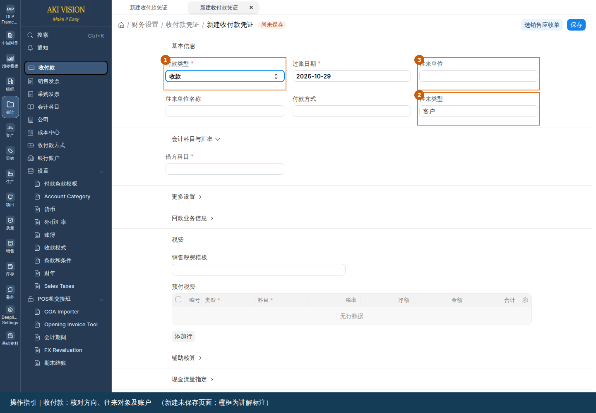
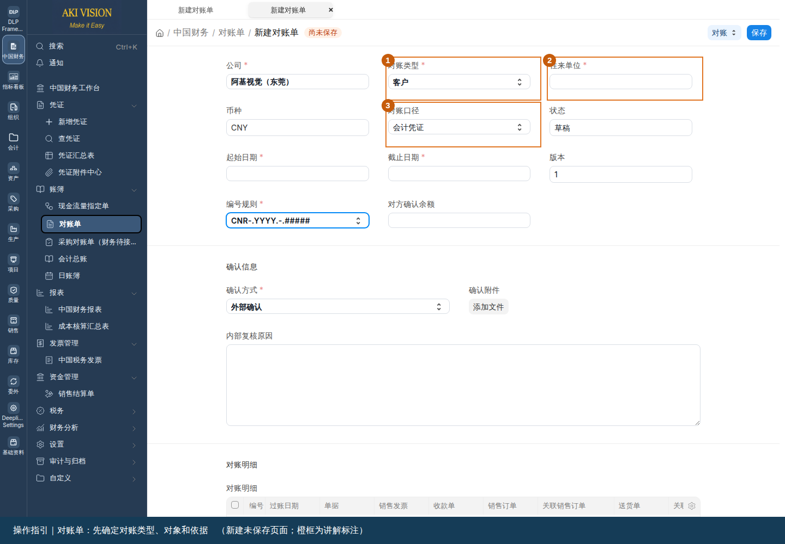
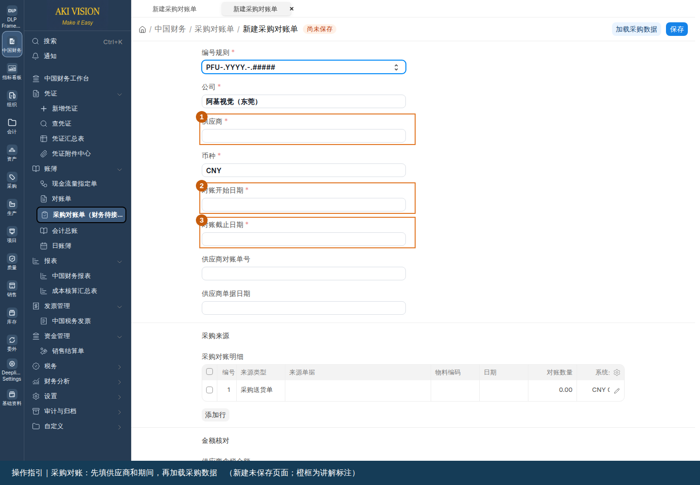

# aki_erp 财务与税务操作手册

[返回手册目录](README.md)｜[业务模块](02-各业务模块操作手册.md)｜[月结案例](04-完整业务流程与岗位交接.md#流程八财务从业务交接到月结归档)

适用对象：财务、出纳及获授权负责人。销售和采购重点阅读第 1、3、4 节，掌握交接要求即可。科目、税率、抵扣资格和结账政策由财务负责人确定，本册说明系统操作与核对方法。

## 1. 先分清五类记录

| 记录 | 作用 | 不能直接表示 |
|---|---|---|
| 订单、收货、送货 | 约定业务及记录物流 | 已经收付款 |
| 对账单、销售结算、采购跟进 | 核对业务、确认结算及移交 | 对方款项已到账或已付出 |
| 销售发票、采购发票 | 系统应收应付和会计业务单据 | 税务平台已开具法定发票 |
| 中国税务发票 | 登记和关联实际税票信息 | 仅登记就完成申报、缴税或银行支付 |
| 收付款、凭证、账簿 | 记录资金、会计确认及账务结果 | 仅保存草稿就已正式记账 |

业务交接至少核对：公司、客户／供应商、币种、业务期间、来源单据、数量、未税额、税额、含税额、确认附件及差异说明。

## 2. 应收、应付、收付款与核销

**入口：** 销售发票（Sales Invoice）、采购发票（Purchase Invoice）、收付款单／付款分录（Payment Entry）、应收应付及付款核销相关报表或页面。

“核销／分配”是把一笔收付款对应到具体应收或应付单据，避免钱已登记但账单仍显示未结清。

### 2.1 销售应收

1. 查明本业务采用直接开票，还是由销售结算生成应收；先查已有发票，防止两条路径重复。
2. 从有效来源建立或打开销售发票，核对客户、公司、币种、订单／送货来源、数量、价格和税额。
3. 需要结算或开票控制的，先完成相应校验，不另建无来源发票绕过控制。
4. 保存复核，按权限提交，查询应收余额和会计记录。

### 2.2 采购应付

1. 接收采购交接，核对订单、实际合格收货、供应商对账及真实发票资料。
2. 从有效来源建立采购发票；要求采购跟进单关联时，选择已接收的对应记录。
3. 逐行核对物料、单位、已收／已退数量、金额、税额和来源，处理差异后再提交。
4. 查询应付余额，确认没有重复开票或重复计入已结算范围。

### 2.3 收款和付款

看图操作（下面的完整步骤继续适用）：

1. 先核对“付款类型”是收款还是付款，再核对往来类型。
2. 选择正确往来单位，向下检查账户、金额及关联应收应付。
3. 核对银行凭据后按下文保存、审核和提交，系统单据不代替银行操作。

1. 根据真实银行或现金凭据创建收付款单，选择收款或付款方向。
2. 核对公司、客户／供应商、收付账户、币种、日期、金额及凭据号。
3. 在引用明细中选择应收／应付发票，填写本次分配金额；检查多发票分配和预收预付。
4. 保存并复核，按实际审批及权限提交。
5. 查询发票剩余未付金额、收付款状态和总账记录，与银行／现金凭据核对。

**示例：** 发票含税额 1,130 元，本次到账 600 元且全部正确分配，本张剩余应收应为 530 元。登记收款 600 元但未分配，不代表这张发票已核销。

**异常：** 金额不足、跨币种、手续费、退款或预付款未分配，按实际业务另行核实。不得为凑平账款，把尾差随意分配到其他客户或发票。

## 3. 客户对账与销售结算

**入口：** 对账单（China Reconciliation Statement）、销售结算单（China Sales Settlement）。

### 3.1 选择对账依据

看图操作（下面的完整步骤继续适用）：

1. 先选对账类型、往来对象和对账依据。
2. 填写本次期间与范围，再按下文加载相应明细。
3. 核对送货依据与往来账依据的区别，不混用两种金额。

| 依据 | 适用问题 | 注意 |
|---|---|---|
| 送货明细（Delivery） | 本期送了什么、哪些数量待结算 | 不等同于客户账面欠款 |
| 往来账（Ledger） | 期初、期间发生、收款与期末余额如何形成 | 不等同于所有未开票送货金额 |

### 3.2 按送货对账

1. 新建客户类型对账单，选择公司、客户、期间及送货依据。
2. 使用“加载送货明细”，核对送货单、物料、数量、价格、退货和期间范围。
3. 保存后按实际需要导出客户对账单 PDF，交客户核对。
4. 有差异时查原始业务，登记差异、原因、责任人和处理期限，补充确认依据。
5. 数据及确认依据齐全后，按权限完成确认／提交。
6. 查看“打开自动结算草稿”或已有结算记录；没有草稿时先看提示，再按可用的“创建销售结算单”办理。重复点击前先查已有记录。

自动草稿受客户结算规则、剩余可结算数量、来源及站点启用情况限制，不代表财务已记账。

### 3.3 按往来账对账

1. 选择客户及往来账依据，填公司、期间。
2. 使用“加载往来账”，核对期初未结账单、本期借贷发生、结算及期末余额。
3. 抽查来源发票、收付款和调整记录，确认期间及币种口径。
4. 保存并导出，记录客户确认及差异处理结果。

“重新加载往来账”会替换明细并更新账务快照。确认前阅读提示，不把新旧版本混合发给客户。

### 3.4 销售结算生成正式应收

1. 打开来源对账生成的草稿，或新建销售结算单后“选择未结算销售单”。
2. 勾选本次范围，核对剩余可结算数量、订单和送货来源；选择操作会替换当前明细，应先确认。
3. 核对客户、币种、结算规则、金额和确认依据，保存草稿。
4. **执行“生成正式应收”前确认：该动作会提交结算，并创建、提交正式销售发票，产生应收。** 不作为预览或练习按钮使用。
5. 生成后使用“查看正式销售发票”核对来源、数量、金额、状态及应收余额。
6. 真实到账后另行办理收款和核销，检查剩余应收。

**完成检查：** 对账范围与结算范围一致，同一送货数量未被重复结算；已确认对账、已形成应收和已回款分别可查。

## 4. 采购对账、采购跟进与财务接收

**入口：** 采购对账单／采购跟进单（Purchase Follow Up），以及中国财务中的“采购对账单（财务待接收）”。

### 4.1 采购人员整理和提交

看图操作（下面的完整步骤继续适用）：

1. 先核对供应商及本次对账期间。
2. 按下文保存并加载采购数据，逐项核对到货、退货及金额。
3. 差异确认后再交财务接收；新建页不代表财务已经接收。

1. 新建或打开已有草稿，填写公司、供应商、币种和对账起止日期。
2. 点击“加载采购数据”，核对待加载的收货记录。确认替换前先检查当前已填明细及备注。
3. 逐行核对采购收货、退货及可对账范围，检查是否已被其他有效对账单使用。
4. 填写供应商确认金额、差异及原因，补充确认附件。
5. 保存并核对后提交，把单号和未结事项交财务。

供应商通用对账单确认后也可能生成采购跟进草稿。先查“打开采购对账草稿”和实际提示，不再重复手工创建；无准确收货来源映射时由采购补核，不猜测关联。

### 4.2 财务接收和后续核票付款

1. 打开已提交且待财务处理的采购对账单，核验交接资料。
2. 核对收货来源、供应商确认金额、币种、差异处理及附件。
3. 符合要求时，授权财务人员使用“接收对账单”，检查接收信息。
4. 关联相应采购发票，核对金额上限、已开票范围和收货来源，按规则提交。
5. 根据真实支付办理付款及核销。
6. 使用“刷新财务状态”检查关联采购发票等结果，并另外查询实际付款、未付余额。

**完成检查：** 已提交、财务已接收、已形成应付、已付款四个节点有各自依据。采购对账报表只是查询结果，不能当作一张可提交的对账单。

## 5. 新增凭证、草稿与正式记账

**入口：** 中国财务→新增凭证；查凭证、凭证汇总表；来源日记账分录（Journal Entry）。

### 5.1 手工凭证

1. 先查询业务是否已通过发票、收付款等形成账务，避免再手工记一遍。
2. 选择公司、记账日期、凭证字，填写附件张数和摘要。
3. 选择可用的末级科目，按需要填写客户／供应商、成本中心等辅助信息；专用页面不提供必要字段时，应由授权财务使用适合该业务的原生凭证入口，不省略辅助核算。
4. 分行填写借方和贷方金额，同一行不要同时填借贷，核对总借方等于总贷方。
5. 未填完整时使用“保存草稿”，记下草稿；需要时从“我的草稿”恢复。
6. 核对期间预检提示。日期处于未启用、关闭或冻结期间时，先由财务负责人处理，不随便改日期规避。
7. 根据公司配置执行“提交审核”或“保存并记账”。启用制单审核分离时，制单人与审核、记账职责按工作流执行。
8. 打开来源 Journal Entry 和正式中国会计凭证，核对状态、凭证字、附件数、日期和金额。

**培训示例：** 经财务确认的费用报销 100 元，借记适用费用科目 100 元，贷记适用结算科目 100 元。真实科目、税额和辅助信息由财务决定，不照搬示例记正式账。

**完成检查：** 草稿保存后可恢复；正式记账后有正确来源和账簿记录。未平衡草稿没有正式总账影响，保存草稿不等于已记账。

### 5.2 查凭证、汇总和附件

1. 在“查凭证”按公司、期间、凭证字号及来源筛选。
2. 打开凭证，核对借贷、摘要、来源和当前状态。
3. 在凭证汇总表核对汇总范围及合计，需要时回到来源抽查。
4. 在凭证附件中心检查原件、对应单据、附件完整性及授权范围。

### 5.3 取消、冲销与回收站

已记账错误先核对来源和期间，由授权财务按原生取消、冲销或修订流程办理。正式凭证快照与来源账务相关联，不直接改快照代替改账。

凭证回收站用于按系统规则查询相关记录，不等同于删除正式会计账簿；也不能认为“恢复显示”就会恢复原总账。操作前后核对来源、冲销关联及账簿结果。

## 6. 中国税务发票、识别与开票申请

**入口：** 中国财务→中国税务发票（China Tax Invoice）、识别相关入口、税务开票申请（China Tax Invoice Request）。

### 6.1 上传识别

1. 准备清晰的真实原件或公司允许格式的电子文件。
2. 使用当前页面提供的上传识别入口，上传并等待结果；识别能力和文件格式取决于本站点配置。
3. 将识别结果逐项与原件对照：发票号码／代码、日期、购销双方名称和税号、金额、税额、价税合计及明细。
4. 核对进项／销项方向、公司和重复提示。模糊内容人工修正并保留原件，不能盲信识别结果。
5. 按页面支持方式生成或保存税票草稿，关联有效销售发票、采购发票等业务来源。
6. 复核后按权限提交，检查税票台账及来源关联。

### 6.2 识别不可用时手工登记

从税务发票新建，按真实原件填写必填项和明细，上传原件，完成同样的金额、重复、方向及来源核对，再按权限提交。识别失败不需要虚构号码或重复上传生成多张税票。

### 6.3 开票申请与外部结果

按有效业务来源创建开票申请，核对购方抬头、税号、明细、金额及开票要求。是否能对接税务服务、发送申请或取回开票结果，以当前配置和外部回执为准。

**完成检查：** 税票与原件一致、关联正确、无重复登记。税票保存或申请提交，均不直接代表税务平台已经开票成功。

## 7. 进项税抵扣

**入口：** 进项抵扣批次（China Input Tax Deduction Batch）及税务发票的进项税相关动作。

1. 财务确认本次公司、抵扣所属期、发票有效性和抵扣资格。
2. 新建批次，使用“装载待勾选发票”。
3. 逐张核对发票、税额、来源及是否被其他批次使用，不符合条件的不加入本次抵扣。
4. 保存并复核，使用“确认勾选”。
5. 依据实际抵扣办理情况及公司规则使用“确认抵扣”，核对状态和所属期。
6. 不得抵扣时，在支持的税票动作中“标记不得抵扣”并填写真实原因。

草稿或已勾选阶段需要撤回时，按可用的“取消批次”填写原因。已抵扣后的更正交财务负责人按实际功能及税务规则处理，不自行删票重建。

**完成检查：** 批次、税票和税额一致，无重复抵扣。系统内“已抵扣”是内部登记状态，外部税务平台的认证、申报结果仍需独立核验。

## 8. 总账、日账簿、财务报表与现金流

**入口：** 会计总账（General Ledger）、日账簿、中国财务报表、成本核算汇总、现金流量指定单。

1. 先选公司、期间及币种口径，再选科目、往来对象或项目等筛选。
2. 总账核对期初、本期借贷和期末；日账簿按日期、科目和来源追查发生额。
3. 财务报表先确认模板与科目映射，再核对报表勾稽和来源。
4. 现金流业务按公司现金及现金等价物口径，通过已启用的指定单关联来源和现金流项目，检查未指定或重复指定项目。
5. 成本汇总核对与生产、项目、库存来源的关系；管理分析结果不直接代替法定账簿。
6. 导出或打印前记录期间、筛选条件和版本，已结账期间优先核对相应报表快照。

**异常：** 报表为零或缺项，先看是否有正式账务、日期是否正确、映射是否完整和权限是否足够；不要马上补一张无依据凭证让报表出现数字。

## 9. 订单财务核算、毛利与财务分析

**入口：** 销售订单的“财务核算”相关操作、销售订单财务核算统计、财务能力分析页面。

1. 获授权财务打开已开票订单，选择“填写开票后财务核算”及本次发票。
2. 核对发票行与订单行，明确本次核算数量和未税收入。
3. 填写材料、人工、制造费用等本次匹配成本及依据；有自动建议时先核对来源，再决定采用。
4. 损耗是否已包含在材料成本中必须说明，避免重复计入；项目费用明确分摊范围。
5. 保存草稿，完整复核后确认。调整采用修订版本，保留原确认记录。
6. 在统计中核对有效版本、来源状态和本次范围；来源变化时先复核。

**示例：** 本次未税收入 10,000 元，匹配销售成本 6,000 元，管理毛利 4,000 元，毛利率 40%。尚未填写成本时不能把 10,000 元当成毛利。分批开票不能每次都扣除整单生产成本。

财务核算台账、能力分析与账务记账分开；确认管理毛利不等于生成会计分录。普通销售人员不需要获得成本或毛利权限才能完成销售业务。

## 10. 税费计算表

**入口：** 中国财务→税费计算表。

1. 选择公司、月份和税种，查看来源数量、缺项提示及单位。
2. 对自动来源金额钻取，核对销项、进项抵扣所属期及作废状态等范围。
3. 授权财务使用“维护本期数据”，填写人工底稿和依据。人工值会替代对应自动行；留空回到自动来源，明确填 0 表示核实后为零。
4. 仅在符合页面支持的常规一般纳税人、无减免无预缴场景时使用相应计算选项；其他情形按真实政策和完整人工底稿复核。
5. 缺项补齐后保存草稿或复核确认，核对版本、依据和确认人。
6. 来源变更或版本冲突时刷新核对，不直接覆盖他人已确认结果。
7. 导出 CSV 或打印，保留公司、单位、来源、依据和版本。

**完成检查：** 所有确认金额有来源或人工依据。月度页面不代表自动支持季度／年度申报；确认只表示底稿复核，不触发申报、记账或缴税。

## 11. 月结、重新开账与归档

**入口：** 结账运行（China Closing Run）、相应结账检查、报表快照和电子档案入口。

1. 通知业务部门核对截止日前业务：到货、检验、出入库、退货、发票及收付款是否完整。
2. 核对未审凭证、往来差异、税票与抵扣、现金流分类、科目映射等期间事项。
3. 财务负责人确定公司、起止日期和结账类型，按当前流程准备并关联已提交且公司、截止日期一致的损益结转凭证，保存结账运行单。
4. 使用“运行结账检查”，逐条处理阻断项；需要时先使用“生成必需对账单”并完成相应对账确认。警告项由财务负责人判断并留据。公司、期间等条件变化后重新保存和检查。
5. 检查通过后，由授权人员提交结账运行单，核对结账状态及对应凭证；是否冻结期间取决于公司结账设置，另查实际冻结日期。
6. 查看报表快照、电子档案状态。显示“生成中”时等待，失败时保留错误并由支持人员处理。
7. 打开档案包或电子档案，抽查期间、文件完整性、报表与来源关联。

**重新开账：** 由财务负责人批准后，授权人员按页面动作填写原因并执行，检查期间状态、原快照和档案的状态变化，完成调整后重新检查和结账。不通过直接修改冻结日期或删除结转凭证替代正式处理。

前期差错调整、会计政策、重分类规则及财务报表附注由授权财务人员根据真实事项维护。先明确适用期间、金额和依据，再使用对应单据；不能将前期差错简单挤进当期来规避关账控制。

**完成检查：** 结账状态、账簿、快照及档案一致，期间调整有授权和记录。点击结账成功后仍要检查快照、归档是否完成。

## 12. 配置及异常队列由谁处理

财务设置、凭证编号、报表映射、税额科目映射、开票控制、采购对账规则和销售结算规则由获授权财务负责人会同管理员维护。普通业务人员仅反馈需求。

凭证同步异常、税务对接调用异常和电子档案失败，应记录公司、来源单号、发生时间及原始提示，交支持人员排查；先确认原业务是否已记账或已开票，再决定重试，避免重复产生正式结果。
