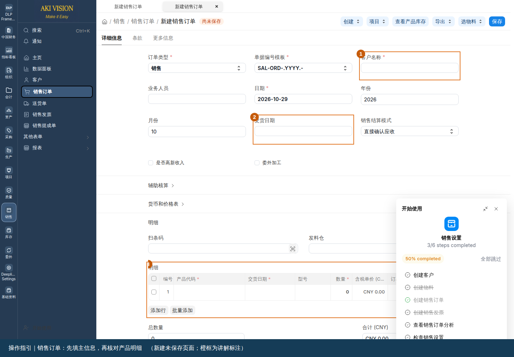
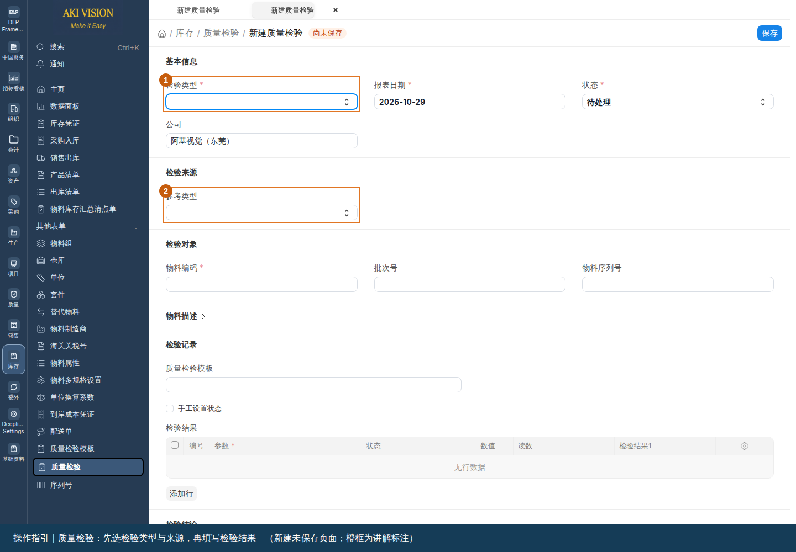

# aki_erp 完整业务流程与岗位交接

[返回手册目录](README.md)｜[业务操作详解](02-各业务模块操作手册.md)｜[财务操作详解](03-财务与税务操作手册.md)

以下 8 个案例使用虚构的培训数据。数量、价格、税率仅便于练习，不是正式经营参数。先准备培训环境和对应权限；正式站点不照抄案例提交业务。表格按操作顺序阅读，当前步骤检查通过再交下一岗位。

## 流程一：现货销售，从接单到收款



照图完成订单填写后，继续按下表交给仓库、财务处理。字段填写方法见 02 的“创建销售订单”；本图不是已提交或已收款的结果。

### 场景与准备

客户 A 订购产品 A 共 10 件，培训假设未税单价 100 元、税率 13%，合计未税 1,000 元、税额 130 元、含税 1,130 元。仓库有足够可分配合格库存，无退货，客户最终一次付清。

准备：客户和产品资料、仓库、价格确认、交期、结算方式及可分配库存。确认采用直接销售发票路径还是销售结算生成发票路径，两者不可重复开票。

```text
销售确认需求 → 销售订单 → 仓库核对并送货
→ 客户对账 → 财务结算／开票 → 真实收款及核销 → 复核收尾
```

| 步骤 | 谁操作 | 怎么做 | 检查通过后交给谁 |
|---|---|---|---|
| 1 接单 | 销售 | 核对客户、产品、10 件、价格税率、交期和确认依据 | 条件一致，交订单审核／提交人员 |
| 2 订单 | 销售／授权人员 | 建立销售订单，保存复核后按当前规则提交 | 记录单号，交仓库 |
| 3 备货 | 仓库 | 查询订单已生成送货草稿，核对可分配库存和已有记录 | 只保留本次正确数量，交发货人员 |
| 4 送货 | 仓库 | 从订单来源办理送货 10 件，核对仓库、实物及序列号，按制度提交和交接 | 订单累计交付 10 件，签收依据交销售 |
| 5 对账 | 销售／财务 | 新建客户对账，按所选送货或往来口径加载明细，核对并取得确认 | 差异已说明，交财务结算 |
| 6 应收 | 财务 | 采用结算路径时，核对结算单后执行生成正式应收；否则按批准路径建立销售发票 | 只形成一套有效发票，金额 1,130 元，交出纳 |
| 7 收款 | 出纳／财务 | 根据实际到账登记收款 1,130 元，分配到对应发票并提交 | 核对银行凭据、未付余额，交销售确认 |
| 8 收尾 | 销售、财务 | 查订单、送货、对账／结算、发票、收款和附件 | 交付 10 件、剩余应收 0，业务可按规则收尾 |

### 遇到例外

- 客户本次只收 4 件：送货单只办 4 件，剩余 6 件继续跟进，开票结算按实际合同及公司规则处理。
- 客户只到账 600 元：正确核销后仍有 530 元待收，不将订单标记为款项结清。
- 看不到送货草稿：先查关联单和后台提示，不重复点击创建。

### 完成标准

同一客户和来源订单可追溯到有效送货、对账、发票和收款；实物、数量、金额一致，无重复交付及开票。销售知道客户是否仍欠款，财务能查到真实收款凭据。

## 流程二：部分现货、缺料采购、生产后分批交付

### 场景与准备

客户 B 订购产品 B 共 10 件。培训假设可分配成品 4 件，缺口 6 件需要自制。有效 BOM 为每件成品用原料 R 2 件，生产 6 件共需原料 12 件；原料可用 4 件，需采购 8 件。假设无损耗、无替代料、无其他占用。

自动分流取决于实际库存和 BOM，培训前调整并核验条件，不要求系统无条件生成相同数量。

```text
销售订单 10 件
  ├─ 可分配现货 4 件 → 首批送货
  └─ 生产缺口 6 件 → 工单 → 用料 12 件
       → 原料可用 4 件＋采购缺口 8 件
       → 到货 → 检验 → 合格入库 → 领料生产
       → 完工入库 6 件 → 第二批送货
两批交付 → 对账／结算 → 开票 → 收款核销
```

| 步骤 | 谁操作 | 怎么做 | 交接与检查 |
|---|---|---|---|
| 1 下单 | 销售 | 按客户确认建立并提交 10 件订单，约定分批交期 | 单号及交期交仓库、计划 |
| 2 核对分流 | 仓库、计划 | 查实际生成的送货与工单草稿，核对 4 件和 6 件及其来源 | 记录实际结果；缺 BOM 等异常先解决 |
| 3 首批送货 | 仓库 | 核对并办理 4 件送货 | 本单已交 4 件、余 6 件，告知销售 |
| 4 核对工单 | 生产计划 | 核对产品、6 件、有效 BOM、仓库、来源订单和工序 | 材料需求 12 件，原料缺口 8 件 |
| 5 发起需求 | 计划／需求人 | 查在途和已有申请，按启用入口为缺口 8 件建立采购申请 | 单号、用途及最迟到货日交采购 |
| 6 采购下单 | 采购 | 询价、核对供应商和单位价格，建立 8 件采购订单 | 订单及计划到货日交仓库和质量 |
| 7 到货检验 | 仓库、质量 | 建收料通知，记录到货 8 件；建立检验，按实际合格结果提交 | 假设 8 件合格，交仓库入库 |
| 8 原料入库 | 仓库 | 从检验来源办理采购入库 8 件 | 培训假设原料合计可用 12 件，交生产 |
| 9 领料生产 | 仓库、生产 | 按工单办理 12 件领料／转移，记录实际工序和工时 | 材料和在制去向清楚，交完工岗位 |
| 10 完工入库 | 生产、质量、仓库 | 核验本次合格完工 6 件，按规则创建生产入库 | 查原料／在制减少、成品增加及累计完工 |
| 11 第二批送货 | 仓库 | 从原销售订单查剩余 6 件及已有草稿，办理第二批送货 | 两批合计 10 件，不重复办理首批 |
| 12 财务收尾 | 销售、采购、财务 | 销售对账、结算开票及收款；采购核对收货和供应商资料、交财务应付付款 | 销售与采购分别核对自己的未结余额 |

### 遇到例外

- 采购 8 件只有 7 件合格：总原料可用只有 11 件，缺口仍为 1 件。采购跟进补货，生产不能按“8 件到货”当作够料。
- 半成品是外购：核对供应方式后走采购，不能直接要求系统自制；自制则核对下层 BOM 和工单。
- 工单已完成但没有成品库存：查生产入库是否正式提交、仓库是否正确，不能只改进度。
- 重生成草稿前：先查已有工单、送货及领料记录，避免重复生产或出库。

### 完成标准

订单交付 4＋6＝10 件；生产 6 件与成品入库相符；本例原料采购 8 件、总耗用 12 件可追溯；相关采购应付与销售应收分别核对，未完成部分有明确责任人。

## 流程三：多部门采购需求合并，到货、对账与付款

### 场景与准备

项目甲需要原料 C 30 件，项目乙需要 20 件，规格和单位一致，计划向同一供应商采购。培训假设合并总量 50 件，未税单价 20 元、税率 13%，含税总额 1,130 元；分两批各到货 25 件，均合格。

合并下单前确认本站点已启用相关入口；未启用时按既定采购方式办理，并保留申请来源，不手工伪造来源分配。

| 步骤 | 谁操作 | 怎么做 | 交接与检查 |
|---|---|---|---|
| 1 提需求 | 两个需求部门 | 分别建立 30 件和 20 件申请，注明项目、用途及日期 | 交采购核对是否可合并 |
| 2 比价 | 采购 | 统一规格、单位、税价和交期，确认供应商与有效报价 | 确认 50 件适用的价格条件 |
| 3 合并下单 | 采购 | 从已启用合并入口选择来源，核对合计 50 件及 30／20 来源分配 | 提交后将采购单及到货计划交仓库 |
| 4 第一批 | 仓库、质量 | 实际到货 25 件，按收料、检验、合格入库流程办理 | 已收 25 件、待到 25 件，通知采购及需求部门 |
| 5 第二批 | 仓库、质量 | 再到 25 件，核对此前已收数量后办理 | 累计合格入库 50 件，未超订单 |
| 6 供应商核对 | 采购 | 新建或打开采购跟进草稿，加载正确收货范围，核对含税金额、退货、差异及附件 | 提交后把单号交财务 |
| 7 财务接收 | 财务 | 核验采购跟进单并接收，关联采购发票，核对来源和金额后提交 | 应付 1,130 元，不重复开票 |
| 8 实际付款 | 出纳／财务 | 按公司流程取得实际付款依据，登记并分配到发票 | 付款凭据及未付余额可查 |
| 9 收尾 | 采购、需求部门 | 检查采购完成、项目来源和需求交付；财务核对余额 | 两个需求均有去向，未结事项已交接 |

**异常处理：** 报价阶梯条件不符时重新核价；需求部门变更数量先核对订单与已到货；对账存在重复收货行先查原对账单，不改日期绕过占用校验。

**完成标准：** 来源数量 30＋20＝订单 50＝两批合格入库 25＋25；发票及付款金额与确认价格一致。分项目领用另有对应库存记录，不把采购到货自动当作项目已消耗。

## 流程四：到货不合格、部分入库与采购退货



照图定位检验入口和来源字段，再按下表分别处理合格及不合格数量。详细填写方法见 02 的“检验并办理合格入库”；不能仅登记检验单就视作完成入库或退货。

### 场景与准备

供应商送来原料 D 100 件，检验后合格 90 件、不合格 10 件。培训假设不合格部分未入库且全部退回，供应商另行补货；不涉及其他让步接收。

| 步骤 | 谁操作 | 怎么做 | 交接与检查 |
|---|---|---|---|
| 1 收料 | 仓库 | 从采购订单登记收料通知 100 件，核对实物和送货依据 | 100 件到货记录交质量 |
| 2 检验 | 质量 | 填写检测数量及 90 合格、10 不合格，记录缺陷并提交 | 数量可勾稽，合格和不合格分别交接 |
| 3 合格入库 | 仓库 | 从质检来源创建采购入库，仅办理合格 90 件 | 合格库存增加 90 件 |
| 4 确认处置 | 质量、采购 | 与供应商确认 10 件退货、补货及费用责任，保留依据 | 处置方案交仓库 |
| 5 建立退货 | 采购／仓库授权人员 | 从质量不合格或原质检创建采购退货，核对来源、数量、原因及实物交接后提交 | 退回 10 件，检查有无库存联动 |
| 6 库存核对 | 仓库 | 本例不合格未入库，不另做库存扣减；若实际已进待退仓，检查关联退库记录 | 实物去向和系统记录一致 |
| 7 财务处理 | 采购、财务 | 核对供应商原账单、已开票及已付款情况，按真实业务办理扣款、红字或退款 | 不直接把 100 件当成全部应付 |
| 8 补货跟进 | 采购 | 核对剩余订单、已退及可继续收货范围，安排补货，再重新办理收料和检验 | 按本次真实补货来源入库，不重复引用已退范围 |

**异常处理：** 不合格品已入待退仓与未入库的处理不同；提交退货后先查关联库存单再决定下一步。质量判定、实物退回和财务冲减是三个节点，分别检查。

**完成标准：** 原到货 100 件＝合格入库 90 件＋未入库退回 10 件；无额外库存减少 10 件。补货、退款或扣款等未结事项持续跟踪，有责任人及凭据。

## 流程五：研发立项、费用归集、产品成本报价到客户订单

### 场景与准备

客户需要新产品 E。培训假设研发实际投入 2,000 元，预计剩余投入 1,000 元，预计摊销 500 台；材料成本 30 元／台，制造成本 18 元／台。预算单独参考，不重复加入成本。

| 步骤 | 谁操作 | 怎么做 | 交接与检查 |
|---|---|---|---|
| 1 明确需求 | 销售、研发 | 记录用途、规格、计划数量、交期和交付物 | 客户确认的需求交项目负责人 |
| 2 申请立项 | 项目负责人 | 按已启用研发申请及项目流程办理，确定负责人、预算和节点 | 预算与实际费用分开 |
| 3 工程准备 | 工程／研发 | 建立产品资料、BOM 和图纸，确认版本和材料供应方式 | 有效资料交采购、生产及报价人员 |
| 4 项目执行 | 研发、项目人员 | 维护任务、实际工时、成本明细和交付依据，核对业务关联 | 实际投入 2,000 元有来源，剩余 1,000 元有估算依据 |
| 5 成本报价 | 授权报价人员 | 新建产品成本报价单，关联 BOM 和项目；设置批量、税率、定价方式并读取来源 | 核对材料、制造、投入分摊和数据完整性 |
| 6 核算确认 | 报价／财务负责人 | 核对研发摊销 (2,000＋1,000)÷500＝6 元／台；总成本 54 元／台，复核报价并确认 | 保留有效版本，估算依据已说明 |
| 7 对客报价 | 销售 | 导出客户版，核对批量、币种、有效版本及承诺条件 | 对外版本没有内部成本及毛利明细 |
| 8 客户接受 | 销售 | 根据接受的报价建立销售订单，按合同核对产品、数量和价格 | 核对后进入流程一或二 |
| 9 后续调整 | 项目、财务、报价人员 | 实际投入或规格变化时复制新报价版本，再复核和确认 | 不直接覆盖已经对客确认的旧版 |

**异常处理：** 来源价格缺失先补核，不把空白当零；试制成本仅作参考，不能与未来材料、制造成本重复叠加；低于最小接单量的估算档由负责人决定是否可对外承诺。

**完成标准：** 从客户需求到项目、工程资料、费用依据、报价版本和订单可追溯。成本 54 元／台的示例能解释清楚，没有把预算再次计入；销售订单不是由报价确认自动等同完成。

## 流程六：仓库盘点，从现场清点到差异处理

### 场景与准备

培训假设盘点时点系统显示物料 F 为 100 件，现场清点 98 件。原因尚未确认，不立即认定损耗。

| 步骤 | 谁操作 | 怎么做 | 交接与检查 |
|---|---|---|---|
| 1 定范围 | 仓库负责人 | 确定仓库、物料、盘点时点和期间实物流动记录方式 | 各相关岗位知道截止口径 |
| 2 准备清单 | 仓库 | 从盘点汇总及库存入口核对范围 | 物料、单位和仓库无遗漏 |
| 3 实物清点 | 仓库、复核人 | 清点并复点 98 件，记录包装换算及序列号 | 有原始盘点依据 |
| 4 查差异 | 仓库及相关部门 | 查 2 件差异是否为漏送货、仓库错误、时点差或真实短缺 | 查明原因，区分补原业务和盘点调整 |
| 5 处理 | 授权人员 | 若是漏单先纠正原业务；若确认真实短缺，按公司流程审批并办理库存对账 | 不同时补业务单又减盘点差异 |
| 6 复核 | 仓库、财务 | 查调整后余额、流水及会计影响 | 差异原因、授权、来源和金额可追溯 |

**异常处理：** 盘点期间还有进出库，先统一截止口径；数量清楚但估值不清时，交财务核对，不随便填单价。

**完成标准：** 调整后的账面数量与相同时点实物一致，每个差异有原因和依据。盘点清单保存不代表库存已调整。

## 流程七：样品借出、部分归还及转销售

### 场景与准备

向客户 G 借出 3 件按序列号管理的样品，分别为培训序列号 S1、S2、S3。S1、S2 后续归还，S3 经客户确认购买。

| 步骤 | 谁操作 | 怎么做 | 交接与检查 |
|---|---|---|---|
| 1 借样确认 | 销售 | 确认客户、用途、样品身份、负责人和归还安排 | 借样依据交样品管理员 |
| 2 借出 | 样品管理员、仓库 | 建样品借出单，逐行选 S1、S2、S3，核对客户及仓库，提交并办理实物交接 | 查借出状态和关联库存记录 |
| 3 催还跟进 | 销售 | 查看未还样品，记录客户反馈，明确下一步 | 实物归还和购买分开处理 |
| 4 部分归还 | 样品管理员、仓库 | 建关联借出归还单，只选择 S1、S2，核验实物和仓库后办理 | 原借出单剩余 S3 未还 |
| 5 转销售 | 销售／授权人员 | 在原借出单选择“转销售”，只选 S3，创建并核对销售订单 | 确认未重复归还、未重复转销售 |
| 6 后续交付 | 销售、仓库 | 按本站点借出转销售规则核对来源及已有库存记录，再完成必要交付手续 | 同一 S3 不重复出库，检查实际状态 |
| 7 财务收尾 | 财务 | 按实际合同及结算路径建立应收，到账后收款核销 | 样品转售记录与发票收款一致 |

**异常处理：** 转销售后先检查实际创建结果，不能因页面未跳转就再点；样品损坏或遗失由销售、质量和负责人确认处置，不登记成“正常归还”。

**完成标准：** 3 件借出＝2 件归还＋1 件转售，无重复归还、转售或出库；S3 的销售及财务业务有后续凭据，不以“转销售成功”代替收款成功。

## 流程八：财务从业务交接到月结归档

### 场景与准备

某月业务已接近截止，财务需要完成业务核票、往来核销、税务底稿、账务复核、结账和归档。期间及操作日期由财务负责人确定，不将示例月份用于正式关账。

```text
业务交接 → 应收应付与资金核对 → 税票／抵扣及凭证复核
→ 账簿报表／税费底稿 → 结账检查 → 结账 → 快照与电子档案检查
```

| 步骤 | 谁操作 | 怎么做 | 交接与检查 |
|---|---|---|---|
| 1 截止核对 | 各业务部门 | 列明已发生未录入、到货未检、已检未入库、已送未对账、退货及未结事项 | 向财务提供单号和处理口径 |
| 2 核票与应收应付 | 财务 | 对照销售结算及采购交接，核对有效发票、金额和来源 | 未开、重复或差异项有处理人 |
| 3 资金与核销 | 出纳、财务 | 对照真实银行现金凭据检查收付款、预收预付和发票分配 | 未核销及银行差异说明清楚 |
| 4 税务发票 | 税务财务 | 上传识别或手工登记，核对原件、方向、金额、重复及业务关联 | 税票资料完整，不以识别替代复核 |
| 5 进项抵扣 | 税务财务 | 核对抵扣资格和所属期，按流程装载、勾选及确认抵扣 | 系统记录与外部办理依据一致 |
| 6 凭证 | 制单、审核及记账岗位 | 补办真实必要凭证，平衡复核，按配置审核记账；查询异常来源 | 草稿、正式凭证及冲销状态清楚 |
| 7 报表底稿 | 财务 | 查总账、日账簿、报表及现金流，维护并确认税费底稿，核对缺项和版本 | 勾稽一致，人工数据有依据 |
| 8 结账检查 | 财务负责人 | 选择公司及期间，核对损益结转等前置记录，运行检查 | 阻断项已解决，警告项有处理结论 |
| 9 结账 | 授权财务 | 执行实际结账动作，核对结账与冻结状态 | 不提前向业务宣称全部完成 |
| 10 归档验收 | 财务、支持人员 | 查看报表快照和档案状态，打开文件抽查完整性 | 已生成且可读取；失败项已处理或明确未完成 |

### 遇到例外

- 税费页面缺数据：补充真实来源或人工底稿，不能用无依据的 0 通过确认。
- 结账出现阻断项：按明细回到来源处理，重新检查，不关闭校验绕过。
- 页面结账成功但档案生成失败：账务结账与档案结果分开说明，记录错误并由支持人员处理；重试前先查已有档案。
- 关账后发现错误：由财务负责人决定重新开账或按适用规则调整，保留原因、版本和授权记录。

### 完成标准

业务截止口径清楚；应收应付、收付款、税票、正式凭证和账簿可核对；底稿确认不冒充外部税务申报；结账、快照和档案均有明确结果，未完成事项有人负责。

## 通用交接与收尾表

可复制以下表格到本次业务记录中；这是一张人工核对表，不表示系统内另有同名申请单。

| 核对项 | 本次填写 |
|---|---|
| 业务名称／客户／供应商／项目 | ____ |
| 来源单号及本次单号 | ____ |
| 本次数量或金额、此前累计、剩余 | ____ |
| 当前单据状态和已完成动作 | ____ |
| 实物去向／资金凭据／确认附件 | ____ |
| 差异及待处理事项 | ____ |
| 下一岗位及接收人 | ____ |
| 处理结果和完成依据 | ____ |
