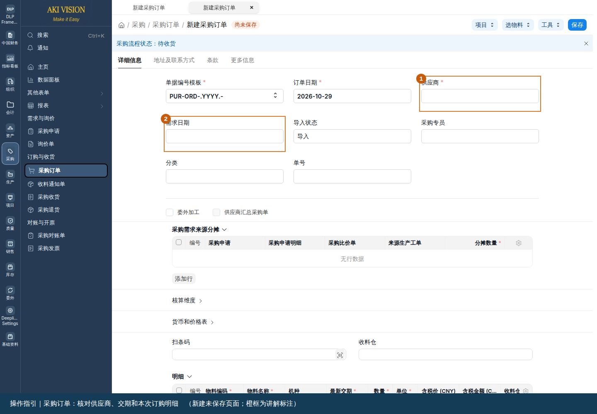
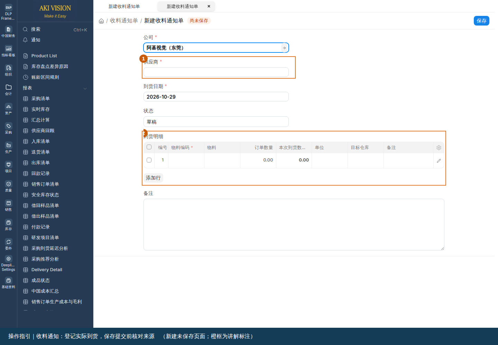

# aki_erp 采购全流程操作手册

适用对象：需求人员、采购、仓库、质量、审核人员和财务。本章将已有模块步骤串联为日常采购操作；具体权限、审批及是否采用收料质检流程，以当前站点和公司制度为准。未对客户正式站点执行真实采购及付款验收。

## 1. 开始前确认

先确认供应商、物料编码、规格／图纸版本、计量单位、收货仓库、公司及财税资料。采购需求来自生产或 BOM 时，先确认采用的 BOM 编号及基准用量，并扣除已确认的可用库存和在途供应；BOM 材料表不等于需要全量重复采购。

常用流程为：需求申请 → 询价／选价 → 采购订单 → 到货登记 → 质量检验 → 合格入库 → 采购对账 → 财务核票及应付 → 付款核销。每个箭头都需要对应人员操作或确认，不表示系统会自动完成下一步。

## 2. 需求人员提出采购申请

1. 查库存、已有申请及在途订单，确认缺口。
2. 搜索“采购申请／Material Request”，新建并选择“采购（Purchase）”用途的申请类型；从来源业务创建时也须核对类型。
3. 填写物料、实际需求数量、单位、需要日期及目标仓库，并补充可用的项目／用途说明。
4. 保存后核对，按权限提交或交审核。把申请单号、规格依据及紧急事项交给采购。

**检查结果：** 采购能明确买什么、买多少、何时到、用在哪里。保存草稿不代表采购已受理，重复申请先核查再处理。

## 3. 采购询价与确定供应商

1. 按相同规格和交付条件向供应商询价。使用“询价单／Request for Quotation”时，在当前页面维护需求明细与供应商。
2. 供应商报价收到后，在“供应商报价／Supplier Quotation”录入供应商、物料、数量、价格、币种、税价口径、有效期及交期。
3. 需要导入报价时，仅使用当前已启用的导入入口与模板，先预览、处理错误再确认；无入口则按表单逐项录入。
4. 比较价格时同时核对规格、单位、税费、运费、最小订量及交期，按公司制度确认供应商和采用价格。未启用专门比价功能时，由采购按制度记录比价依据。

**检查结果：** 有选价依据和有效报价，不将报价记录当作已下单。

## 4. 建立采购订单并发给供应商

1. 打开已提交申请或已确认报价，使用当前页面可用的创建采购订单入口。缺少入口时，检查单据状态、剩余可采购数量和权限，不另建重复单绕过限制。
2. 核对带入的供应商、公司、币种、物料、数量及来源；从申请拆分给不同供应商时，分别核对各订单的来源数量。
3. 核对每行采购单位、换算、单价、税费、金额、交期及收货仓库。按实际情况补充付款条件、交付要求和图纸附件。
4. 保存，交审核；按权限提交。订单变更按当前页面允许及公司授权处理，不能私下覆盖已对外确认的版本。
5. 从打印／导出入口取得正确版本。需系统邮件发送时，先完成 06 的邮箱配置与收发验收，再从单据“Email”窗口核对收件人、附件和内容后发送；也可按公司批准方式线下发送。
6. 取得供应商对价格、数量及交期的确认，记录跟进依据。发送成功不等于供应商已确认。

**检查结果：** 订单状态符合执行条件，供应商确认的版本一致，需求部门知道预计交期。

## 5. 到货时建立收料通知

1. 仓库核对送货单、实物、供应商与采购订单。采用本系统定制收料质检流程时，打开已提交且未关闭／取消的采购订单。
2. 在“创建”下使用“创建收料通知单”。按钮受订单状态和权限影响，不显示时先核查。
3. 在生成的收料通知中核对来源及明细，填写／确认本次实际到货数量。分批到货不把整单未到数量登记成已到。
4. 保存核对并按权限提交，再交质量人员。登记损坏、短缺或型号不符情况，与采购沟通处理。

**检查结果：** 收料通知对应本批实物；到货登记不是合格入库，不能据此认定可用库存已增加。

## 6. 质量检验与合格入库

1. 在已提交收料通知中使用“创建质量检验”，核对采购订单、收料来源及各物料。
2. 按实际检验填写各行检测总数、合格数和不合格数，核对数量关系及结论，保存后按权限提交。来源收料通知的采购质检界面与独立新建质检界面可能不同，应以来源表单为准。
3. 已提交、结论符合条件且尚未关联入库单时，使用质检的“创建采购入库单”，核对生成记录中的合格数量、仓库及来源。
4. 仓库核对实物和单据，按权限完成入库单提交。不要因为点击“创建”或打开了入库页面，就认定库存已入账。
5. 在库存流水及采购订单关联记录中核对本次数量，余量继续跟进；部分到货、部分合格的，分别保留待到和不合格处理记录。

**检查结果：** 合格入库数量与检验依据一致，实际提交状态和库存流水相符。

## 7. 不合格、短缺及退货

1. 不合格品单独标识、隔离，不擅自并入合格数量；短缺数量与采购、供应商确认后继续跟进或按授权结束余量。
2. 不合格数量需退回时，按质检和入库的实际关联状态使用系统可用退货入口。定制质检的“创建采购退货”有已提交、已关联采购入库及存在不合格数量等条件，不是所有质检页面都会显示。
3. 核对生成的采购退货草稿、来源、数量及仓库，按适用流程审核、提交和实物交接。退货草稿不等于退货已完成。
4. 将退货单据和供应商确认交采购及财务，核对后续补货、价款抵减或退款。退货不会自动代表银行退款已到账。

具体采购退货区别与状态检查见 02 第 7.3 节，不用无来源的库存出库代替采购退货。

## 8. 对账、应付与付款交接

1. 采购在“采购跟进／采购对账（Purchase Follow Up）”选择供应商、期间及本次范围，保存并按当前流程加载采购数据。
2. 核对入库、退货、数量、单价、税费及差异，取得供应商确认。完成提交后交财务；财务按权限使用“接收对账单”等实际入口办理接收。
3. 财务核对采购发票／应付、税务票据、入库及对账依据，按适用流程建立或核对采购发票（Purchase Invoice），审核后提交形成正式应付。对账单不代替采购发票。
4. 按批准付款计划完成银行实际支付，记录“收付款凭证／Payment Entry”，核对付款方向、供应商、账户、金额及所核销应付，保存并按权限审核、提交。
5. 核对付款凭据、系统付款及剩余应付。预付款、分批付款、退款或差异由财务按实际业务处理，不为了清零而强行核销。

具体字段及财务接收操作见 03 第 2、4 节。系统中建立付款单不会替代银行转账。

## 9. 采购收尾检查表

| 岗位 | 收尾要检查 |
|---|---|
| 需求人员 | 需求满足情况、剩余需求及变更已告知采购 |
| 采购 | 申请和订单来源可追溯；到货、退货、待到及关闭余量有依据 |
| 仓库 | 实物、已提交入库／退货和库存流水一致 |
| 质量 | 每批检验数量、结果及不合格处理有记录 |
| 财务 | 对账、正式应付、发票、实际付款及核销相符，余额差异有原因 |

演练时使用授权培训数据，记录每一步单号及实际结果。完整案例也可对照 04 流程三、四；没有真实完成的步骤，不记录为系统自动完成。
