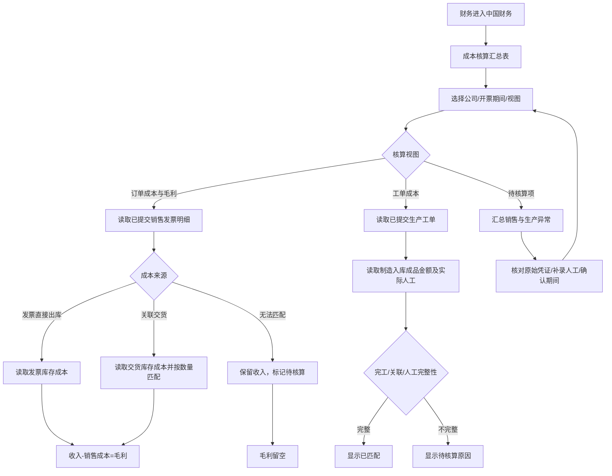
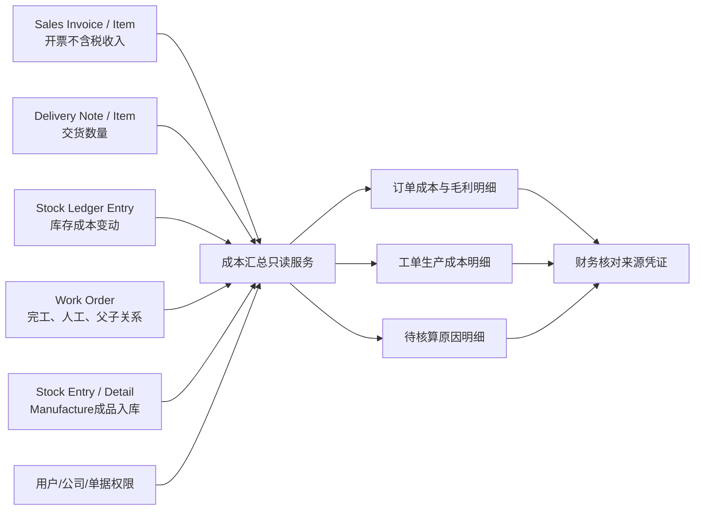

# 中国财务成本核算汇总表实施记录

## 已实现效果

中国财务工作台「报表」分组新增「成本核算汇总表」入口，权限限于 Accounts User、Accounts Manager、System Manager。报表包含公司、开票期间、制造入库期间、核算视图、销售订单和生产工单筛选。日期不混用，工单视图使用制造期间；销售视图使用开票期间，并显示成本实际过账日期及跨月核对提示。

- 「订单成本与毛利」：逐销售发票明细展示销售订单、发票、开票日期、客户、产品、开票数量、开票不含税收入、对应销售成本、毛利、毛利率、核算状态及来源凭证。
- 「工单成本」：展示生产工单、父工单、销售订单、产品、完工入库数量、本期成品入库成本、工单累计实际人工、单位入库成本、状态、待核算原因和制造凭证。
- 「待核算项」：合并销售发票异常和生产工单异常，展示来源类型、原因与建议处理，不把未知成本当作零。
- 工单增加根工单、工单状态、制造入库日期、制造附加费用。人工和附加费用为来源展示，不再加到成品入库金额。报表不提供跨层成本合计。
- 来源凭证支持点击下钻；核算状态区分绿色已匹配与橙色待核算，缺失成本与毛利在表格中留空。
- 以已提交销售发票过账日期确定收入期间；发票直接出库优先读取发票库存成本，否则读取交货单库存成本并按库存数量比例匹配开票数量。
- 未完工工单单列；人工金额只展示，不再叠加到已经包含人工的生产成本；父子工单只作追溯，避免重复合计。
- 通过 Frappe 文档权限、公司范围和来源凭证权限检查；报表只读，不重算、不回写订单、工单或库存。

## 变更文件

- `client_akivision/client_akivision/report/china_cost_summary/china_cost_summary.json/js/py`：新增 Script Report、筛选器、订单/工单/待核算三种视图和只读计算。
- `china_finance/china_finance/workspace_sidebar/china_finance.json`：新增工作台侧边入口。
- `china_finance/china_finance/china_finance/workspace/china_finance/china_finance.json`：新增成本核算卡片入口。
- `china_finance/setup/install.py`：仅在既有报表导航分组追加新入口，保证标准导航同步后仍保留。
- `client_akivision/utils/china_cost_summary_permissions.py`：新增独立财务报表角色校验，避免依赖运营看板入口权限。
- `client_akivision/utils/test_china_cost_summary.py`：成本分摊、空成本、来源权限和统一异常视图测试；提供只读站点执行检查。

## 业务流

## 数据流程图

## 当前边界

本报表当前使用实际已过账数据，不支持直接作为完整月结凭证。期末在制品没有采用估算分配；销售发票未关联可读取交货/库存成本时毛利留空。人工为零显示待确认状态，不能自动判断为无人工。预算、标准成本差异及制造费用完整分配不在本次实现范围。

2026-10-16 已在开发容器的 `aki_test.localhost` 执行两个公司的三个视图。期间为 2026-01-01 至 2026-10-16：有数据公司销售明细 3 条（待核算 1 条）、生产工单 14 条（待核算 12 条）、统一待核算 13 条；另一公司三个视图均为空，正常返回。检查不写业务数据。

5 项针对性测试通过；Python 编译及 JavaScript 语法检查通过。已重载新 Report 配置，执行导航同步并清理站点缓存。本次未进行浏览器完整交互验收，不将接口检查描述为界面验收。

销售退货/红字收入保留原负数，成本冲回首版仍需逐笔核对。未新增不可追溯的总账兜底；没有可靠明细来源就保持待核算。跨月记录仍展示已匹配的成本与分析毛利，但状态为待核算，不能把这部分金额当作本期开票对应的已确认结账结果。
