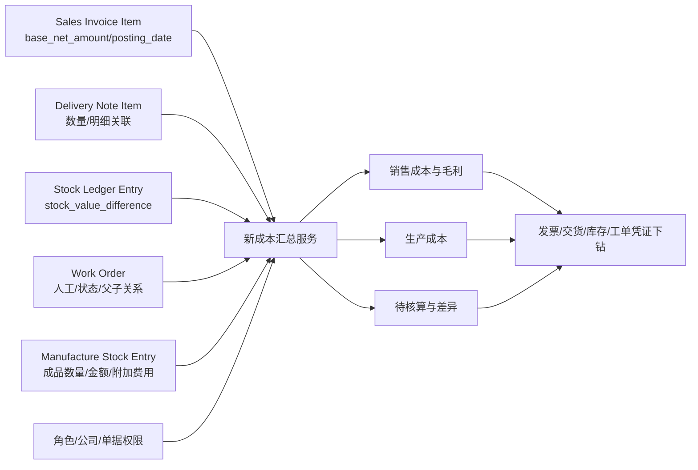

# 中国财务成本汇总表数据来源审查与增量实施方案

日期：2026-10-16。状态：审查与方案沉淀，暂不修改业务代码。

## 1. 方案结论

当前系统已经具备成本汇总所需的大部分原始单据，但不同数据的财务可靠性不同：

- 开票收入：来源明确，可以使用已提交销售发票明细的不含税金额。
- 销售成本：优先使用库存台账的实际成本变动，不能使用订单成本缓存替代。
- 工单生产成本：可以追溯制造入库成品金额，但不能直接等同于本期销售成本。
- 实际人工：字段和计算逻辑已存在，但录入覆盖不足，零值必须标记待确认。
- 制造费用：存在 Stock Entry 附加费用和 ERPNext 工序费用两类来源，当前归属口径尚未完全统一。
- 在制品、跨期结转、退货成本冲回：当前没有完整的统一核算快照，首版必须单列异常，不能自动估算。

实施建议是新增中国财务成本汇总分支，保留原运营看板、销售订单成本回写和旧报表接口。新报表只读查询原始单据，数据不足时返回状态和原因。

## 2. 当前系统数据来源审查

### 2.1 来源与可靠性

| 报表数据 | 实际来源 | 当前可靠性 | 使用建议 |
| --- | --- | --- | --- |
| 开票不含税收入 | `Sales Invoice Item.base_net_amount` | 明确 | 按 `Sales Invoice.posting_date` 统计 |
| 发票公司/币种 | `Sales Invoice.company`、Company.default_currency | 明确 | 统一本位币展示 |
| 销售订单关联 | `Sales Invoice Item.sales_order` | 已有 | 无关联时列入待核算 |
| 交货关联 | `Sales Invoice Item.delivery_note`、`dn_detail` | 已有但并非所有发票都有 | 仅在明细、公司、产品和状态一致时匹配 |
| 销售成本 | `Stock Ledger Entry.stock_value_difference` | 当前最可靠 | 按凭证类型、凭证号、凭证明细读取 |
| 制造成品数量 | Manufacture Stock Entry Detail 的 `transfer_qty`、`is_finished_item` | 明确 | 按制造入库过账日期统计 |
| 制造入库金额 | Manufacture Stock Entry Detail.amount | 可追溯 | 作为工单完工入库成本，不替代销售结转成本 |
| 工单人工 | `Work Order.custom_actual_labor_cost` | 字段存在，覆盖不足 | 只展示实际值；零值标记待确认 |
| 工单工时/费率 | `custom_actual_labor_hours`、`custom_labor_hourly_rate` | 字段存在 | 用于人工来源追溯，不重新估算已确认金额 |
| 工序实际费用 | ERPNext `Work Order.actual_operating_cost` | 当前数据未形成有效金额 | 不自动补入制造费用 |
| 制造附加费用 | `Stock Entry.total_additional_costs` | 有数据，归属需确认 | 单独展示来源，确认后再纳入制造费用 |
| 父子工单 | `custom_parent_work_order`、`custom_root_work_order` | 已有 | 子工单只追溯，不与根工单重复汇总 |
| 工单状态 | `Work Order.status` | 明确 | 未完工工单单列待核算 |
| 订单成本缓存 | Sales Order `custom_*_cost` | 管理缓存，可能过期 | 只用于对账，不作为财务首选来源 |

### 2.2 已查到的实际数据情况

在 `aki_test.localhost` 只读检查得到：

- 已提交生产工单 14 张；其中仅 2 张实际人工金额大于 0。
- 已提交制造用途 Stock Entry 10 张，附加费用合计约 120 元。
- 已提交销售发票 3 张，不含税金额合计约 178 元。
- 已提交交货单 6 张，交货金额约 196.84 元。
- 活跃库存台账约 782 条；交货相关库存价值变动约 43,329 元。
- 当前没有可直接使用的已提交 Budget 记录。
- 已存在未关联销售订单的工单，以及父子分层工单。

这些数据说明报表可以先做“实际来源汇总＋待核算状态”，不能直接宣称已经完成完整月结核算。

## 3. 设计目标与边界

新增“中国财务成本汇总表”，提供三个视图：

1. 生产成本：按制造入库过账日期，展示工单、成品入库数量、工单实际人工、制造入库成本和来源凭证。
2. 销售成本与毛利：按销售发票过账日期，展示不含税开票收入、实际销售成本、毛利和毛利率。
3. 待核算与差异：集中展示成本未匹配、人工未确认、未完工、跨期、父子工单和关联缺失。

本阶段不做：自动月结、期末在制品估算、标准成本差异、自动费用分配、历史成本回填、修改库存估值、修改销售发票或回写销售订单成本。

## 4. 预期效果

```text
中国财务
└── 成本汇总表
    公司 [____]  开票期间 [____ - ____]
    制造入库期间 [____ - ____]  视图 [订单成本与毛利 ▼]
    销售订单 [可选]  生产工单 [可选]

订单成本与毛利
发票 | 开票日期 | 客户 | 销售订单 | 产品 | 开票数量
开票不含税收入 | 实际销售成本 | 毛利 | 毛利率 | 核算状态 | 来源凭证

生产成本
工单 | 父/根工单 | 销售订单 | 产品 | 完工数量 | 制造成品入库成本
实际人工 | 单位成本 | 工单状态 | 核算状态 | 待核算原因 | 制造凭证

待核算与差异
单据 | 金额/数量 | 异常类型 | 原因 | 来源凭证 | 建议处理动作
```

毛利仅在收入和销售成本可靠匹配时计算：

```text
毛利 = 发票不含税收入 - 对应实际销售成本
毛利率 = 毛利 / 发票不含税收入
```

若成本缺失、数量超配或关联不一致，毛利和毛利率留空，状态为“待核算”，不能填 0。

## 5. 成本匹配规则

### 5.1 销售成本

按以下优先级新增只读匹配逻辑：

1. 发票直接出库：读取 `Stock Ledger Entry` 中 `voucher_type=Sales Invoice`、对应发票明细的库存价值变动。
2. 发票关联交货：读取 `voucher_type=Delivery Note` 的库存价值变动，再按交货库存数量与开票数量进行比例匹配。
3. 可追溯的实际销售成本总账分录：作为后续补充来源，不能与库存台账重复相加。
4. 无法匹配或数量超配：进入待核算，毛利为空。

退货/红字发票保留冲减方向；若成本冲回无法对应来源凭证，进入待核算。

### 5.2 工单生产成本

按制造入库过账日期读取已提交 Manufacture Stock Entry。只统计成品明细的数量和金额；工单实际人工读取 `custom_actual_labor_cost`，只展示，不再次加到已经包含人工的成品入库金额中。

未完工工单、无制造入库、无销售订单或实际人工为零时保留记录并提供具体原因。父子工单按照根工单归属避免重复累计。

## 6. 拟修改代码与文件

本次仅沉淀方案，以下为后续实施清单。

| 文件 | 拟修改内容 | 策略 |
| --- | --- | --- |
| `china_finance/.../workspace_sidebar/china_finance.json` | 增加“成本汇总表”入口 | 仅新增菜单项 |
| `china_finance/.../workspace/china_finance.json` | 增加成本核算卡片 | 不改变既有卡片 |
| `client_akivision/.../report/china_cost_summary/china_cost_summary.json` | 新增 Script Report、角色 | 新报表，不改旧报表 |
| `client_akivision/.../report/china_cost_summary/china_cost_summary.js` | 新增公司、开票期间、制造期间、视图、订单和工单筛选 | 新前端分支 |
| `client_akivision/.../report/china_cost_summary/china_cost_summary.py` | 新增三视图查询、成本匹配、状态和来源凭证 | 只读，不回写 |
| `client_akivision/.../api/china_cost_summary.py`（可选） | 若页面需要异步加载，新增专用白名单接口 | 不修改旧接口 |
| `client_akivision/.../utils/china_cost_summary_permissions.py`（可选） | 统一角色、公司和来源单据权限 | 查询、导出、下钻共用 |
| `client_akivision/.../tests/test_china_cost_summary.py` | 公式、匹配、权限和边界测试 | 新测试文件 |

以下文件原则上不修改：

- `operations_kpi.py`、`operations_kpi_export.py`；
- `sales_order_production_cost.py` 订单成本回写逻辑；
- ERPNext 库存估值、销售发票提交和工单提交逻辑；
- 已有销售订单成本报表的接口和字段含义。

## 7. 调用链路

```text
中国财务工作台
  → 成本汇总表
  → 选择视图和期间
  → 新成本报表入口/新成本接口
  → 成本角色与公司权限校验
  → 读取已提交发票、交货、工单、制造入库
  → 读取对应 Stock Ledger Entry
  → 数量匹配与父子工单去重
  → 生成金额、状态、原因和来源凭证
  → 页面展示 / 导出 / 下钻
```

新接口失败只影响成本汇总表；运营指标看板和旧订单成本接口保持原行为。页面切换视图时应使用独立请求序号，避免延迟响应覆盖其他视图。

## 8. 数据流程图



## 9. 受影响模块

| 模块 | 影响 |
| --- | --- |
| 中国财务 | 新增成本汇总表入口和报表 |
| 销售发票 | 只读使用发票明细收入及关联，不改变开票流程 |
| 交货与库存 | 只读使用交货数量和库存台账成本，不改变估值 |
| 生产工单 | 只读使用人工、状态、父子关系和制造入库，不改变工单流程 |
| 销售订单成本 | 不修改旧缓存和回写逻辑，仅作为关联/对账来源 |
| 运营指标看板 | 不改旧接口和页面行为 |
| 权限 | 新报表增加财务角色和来源单据权限检查 |

## 10. 验收与风险

验收需覆盖：发票直接出库、交货后开票、分批开票、退货、成本跨期、数量超配、未完工工单、未关联订单、父子工单、人工零值、无制造入库、无权限和空数据。

主要风险：

- 制造入库金额和库存台账成本可能已经包含人工/附加费用，不能再次相加。
- 订单缓存成本可能未更新，不能作为财务主数据。
- 工单生产成本与销售成本日期不同，不能用订单日期强行匹配。
- 当前人工和制造费用覆盖不足，首版必须显示数据完整性状态。
- 在制品没有统一月结快照时，报表只能做核对分析，不能直接替代正式结账。

## 11. 验收结论标准

只有满足以下条件，才可以将视图标记为“已匹配”：来源凭证可追溯、权限范围完整、数量关系成立、成本期间明确、没有父子工单重复、人工/制造费用状态已确认。其他情况统一进入“待核算”，并保留原因。
