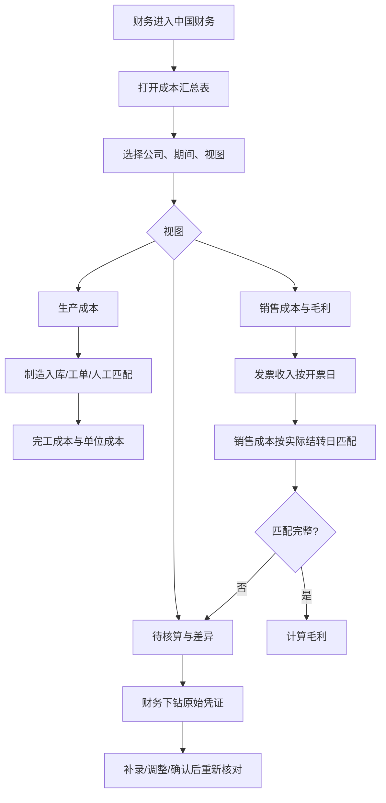
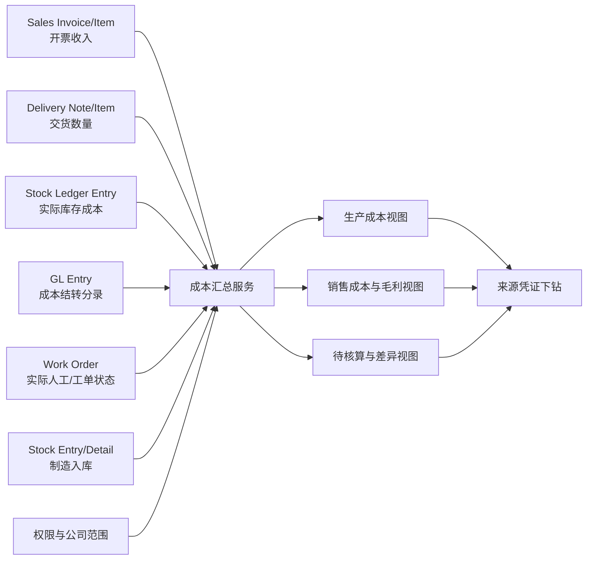

# 中国财务成本汇总表设计方案

日期：2026-10-16。状态：方案设计，暂不修改业务代码。

## 1. 建设目标

在“中国财务”模块提供一张可追溯的成本汇总表，帮助财务核对生产投入、完工成本、销售成本和开票毛利。报表必须区分生产成本与销售成本，避免将同一笔成本重复计入。

本方案遵循以下原则：

- 先展示 ERP 已过账、可追溯的实际数据，再展示管理分析数据。
- 生产工单成本与销售订单毛利分开核算，通过来源单据和关联关系连接。
- 收入按销售发票过账日期；生产成本按制造入库过账日期；销售成本按实际成本结转过账日期。
- 无法可靠匹配的金额标记“待核算”，不填零、不估算、不生成确定毛利。
- 首版只读，不重算成本、不回写业务单据、不改变库存估值和总账。

## 2. 报表入口与视图

在中国财务工作台增加“成本汇总表”入口。一个报表入口提供三个视图，避免维护多套筛选和权限逻辑。

```text
中国财务
└── 成本汇总表
    ├── 生产成本
    ├── 销售成本与毛利
    └── 待核算与差异
```

### 2.1 生产成本视图

回答“本期投入、完工和单位成本是多少”。按制造入库过账日期筛选，展示：

| 字段 | 说明 |
| --- | --- |
| 公司、制造入库日期 | 期间维度；只统计已提交制造凭证 |
| 生产工单、父工单、根工单 | 支持分层生产追溯，子工单不重复计入根工单 |
| 销售订单、产品、计量单位 | 无销售订单时标记为备货/未关联 |
| 完工入库数量 | 来自制造入库成品明细 |
| 实际材料成本 | 读取实际库存成本或制造入库成本来源，需明确是否含半成品 |
| 实际人工成本 | 使用生产工单实际人工金额；金额为零时显示待确认状态 |
| 制造费用 | 只展示已明确归属工单的附加费用，不把未知费用填入制造费用 |
| 损耗、废料回收 | 有独立来源才展示；正常损耗、异常损耗分开 |
| 完工生产成本、单位成本 | 完工成本 / 完工数量；数量为零时不可计算 |
| 核算状态、来源凭证 | 已匹配、待核算；可追溯 Stock Entry、Stock Ledger Entry 等凭证 |

生产成本的标准关系：

```text
期初在制 + 本期实际材料 + 本期实际人工 + 本期制造费用
    = 本期完工转出成本 + 期末在制
```

首版不自行估算期末在制。未完工工单单列为“待核算”，不能将全部投入直接当作完工产品成本。

### 2.2 销售成本与毛利视图

回答“本期开票收入对应的实际销售成本和毛利是多少”。按销售发票过账日期筛选，展示：

| 字段 | 说明 |
| --- | --- |
| 销售发票、发票过账日期 | 只统计已提交发票；退货/红字单独识别 |
| 客户、销售订单、产品 | 保留发票明细的业务追溯关系 |
| 开票数量、库存单位 | 支持分批开票和数量匹配 |
| 开票不含税收入 | 以发票明细不含税金额为准 |
| 实际销售成本 | 优先读取库存台账/总账已结转销售成本，不使用整张工单成本替代 |
| 毛利、毛利率 | 毛利 = 不含税收入 - 实际销售成本；毛利率 = 毛利 / 不含税收入 |
| 成本期间、成本凭证 | 记录成本实际过账期间和来源凭证 |
| 核算状态、待核算原因 | 已匹配、待核算；缺成本时毛利和毛利率留空 |

毛利只在收入与实际销售成本可靠对应时计算。开票日期与销售成本过账日期不同的记录，保留两个日期并标记跨期核对，不强行按订单日期摊销。

### 2.3 待核算与差异视图

集中展示需要财务处理的记录：

- 发票没有可读取的交货或库存成本。
- 发票数量超过可交付或可结转数量。
- 销售订单、交货单、发票和库存凭证关联缺失。
- 工单未完工、无制造入库、人工未录入或制造费用未确认。
- 父子工单存在重复归集风险。
- 收入期间与成本过账期间不一致。
- 退货、红字发票或成本冲回未完成匹配。
- 生产成本已发生但尚未结转销售成本。

每条异常必须包含单据、金额/数量、来源凭证、原因和建议处理动作；不能只显示“数据异常”。

## 3. 期间与成本口径

### 3.1 三个日期

报表筛选区不使用一个日期含义覆盖所有数据，建议明确显示：

- 开票期间：销售发票 `posting_date`。
- 制造期间：制造用途 Stock Entry 的 `posting_date`。
- 成本结转期间：库存台账或总账销售成本分录的 `posting_date`。

生产成本视图使用制造期间；销售收入使用开票期间；销售成本使用实际结转期间。若界面暂时只能提供一组日期，必须在视图标题和说明中明确当前日期含义，不能默默混用。

### 3.2 成本优先级

销售成本按以下顺序取数：

1. 已提交销售发票直接出库的实际库存成本。
2. 发票明细关联交货明细时，读取交货对应的实际库存成本，并按有效库存数量匹配开票数量。
3. 已有明确销售成本总账分录且可追溯到业务明细时，采用总账结转金额。
4. 无法确认来源或数量不一致时，状态为待核算，不计算毛利。

生产成本优先读取已提交制造入库及其库存成本来源；实际人工使用生产工单实际人工金额。人工为零必须区分“真实为零、无需发生、尚未录入”三种状态，不能仅靠数值判断。

## 4. 权限与数据安全

报表默认只开放 Accounts User、Accounts Manager、System Manager，最终角色矩阵由财务确认。权限必须同时作用于：

- 报表入口。
- 报表接口和导出接口。
- 公司、销售订单、工单、发票、交货单、库存台账和总账明细。
- 下钻链接和来源凭证。

原生 SQL 不会自动完成所有 Frappe 文档权限过滤，实施时应先取得有权限的父单据，再读取子表和库存来源。不得通过汇总金额、数量或异常数量间接泄露无权限公司的数据。

## 5. 建议的数据模型

首版优先复用现有单据和字段，不新增成本快照表。数据关系如下：

```text
销售发票明细
  ├─ 销售订单明细
  ├─ 交货单明细
  └─ 库存台账成本

生产工单
  ├─ 实际人工字段/明细
  ├─ 父工单、根工单
  └─ 制造入库明细
       └─ 库存台账成本
```

后续若需要月结快照，再新增“成本核算快照”数据结构，保存核算期间、口径版本、来源凭证、标准/实际金额、调整凭证和生成时间；不得用当前价格重算历史期间。

## 6. 代码实施方案（后续实施时）

本次文档阶段不修改代码。进入实施后建议采用新增分支，保留原有接口：

| 文件/模块 | 建议变更 |
| --- | --- |
| `china_finance` 工作台配置 | 增加成本汇总表入口 |
| `client_akivision/.../report/china_cost_summary/` | 新增 Script Report、筛选器、三种视图和列定义 |
| 新增只读成本服务 | 统一权限、期间校验、成本匹配和异常状态 |
| 新增成本导出服务 | 与页面使用相同筛选、权限和计算结果 |
| 成本服务测试 | 覆盖分批开票、直接出库、交货匹配、退货、跨期、未完工、父子工单和零分母 |

不建议首版修改：原运营指标看板接口、原销售订单成本回写、库存估值逻辑、销售发票提交逻辑、工单提交逻辑和现有订单成本报表。若发现旧接口口径不适合财务核算，应新增财务成本接口，不直接改变旧接口含义。

## 7. 调用链路

```text
中国财务工作台
  → 成本汇总表
  → 选择视图与期间
  → 成本汇总只读接口
  → 角色/公司/单据权限校验
  → 按视图读取已提交单据
  → 匹配库存台账、工单、发票和交货明细
  → 计算状态、毛利和异常
  → 表格展示/导出/来源凭证下钻
```

接口响应应区分 `available`、`no_data`、`incomplete`、`not_applicable`，并返回 `reason`、`source_documents`、`period_basis`。错误不能通过返回空数据隐藏权限失败或查询失败。

## 8. 业务流程图



## 9. 数据流程图



## 10. 验收标准

- 生产成本按制造入库日期，销售收入按发票过账日期，销售成本按实际结转日期，页面明确展示期间口径。
- 分批开票不会扣除整张工单成本；无法匹配时毛利为空并进入待核算。
- 生产成本、销售成本和销售毛利不重复累计同一笔成本。
- 父子工单可追溯但不重复汇总；未完工工单单列，不自动估计期末在制。
- 退货和红字发票显示冲减方向，成本冲回未匹配时进入异常。
- 页面、导出和下钻使用相同权限和筛选结果。
- 财务可以从每一行追溯到发票、交货、工单、制造入库、库存台账或总账来源。
- 空数据、零分母、缺失成本、权限不足和查询失败均有明确状态，不以零替代。

## 11. 首版不包含的内容

- 自动月结和期末在制品估算。
- 历史标准成本差异分析。
- 自动分配未归属的人工、折旧、水电和委外费用。
- 自动修改成本、库存估值、销售发票或会计凭证。
- 将订单累计成本字段直接当作本期财务销售成本。

上述功能需要财务确认核算规则和数据来源后另行立项。
