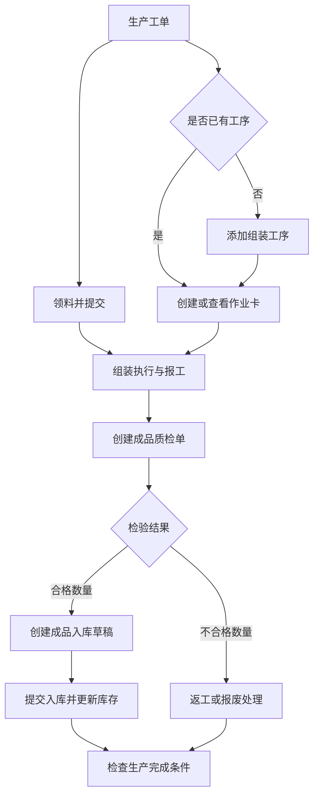

# 生产工单直接添加工序与组装流程优化方案

本文为设计方案，不代表相关功能已实现；本次不修改业务代码。

## 1. 目标与现状

在生产工单中直接添加“组装”等工序，并创建或查看关联作业卡，让生产人员按工单完成领料、组装报工、质检和入库。

目前作业卡的“操作”只能选择来源工单已经配置的工序。操作资料中有“组装”，不代表当前工单有该工序。没有工序时，普通下拉和高级搜索都会为空。

已核实工单 `MFG-WO-2026-00049` 没有工序，其 BOM `BOM-AKY-55R5-CGTC` 未启用工序，且工单目前状态为 Completed。该工单不能直接作为补加工序的试点；实施前须核查有效制造入库记录、完工数量以及自定义工单完成逻辑，确定它为何已完成。不得为了补工序直接改写历史状态。

## 2. 工单操作入口

在工单页面增加“工序与组装”操作区。

| 工单情况 | 页面入口 | 行为 |
|---|---|---|
| 草稿 | 添加工序 | 增加工序明细，随工单保存；提交后创建作业卡 |
| 已提交、未完成、未关闭 | 添加工序、创建/查看作业卡 | 按权限和校验补加工序；自动关联作业卡 |
| 已完成、已取消、已关闭或停止 | 查看工序、作业卡、质检及入库记录 | 禁止新增正常生产任务；返工走单独流程 |
| 没有工序 | 明确提示并提供添加入口 | 不再让用户进入空白操作搜索框 |

作业卡界面的“操作”显示为“工序”，底层仍使用标准 Operation，不创建重复概念。

### 添加工序弹窗

填写工序、工作站或工作站类型、工序顺序、预计作业时间（分钟）、计划处理数量和添加原因。默认数量根据当前工单及已有执行记录计算，不直接固定为订单数量。

弹窗提供两种用途：

- 仅当前工单：追加工单工序，不改 BOM。
- 后续工单也使用：先添加当前工单工序，再提供独立“生成新版 BOM 草稿”入口，由工程人员审核并提交。不得自动替换默认 BOM。

没有合适工序资料时，具备资料维护权限的人员可在弹窗中创建 Operation，创建后回填。但创建 Operation 和向工单添加工序必须是明确的两个动作。

工作站相关字段的必填规则沿用 ERPNext 配置；生成可执行作业卡前必须满足所需工作站条件。

## 3. 已提交工单补加工序规则

采用自定义应用的服务接口实现，不修改 ERPNext 核心代码，不开放已提交工单全部字段的随意编辑。

补加前锁定工单并重新读取状态，检查用户权限、剩余生产数量、已报工数量、制造入库及关联作业卡。默认由 Manufacturing Manager 或系统管理员执行；普通生产人员只操作已有作业卡。

只允许追加工序，不允许通过此入口删除、重排或修改已执行工序，也不修改原有领料、报工和入库数据。禁止使用相同工序行重复创建作业卡；若同一操作需要多次执行，应明确序号与执行用途，并确认标准系统是否支持。

已经部分入库的工单，新增工序只能覆盖尚未完成的生产数量；如果无法可靠区分已入库和待加工数量，阻止补加并要求走返工流程。补加前展示影响数量，用户提交后记录添加人、时间、原因和新增工序行。

追加实现须经过标准工单、作业卡、工序成本及完成率逻辑验证。若标准系统无法安全追加，不使用直接 SQL 写入绕过校验；改为生成关联的独立组装/返工任务方案。

## 4. 作业卡生成与报工

推荐从工单“创建组装作业卡”进入，自动带出工单、工序行 ID、工序、工作站、计划数量及所需来源字段。

同一工序已存在未完成作业卡时，优先提供“继续作业”或“查看作业卡”。需要拆分作业卡时，校验全部作业卡计划量及实际完成量，防止同一生产数量重复报工。接口必须幂等，连续点击不得生成重复单据。

手动新建作业卡仍保留。选择无工序工单时，提示“此工单尚未配置工序，请从生产工单添加”，并提供工单链接；已完成工单提示不可继续正常报工。

作业卡记录开始/结束时间、员工、实际工时、完工数量及损耗。工时用于生产成本归集，报工本身不增加成品库存。多道工序的处理数量不能相加作为成品产量；成品产量依据末道工序或明确的最终完工记录。

## 5. 组装、质检与入库流程

作业卡完成后提供“创建成品质检单”，自动关联工单和本次完工批次；存在关联质检时显示查看入口。检验数量不得超过该批次待检完工数量。

不合格数由“检测总数－合格数”计算，并保留未检状态，不能把未填写的检测行自动当作已检不合格。合格数量与不合格数量不得为负；提交质检时两者之和必须等于检测总数。

质检提交后，只允许按本批合格数量创建入库单。入库提交前检查质检有效性、来源、物料、批次及剩余合格数量；同一合格数量不可被多张有效入库单重复使用。并发创建、分批入库和取消重建都需校验。已生成草稿时优先打开原草稿。

不合格数量不进入正常成品库存，由有权限人员确认返工或报废，保留原因及成本处理记录。返工后重新报工、重新检验，不覆盖原质检历史。

当前已有制造质检门禁须一并审查，重点检查合格数量累计占用、批次匹配和校验触发时机；不能仅依据一张工单质检单的总合格数放行所有入库。

## 6. 状态、成本与取消

页面显示“待领料、待组装、组装中、待质检、部分入库、生产已完成”等生产进度，依据有效关联单据计算，不由用户手动选为完成。具体状态字段与标准 Work Order 状态如何并存，在实施时明确，避免两个状态相互矛盾。

生产完成必须综合计划量、末道工序实际产出、有效质检、已提交成品入库及经审批的损耗处理；仅提交领料不能完成工单。生产完成与成本结算完成分开显示，不能把“已入库”等同于“成本已结算”。

材料领用进入在制品；人工和制造费用按既有成本规则归集；成品入库承接生产成本。新增工序的计划成本与实际成本分别记录，避免重复计入领料或报工成本。成本金额仅财务及管理员可见，权限检查须覆盖接口和导出。

取消作业卡、质检或入库后重新计算进度及可用数量。存在已提交下游单据时，按反向顺序取消或走标准冲销/返工流程，禁止遗留无来源的有效入库单。

## 7. 实施步骤

1. 核查历史完成状态与标准追加工序能力，确定现有工单的处理边界。
2. 增加工单添加工序入口、服务端权限校验及审计记录；改善空白搜索提示。
3. 接入标准作业卡创建，补充幂等、数量限制和查看入口。
4. 实现本次完工批次到质检、合格数量到入库的关联和累计校验。
5. 完善进度显示、取消回退及成本权限，验证后上线。

每阶段交付后说明已实现范围，不将按钮上线描述为整条生产流程完成。已有领料、报工、质检和入库记录不做无依据的批量改写。

## 8. 验收标准

| 场景 | 预期 |
|---|---|
| 草稿工单添加组装工序 | 正常保存，来源和字段完整 |
| 有权限人员给未完成工单补加工序 | 新增行和日志可追溯，既有领料不变 |
| 无权限用户直接调用接口 | 拒绝新增或修改 |
| 已完成工单添加工序 | 拒绝，提供历史记录入口 |
| 无工序工单手动创建作业卡 | 明确提示原因，不显示无法解释的空白搜索 |
| 连续点击创建作业卡或入库 | 无重复单据或重复占用 |
| 两道工序各完成同一数量 | 成品产量不翻倍 |
| 部分入库后补加工序 | 仅处理剩余数量，历史产出不重复报工 |
| 检测总数99、合格98 | 不合格自动为1，最多按98入库 |
| 合格批次被分批或并发入库 | 累计不超过合格量 |
| 不合格返工 | 新记录关联原记录，重新检验后才能正常入库 |
| 取消上游或下游单据 | 校验依赖，正确回退数量及进度 |
| 无成本权限用户访问或导出 | 不返回成本金额 |

上线前使用隔离测试数据完成整条流程验证，并复核 `MFG-WO-2026-00049` 的完成原因；不得在验证过程中将历史已完成工单直接改为生产中。
