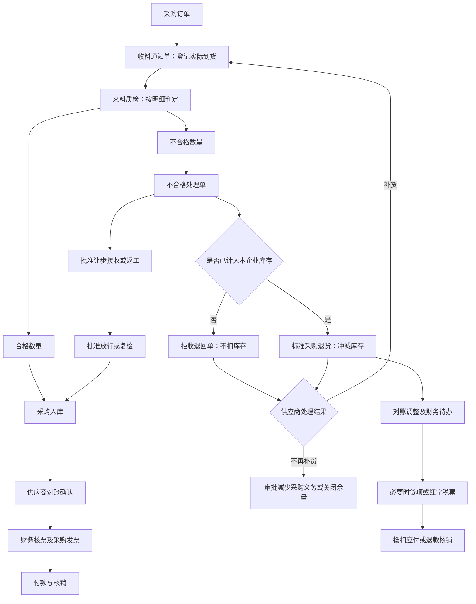
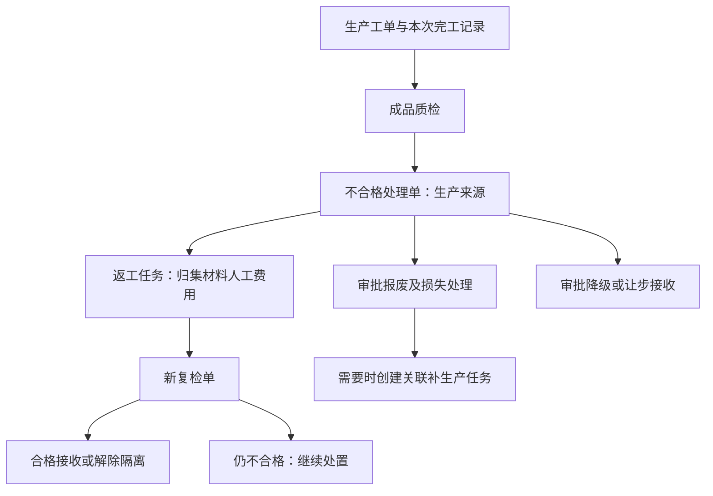

# 质检不合格处理与采购退货财务闭环方案

编制日期：2026-10-09。文档状态：讨论稿，仅方案，未实施。

## 1. 目标及范围

让质检的不合格数量有去向、有责任人、有执行单据，并在采购订单、库存、对账、发票、付款和生产进度中体现。用户可以从质检单创建对应处理单和退货草稿，自动关联来源，不必手动重复填写。

本次只新增方案文档，不修改业务代码、不提交业务单据。生产入库质检拦截目前按用户要求关闭；本方案不代表重新启用。以后是否恢复生产质检门禁单独决定。

采购来料不合格与生产成品不合格分别处理：采购可退给供应商；生产成品一般走返工、报废或降级。生产发现供应商材料缺陷时，必须追溯采购来源及实际可退物料，不能把整件自制成品直接映射成采购退货。

## 2. 现有能力与缺口

根据当前工作区源码核查，采购已有“采购订单 → 收料通知单 → 质量检验 → 按合格数量创建采购入库”的路径。合并质检按明细保存检测数、合格数、不合格数；整单状态 Accepted 可能仅表示存在合格数量，不能据此认定全部物料合格。

当前质检页面只有合格数量创建入库入口，缺少不合格数量处理及退货入口。已有 Purchase Follow Up 可加载采购收货和退货来源，但订单完成判断主要依赖收货、对账、开票及付款，缺少不合格待处理、补货、贷项及退款闭环。退货金额符号、原来源关联和已对账后的调整需要专项验证，不能认为已有退货字段就完成了流程。

生产已建立质检关联和数量字段，但强制入库校验不再挂载。生产不合格处理、返工复检及成本闭环仍作为拟建设能力。

## 3. 整体数据流



退货草稿不改变库存、应付或完成状态。库存变化以已提交库存单据为准；财务变化以已提交会计单据和核销记录为准。

## 4. 单据设计

### 4.1 不合格处理单

建议新增统一“不合格处理单”主表及处理明细，作为质检与执行单据之间的载体。建议英文名称 Nonconformance Disposition，实施前核实是否已有同用途单据，避免重复建设。

| 字段组 | 内容 |
|---|---|
| 基本信息 | 公司、来源类型（采购/生产）、供应商或生产部门、负责人、日期、状态 |
| 来源追溯 | 质检单及明细行、收料通知单及行、采购订单及行、生产工单、本次完工来源 |
| 库存来源 | 原采购入库单及行、原制造入库单及行、物料、批次、序列号、实际所在仓库 |
| 数量 | 来源不合格量、当前申请量、已执行量、剩余量、采购单位、库存单位、换算系数 |
| 决策 | 退货、返工、报废、让步接收、降级；原因、缺陷分类、附件、审批人和时间 |
| 后续 | 执行单据及明细、需补货量、已补货并验收量、复检单、处理完成时间 |
| 财务 | 原单价、预计调整金额、对账调整、贷项、退款关联及财务处理状态 |

每一处理明细只对应一个确定的来源质检明细和数量范围；多供应商、不同公司不合并在同一张单据。可先建立一张处理单，再按仓库及原入库来源拆成多张执行单。

处理状态：草稿 → 待审批 → 已批准/待执行 → 部分执行 → 待复检或待补货 → 已完成。驳回、取消单独显示。财务状态独立显示，不以实物退回完成替代退款完成。

### 4.2 两种采购退回单据

| 场景 | 单据及库存影响 | 财务影响 |
|---|---|---|
| 质检前只登记收料通知，不合格部分从未入账 | 自定义“来料拒收退回单”，业务界面可归入采购退货；记录交接、物流、数量和供应商签收，不扣企业库存 | 不冲减从未确认的库存或应付；有预付款时另办退款或保留作补货预付款 |
| 原采购入库已提交，后来发现不合格 | 复用标准 Purchase Receipt 退货（is_return、return_against 及原明细）；按实际仓库退回 | 标准库存及暂估账务按配置处理；已开票应付仍需财务贷项处理 |

一期建议沿用现有“先检验、合格部分入库”，未入库不合格品在物理待处理区保管，仅做业务数量台账。不默认引入“不合格品仓计价入库”。若以后选择隔离仓入账，须单独设计所有权、计价、库存冻结和会计政策，不能用普通入库绕过现有采购门禁。

已入库品需要隔离时，用实际库存转移单据处理；退货出库仓库必须与实物所在仓库一致。无库存来源不得伪造负数入库或先虚增库存再退货。

## 5. 页面按钮和自动关联

| 页面及条件 | 入口 | 行为 |
|---|---|---|
| 已提交质检，任一行有未分配不合格量 | 创建不合格处理单 | 自动带来源行、物料、剩余数量和原因；支持选择部分行 |
| 已有处理单 | 查看处理进度 | 展示累计分配量、执行量及每张后续单据 |
| 已批准采购退货处理明细 | 创建采购退货单 | 自动判定已入库/未入库，创建正确类型草稿，并明确库存影响 |
| 已有对应执行草稿 | 打开退货草稿 | 相同请求重复点击返回原草稿，不生成重复单据 |
| 退回已执行、约定补货 | 创建补货收料通知 | 沿用原订单剩余义务并关联原退货；补货仍须重新质检 |
| 财务需要调整 | 创建或查看财务处理 | 财务创建对账调整、贷项、退款草稿，不自动提交 |
| 生产返工已批准 | 创建返工任务/查看复检 | 来源、数量及成本归属完整保留 |

已提交部分合格质检应同时显示“合格数量创建入库”和“不合格数量创建处理单”。全部不合格时只开放不合格处理入口。按钮条件按明细和剩余数量计算，不只看 Accepted/Rejected。

## 6. 数量、复检与防重复规则

所有累计校验统一用库存单位计算，界面同时展示采购或生产单位。服务端应用物料精度和换算系数，不仅靠前端计算。

```text
质检提交：合格数量 + 不合格数量 = 本次报检数量
尚未分配不合格量 = 原不合格量 - 有效处理申请累计分配量
尚未执行处理量 = 已批准处理量 - 已提交有效执行量
来源可退库存量 = 来源有效入库量 - 来源已退量 - 已消耗/已出库量
本次可退量 = min(已批准剩余退货量, 实际可追溯可退库存量)
```

草稿有未检状态，不因合格数暂为零就认定整批已检不合格。合格数输入后自动计算不合格数，提交时必须全部检测完毕并填写缺陷原因。

退货、返工、报废、让步及降级分配量合计不能超过该来源不合格量。尚未决定处理方式时允许合计小于原量，并明确剩余待处理；只有完成处置分配后才要求全部覆盖。

返工是过程，不等于最终报废或最终接收。原不合格10件返工后8件合格、2件报废，应显示“最终恢复8、报废2”，不能把返工10和报废2相加算成处置12件。复检作为新记录关联原质检及返工任务，不覆盖原不合格事实。

创建草稿按来源和请求键幂等；不同分批请求允许不同草稿。提交处理申请和执行单据时锁定来源余额、重新核验占用；取消草稿或执行单据后恢复对应余量，取消质检前检查有效下游。供应商签收、物流交接不重复扣库存。

## 7. 对账、发票及付款的后续体现

正常路径保持“采购入库 → 对账确认 → 财务核票/开票 → 付款”。税率、税额、会计处理由财务填写或审核，采购和质检不能修改财务金额。成本和毛利金额仅财务及管理员可见，权限覆盖接口、报表和导出。

| 退货发生时点 | 后续动作 |
|---|---|
| 未入库、未开票 | 拒收记录不作为负库存/负应付对账来源；对账只纳入实际有效入库，拒收作为关联附件或异常明细 |
| 已入库、未对账 | 将已提交原收货和退货按一致符号纳入净额对账，未执行退货不作为已完成扣款 |
| 已对账、未开票 | 保留已确认快照；生成关联退货调整对账，在开票前核实原确认额与调整额，不直接改已提交对账行 |
| 已开票、未付款 | 退货单处理库存；财务创建采购贷项/红字相关记录，减少应付或形成供应商贷方余额，再核销 |
| 已付款 | 财务确定供应商退款或抵后续货款；退款用标准付款/收款及核销关系记录，不能直接把原付款额减掉 |
| 有预付款、未入库拒收 | 保留预付款事实，办理退款或批准转作补货/其他订单的预付款并留下分配记录 |

税务红字发票与 ERP 会计贷项单分别记录并关联，不因创建退货或贷项自动认为税务发票已经完成红冲。运费、索赔、折扣、汇差单独处理，不任意摊进退货数量。

对账应统一约定数量/金额符号：正常入库为正，已入账退货为负；如明细另设绝对值和方向，则汇总时只应用一次方向，防止把标准负数退货再次翻正。拒收退回只列业务数量，不冲减原本没计入应付的金额。

已经完成并对账的来源不重新进入普通对账候选。新退货是新增调整来源，仅对未确认的调整余额对账。原收货、退货、补货、贷项及退款必须可互相跳转。

## 8. 采购订单状态与完成条件

页面分别展示履约、质检处理、对账、开票、资金状态。采购总状态可显示“待收货、质检异常待处理、退货待补货、待对账调整、待开票/贷项、待付款、待退款/抵扣、已完成”。允许合格部分先对账付款，同时订单整体保留异常未完成提示。

```text
有效采购义务量 = 原订单量 - 经审批不再采购的数量
净有效接收量 = 已入库合格/批准接收量 - 已入账退货量
待补货/待交付量 = max(有效采购义务量 - 净有效接收量, 0)
```

未入库拒收本来就不计入净接收量，不再额外扣一次；补货验收合格入库后增加净接收量。退货本身不履行订单数量：需补货时订单仍未完成；不再补货时必须审批减少义务或关闭剩余量。

采购完成需要同时满足：有效采购义务已履行或获批关闭、不合格处置最终完成、全部需确认来源及调整已对账、应开票及贷项已处理、应付已结清且应退资金已退款或批准抵扣。全批拒收并获批关闭、无应付/无预付款的订单显示“不适用开票/付款”，不要强迫虚开零额发票以完成。

退货、贷项、退款及取消后重算状态。标准订单状态与自定义采购流程状态分别保留，不能无依据强行改写 ERPNext 历史状态。

## 9. 生产不合格分支



当前允许直接生产入库，方案必须支持“先入库后发现不合格”：关联原入库及批次/序列号，隔离现存数量，返工后解除隔离或恢复正常仓。已经入库的同一件成品不能在复检合格后再做一次全新制造入库，否则库存及生产数量会重复。

未入库的不合格产出仍属在制或待处理业务数量，报废处理不能冲减不存在的成品库存；财务处理在制损失。已入库的按实际库存执行报废并由财务确认损失。返工追加成本关联原工单/返工任务；已结算批次按现行成本调整机制处理，不重复结转原材料成本。

降级使用明确的降级物料及审批计价；让步接收保留审批依据和适用范围。需要生产补足时按有效订单需求创建关联补生产任务，不直接增加已完成工单的历史产量。生产完成和质量异常关闭、成本结算分开展示。

## 10. 报表、权限与审计

提供“不合格待处理清单、采购拒收与退货明细、退货待补货清单、对账调整及贷项待办、退款/抵扣待办、生产返工报废及损失明细”。可按公司、供应商、订单、物料、批次、原因、责任人、日期、状态筛选并跳转来源。

质检负责检测事实；采购负责供应商方案与补货约定；仓库负责实物交接、隔离和退货出库；生产负责返工报工；负责人审批让步、报废及关闭余量；财务负责税票、贷项、资金和成本。角色名称实施时映射站点现有角色，不默认普通业务人员可查看成本或提交资金凭证。

保存来源快照、审批意见、执行单据、操作者、时间和取消原因。通过后端校验来源读取/创建/提交权限及公司、供应商一致性，隐藏按钮不能替代权限校验。

## 11. 拟实施位置与顺序

仅列实施计划，不表示本次修改以下文件。

| 应用/位置 | 拟建设内容 |
|---|---|
| client_akivision 新增不合格处理主表及明细 | 决策、来源、数量占用、审批与执行状态 |
| client_akivision 新增拒收退回单及明细 | 未入账不合格品交接、签收、补货关联 |
| purchase_quality_flow.py / purchase_quality_flow.js | 按行创建处理单，部分不合格入口及自动关联 |
| 自定义 Purchase Receipt 扩展与相关校验 | 合格入库与退货分别校验，标准退货来源及仓库校验，取消回退 |
| purchase_order_payment_flow.py | 拒收、退货、补货、关闭余量、贷项退款后的状态重算 |
| china_finance 的 Purchase Follow Up | 退货调整来源、余额防重复、符号统一及已确认快照 |
| 财务采购发票与付款扩展 | 贷项、退款/抵扣关联及财务待办，复用标准总账与核销 |
| manufacture_quality_gate.py 及生产扩展 | 生产不合格处置及复检追溯；不在本轮恢复入库门禁 |
| hooks、迁移、工作区、报表 | 增量注册及字段迁移，不改 ERPNext 核心 |

建议分期交付：第一期实现采购不合格处理、拒收/标准退货、补货及页面入口；第二期补齐调整对账、贷项、退款/抵扣和订单完成规则；第三期实现生产返工、报废、复检及成本处理。第一期若涉及已开票或已付款退货，必须显示财务待办和未闭环状态，不能提前标记完成。

实施前验证当前标准退货映射是否保留质检引用并触发原入库限定校验；不能通过取消整个原入库、删除质检引用或全局绕过校验来实现退货。历史记录不自动制造退货、凭证或倒填审批；通过明确的历史关联/补录流程处理。

## 12. 验收场景与预期效果

| 场景 | 预期 |
|---|---|
| 到货100，合格90，不合格10，尚未入库 | 入库90；拒收退回10不扣库存；订单等待补货或关闭余量审批 |
| 到货100，全部不合格 | 可以创建拒收退回，不要求先创建合格入库；不能生成负库存 |
| 合并质检中部分物料全部不合格 | 按行开放处理；其他合格行可继续入库 |
| 入库100后发现10件缺陷 | 关联原入库退10，净库存90；退货累计不得超过来源及实物可退量 |
| 退10后补10合格入库 | 净接收100；补货独立复检，不复用原批不合格结果 |
| 不补货并批准减少义务10 | 以有效义务90判断履约，保留批准记录 |
| 原收货已对账后新增退货 | 原来源不重复对账，只确认新增退货调整 |
| 已开票未付款退货 | 库存退货与应付贷项分别执行，未经财务处理保持待贷项 |
| 已付款退货 | 显示待退款/抵扣；有效退款或分配核销后关闭财务异常 |
| 全拒收且无任何应付或预付款 | 批准关闭义务、拒收完成后可完成，开票付款显示不适用 |
| 同源重复点击或并发提交 | 返回原草稿或按余额拒绝超量，不能重复退货、处理或对账 |
| 取消退货、贷项或退款 | 数量及财务状态准确回退，原历史不被覆写 |
| 生产10件返工，复检8合格2报废 | 最终处置10件，返工过程不重复计入总量 |
| 先生产入库后返工合格 | 不再次新增同批成品库存，返工成本可追溯 |
| 普通业务角色访问成本接口/导出 | 无权读取受限成本及毛利 |

最终效果：质检发现异常后，用户能直接创建下一步草稿并保留完整来源；采购和仓库能追踪实物、补货及余量；财务能追踪对账调整、税票、贷项和退款；订单只有在履约、异常处置及财务均完成后才显示完成。

## 13. 待确认业务选择

以下为建议默认方案，尚未获得实施确认，不因生成文档而自动执行：

1. 未入库不合格品一期采用物理待处理区及拒收业务台账；隔离仓入账留作后续单独设计。
2. 补货优先沿用原采购订单；重新议价或改变采购对象时新建订单，并明确原义务审批关闭，避免双重待采购量。
3. 已对账后退货采用新增调整确认，保留原快照；已开票用贷项，已付款由财务选择退款或抵扣。
4. 建立统一不合格处理单，先交付采购分支，生产分支按后续阶段实施。
5. 生产直接入库现行规则继续保持；恢复质检门禁需要另行确认和累计合格量校验方案。

## 14. 小增量代码设计与老接口兼容

本节为拟修改代码的设计，不是已实施结果。新增接口名称为建议名，落地前核实命名冲突。优先在自定义应用新增服务、单据和事件分支；既有正常采购、合格入库、对账、生产入库调用保持原入口。

约定以下路径简称，均相对于工作区根目录：

- `CA`：`development/frappe-bench/apps/client_akivision/client_akivision`
- `CF`：`development/frappe-bench/apps/china_finance/china_finance`

### 14.1 新增代码及文件

| 拟新增文件/目录 | 主要代码职责 | 对外接口或入口 |
|---|---|---|
| `CA/client_akivision/doctype/nonconformance_disposition/`，包括 `.json/.py/.js/__init__.py` | 处理单、审批、来源快照、逐行余额及执行进度 | 处理单保存/审批/提交；创建执行草稿按钮 |
| `CA/client_akivision/doctype/nonconformance_disposition_item/` | 来源明细、分配量、处理方式、执行关联 | 主单子表，不独立开放写入接口 |
| `CA/client_akivision/doctype/purchase_rejection_return/` 及 `purchase_rejection_return_item/` | 未入库拒收退回、交接签收；不写库存台账或总账 | 拒收提交、签收、取消 |
| `CA/utils/nonconformance_flow.py` | 质检到处理单映射、审批量、复检来源、并发占用及状态查询 | `create_disposition_from_inspection(quality_inspection, selected_rows=None, request_id=None)`；`get_disposition_progress(disposition)` |
| `CA/utils/purchase_quality_return.py` | 判定拒收或入库退货，按原单映射标准退货、来源库存校验 | `create_return_from_disposition(disposition, selected_rows=None, request_id=None)`；库存退货提交/取消事件处理 |
| `CA/utils/purchase_quality_replacement.py` | 补货量及原订单余量、收料通知映射，关闭余量审批关联 | `create_replacement_notice(disposition, selected_rows=None, request_id=None)` |
| `CF/china_finance/services/nonconformance_finance.py` | 调整对账、贷项及退款/抵扣状态；标准会计单据映射 | `create_return_adjustment(disposition)`；`create_supplier_credit_draft(disposition)`；`get_return_finance_progress(disposition)` |
| `CA/utils/production_nonconformance.py`（第三期） | 返工、复检、报废、降级和已入库隔离分支 | `create_rework_draft(disposition)`；`create_reinspection(disposition)`；审批后生成库存处置草稿 |
| `CA/patches/v0_0_1/setup_nonconformance_flow.py`、财务应用对应增量 patch | 幂等建字段、工作区入口及权限，不生成历史业务单据 | 在各自 `patches.txt` 注册，重复运行不重复建字段 |
| 自定义应用新增报表目录及对应测试文件 | 异常待办、退货补货、贷项退款、来源余额及回归验证 | 查询和导出沿用权限框架 |

新建服务目录若不存在，应补 `__init__.py`；不能假设已有目录即可导入。生产返工优先复用标准作业卡/库存机制，需独立任务时再新增对应单据，不先修改已完成工单。

建议接口返回至少包含 `doctype`、`name`、`created`、`existing` 和处理提示。创建接口只返回已保存草稿；审批、库存提交、发票提交及付款提交是后续明确动作。服务端从来源读取公司、供应商、金额和物料，不信任浏览器传入的快照。

### 14.2 既有文件的最小修改点

| 现有文件 | 拟修改的代码位置与新增分支 | 预期效果 |
|---|---|---|
| `CA/public/js/purchase_quality_flow.js` | 在 Quality Inspection.refresh 追加按明细不合格余额显示的按钮及进度；保留原创建入库调用 | 部分合格时两个入口并存，全不合格也能继续处理 |
| `CA/utils/purchase_quality_flow.py` | `validate_purchase_order_source` 增量校验新来源字段；`update_receiving_notice_status` 对新补货/拒收关联调用进度服务 | 旧创建收料、质检、入库函数参数及返回格式不变 |
| `CA/client_akivision/doctype/purchase_receiving_notice/purchase_receiving_notice.json/.py/.js` | 追加原处理单、补货来源及只读异常进度；补货分支校验剩余义务 | 收料、补货、复检和原异常互相可查 |
| `CA/overrides/purchase_receipt.py` | `QualityCheckedPurchaseReceipt.validate_items_quality_inspection` 对本方案关联退货先走独立来源/可退量校验，再按验证后的标准退货规则处理；正常入库沿用旧分支 | 退货不被误要求关联到当前负数收货单，也不能无来源退货 |
| `CA/utils/purchase_receipt.py` | 保留 `validate_purchase_receipt_gate` 正常入库门禁；对关联异常退货追加服务调用或使用独立事件，避免重复校验 | 原合格采购入库规则继续有效 |
| `CA/public/js/purchase_receipt_quality_gate.js` | 仅关联异常单据显示处理来源及查看入口；正常单据保留原提示 | 收货与退货页面可解释来源及库存影响 |
| `CA/utils/purchase_order_payment_flow.py` | `_recalculate` 检测存在有效不合格流程时调用新状态计算分支；`sync_purchase_order_flow` 增量解析退货、补货及贷项关联 | 旧订单走旧逻辑；有异常订单体现待处理、补货、贷项和退款 |
| `CA/public/js/purchase_order.js` | 追加异常数量、处理单列表、退货/补货/财务进度展示 | 订单页面能看见后续环节，而不仅是一个完成标签 |
| `CF/china_finance/doctype/purchase_follow_up/purchase_follow_up.json/.py` | 新增调整类型及原确认单关联；类校验和金额校验仅对调整单分支调用新服务 | 正常对账不改入口；原快照与调整分别留存 |
| `CF/china_finance/doctype/purchase_follow_up_item/purchase_follow_up_item.json` | 追加处理单行、原收货行、退货行、调整方向及已确认余量 | 金额和数量能追溯到具体退货，防重复调整 |
| `CF/public/js/purchase_follow_up.js` | 新增调整预览及查看来源入口，保留普通来源预览函数 | 普通对账不重复加载已确认来源；异常只加载新增调整 |
| `CA/public/js/purchase_invoice.js` 与 `CF` 现有采购发票校验 Hook | 新增异常贷项来源显示及专用校验，不替换 `validate_invoice_reconciliation`、正常发票关联规则 | 退货贷项可关联原发票和调整，不混成普通新采购 |
| `CA/utils/work_order_completion.py`、`CA/public/js/work_order.js`（第三期） | 新增独立质量异常进度，不修改现有完工数量接口返回格式 | 生产已入库与异常未关闭可同时体现 |
| `CA/utils/production_reorder.py`（第三期） | 仅对关联返工/补生产新增分支，区分返工恢复与新增产出 | 返工不会误触发第二次补生产或重复累计产量 |
| `CA/utils/manufacture_quality_gate.py`（第三期） | 新增复检和处置来源数量校验，保留原入口但不恢复入库 Hook | 可直接入库的现行规则不因异常流程上线改变 |
| `CA/hooks.py`、`CF/hooks.py` | 在现有事件列表中追加异常处理事件；不覆盖已有 on_submit/on_cancel，避免同一事件重复注册 | 提交、取消及时同步源单和财务待办 |
| `CA/utils/buying_sidebar.py`、`CA/utils/manufacturing_sidebar.py`、财务工作区现有配置 | 增量增加处理单、退货补货、贷项退款待办入口 | 用户可从相关模块进入，不只靠质检按钮找单 |

所有条件修改在实施前检查真实挂载位置。财务税票、付款和核销的事件归属以已安装应用为准，复用现有扩展；不臆造标准核心文件路径，不在两个应用重复生成同一待办。

### 14.3 老接口保护规则

1. 保留 `create_receiving_notice(purchase_order)`、`create_quality_inspections_from_notice(receiving_notice)`、`create_quality_inspections(purchase_order)`、`create_purchase_receipt_from_quality(purchase_order=None, receiving_notice=None)` 的签名及原返回字段。
2. 保留 `preview_purchase_follow_up_sources(company, supplier, from_date, to_date, currency=None)` 普通调用方式。异常调整优先新增预览接口；若必须扩展参数，仅增加有默认值的可选参数，普通调用仍走原分支。
3. 保留工单完工及进度现有白名单接口。质量异常进度通过新接口提供，不把现有数值字段改成对象或更改状态语义。
4. 普通无异常历史单据采用原路径；有本方案来源标记才采用新处置分支。确实存在的标准退货关联冲突需单独修复、回归所有标准退货，不以兼容之名保留阻断，也不全局跳过质检。
5. 对账退货符号若确认存在错误，按来源事实修复未来计算；历史已提交快照不能自动覆写。上线前列出受影响历史记录，提供独立核查及调整流程。
6. 不变更 ERPNext 核心映射接口，不用直接 SQL 伪造库存、余额或总账。不通过本方案实现的功能开关反向启用生产入库质检门禁。

## 15. 调用链路与事件同步

### 15.1 从采购质检创建下一步

```text
Quality Inspection.refresh
  → 新按钮“创建不合格处理单”
  → nonconformance_flow.create_disposition_from_inspection
  → 来源读取权限、质检提交状态、行级不合格量校验
  → 锁定来源/幂等校验 → 保存处理草稿 → 跳转处理单
  → 负责人审批处理方案
  → purchase_quality_return.create_return_from_disposition
      ├─ 未入库：Purchase Rejection Return 草稿
      └─ 已入库：标准采购退货映射 → Purchase Receipt 退货草稿
  → 仓库审核并提交执行单
  → 同事务更新来源余额及相关单据进度
```

标准退货映射在运行站点核实实际函数名和参数后调用，不把猜测的方法名写成已验证接口。标准库存记账由标准控制器负责，自定义 Hook 只处理关联与业务余额。

### 15.2 退回、补货及财务调用

```text
拒收/采购退货 on_submit 或 on_cancel
  → 新服务解析处理单明细及原订单行
  → 重算处理单、质检、收料通知单和订单异常进度
  → 有补货义务：显示“创建补货收料通知”
      → purchase_quality_replacement.create_replacement_notice
      → 原收料质检链路 → 合格入库 → 重算补货剩余量
  → 有财务影响：生成/更新关联财务待办
      → nonconformance_finance.create_return_adjustment
      → Purchase Follow Up 调整确认
      → 财务创建标准采购贷项草稿及税票关联
      → 贷项提交/取消 → 应付及贷项状态重算
      → 退款或抵扣分配/取消 → 核销状态重算
      → 订单完成条件重算
```

核心数量更新、并发校验与执行提交在同一数据库事务完成，失败应整体回滚。通知与报表刷新可异步，但不能依赖异步任务保证可退量或是否结清。财务待办从有效来源查询可重建，通知失败不丢失待处理事项。

### 15.3 生产异常调用

```text
生产质检不合格
  → 新处理单（工单 + 本次产出 + 库存来源）
  → production_nonconformance 新接口
      ├─ 返工任务 → 报工/追加成本 → 新复检
      ├─ 未入库报废 → 在制损失处理
      └─ 已入库报废/隔离/降级 → 标准库存处置
  → 新质量异常进度接口 → 工单与销售订单关联页面
  → 财务成本/损失待办 → 成本结算展示
```

原制造入库接口仍可直接执行，不增加强制质检步骤。已入库返工合格只释放隔离或转回正常仓，不再新增制造入库量。

## 16. 受影响模块及关联修改闭环

| 模块 | 必须一起修改的关联部分 | 用户看到的预期效果 |
|---|---|---|
| 质量检验 | 处理单入口、逐行处理余额、复检关系、取消依赖 | 不合格有下一步，部分合格不会掩盖异常 |
| 收料通知 | 拒收、补货和质检来源、逐行到货与处理进度 | 同一订单多次到货能区分批次和补货 |
| 采购订单 | 原行到净接收/余量/批准关闭的关联；异常与财务进度 | 退货不误算履约完成，补货和关闭有依据 |
| 仓库及采购退货 | 原入库行、实际仓库、批次/序列号、占用余额、交接 | 未入库拒收不扣库存；已入库退货扣一次 |
| 供应商对账 | 原确认单、退货调整行、方向、未确认余量 | 已对账正常来源不重复对；新增退货单独调整 |
| 财务采购发票及税票 | 原发票、处理单、调整单、贷项及税务红字关系 | 实物退货完成与税票/应付调整完成分别可见 |
| 付款、退款及抵扣 | 原支付、贷项、退款和核销分配关系 | 已付款退货显示资金待处理，不虚减历史付款 |
| 生产与作业卡 | 原工单、返工任务、复检、原入库和补生产关联 | 返工恢复与新增产量区分，质量异常独立展示 |
| 销售订单关联生产 | 读取关联工单异常及补生产进度；不改销售订单计价接口 | 销售人员看到交付风险及可交付数量，不能查看受限成本 |
| 成本及中国财务 | 库存价值、在制损失、返工追加成本和凭证来源 | 成本可追溯、无重复计入，金额权限统一 |
| 工作区、报表、导出 | 页面入口、状态字段及同一查询服务权限 | 不同页面对同一异常显示一致数量和状态 |

关联字段至少保留“单据类型、单据号、明细行ID”三级定位；同物料重复行不可只凭 item_code 关联。批次、序列号需要时同时保存，跨公司/供应商关联拒绝。下游有效时禁止取消源单，改走反向取消或新增调整，不能形成孤立有效单据。

## 17. 分步实施、预期效果与验证交付

| 小增量阶段 | 修改范围 | 本阶段预期效果 | 必须验证 |
|---|---|---|---|
| A：来源和处理单 | 新单据、新余额服务、质检按钮、幂等字段迁移 | 可从不合格行创建关联草稿，责任和处理方式有记录 | 全不合格、部分不合格、重复行、无权限、并发分配、取消余量恢复 |
| B：拒收与标准退货 | 新拒收单、退货映射和专用校验；收料/质检关联显示 | 未入库可退回不扣账，已入库可真实退货；订单提示异常未闭环 | 100/90/10数量例、真实仓库、批次、超退、标准采购退货回归 |
| C：补货与订单进度 | 新补货接口、收料来源字段、异常订单计算分支 | 退货后能补货并复检，不补货能审批关闭，普通订单路径保持可用 | 多批补货、再次不合格、关闭余量、取消重算、普通采购回归 |
| D：对账及财务闭环 | 新调整服务、对账调整分支、贷项税票关联及退款核销待办 | 已对账退货不重复对账；贷项和退款处理后异常关闭 | 未开票/已开票/已付款/预付、符号、部分退款、跨期、取消及权限 |
| E：生产不合格 | 返工复检服务、原库存处置、异常进度及成本关联 | 返工/报废/降级可追溯，已入库品复检不重复入库 | 未入库/已入库、返工8合格2报废、成本、补生产及原直接入库回归 |
| F：入口及报表收尾 | 工作区、关联页面、报表导出及操作说明 | 采购、仓库、生产、财务都能找到账和数量的下一环节 | 各页面一致、普通用户成本隔离、历史记录兼容 |

阶段上线不得把未完成的后续环节显示为“已完成”。A–C上线后，已开票/已付款退货以财务待办和未关闭状态保留，D通过验收后才能自动判断完整财务闭环。

每阶段交付应附：实际新增/修改文件清单、函数及接口变化、迁移执行记录、调用链路、关联模块同步情况、验证结果、未实现范围，以及用户可见的前后对照。例如“此前质检10件不合格无入口；本阶段可创建退回草稿，退回提交后待补货10，财务未完成时订单不关闭”。

测试使用隔离数据或回滚事务，不提交用户真实退货、入库、发票或付款。上线先验证老采购正常流程、普通标准退货及生产直接入库，再验证新分支。需要撤回时停用新增入口和新分支，保留已经执行的单据和历史关联；不能靠删除字段或数据回退财务事实。

## 18. 当前“采购退货单”实现现状及补充方案

### 18.1 已查明的系统现状

当前站点没有独立的 `Purchase Return`（采购退货单）DocType。ERPNext 使用标准 `Purchase Receipt`（采购送货单）承载收货和退货两种业务，通过以下字段区分：

| 字段 | 正常收货 | 采购退货 |
|---|---|---|
| DocType | `Purchase Receipt` | `Purchase Receipt` |
| `is_return` | `0` | `1` |
| `return_against` | 空 | 原采购送货单号 |
| 明细数量 | 正数 | 负数 |
| 库存影响 | 增加库存 | 冲减原入库库存 |
| 会计影响 | 借库存商品/原材料 | 冲减库存并形成退货成本方向 |

采购侧边栏当前只有“采购送货单/Purchase Receipt”，没有独立“采购退货单”菜单。页面上显示“采购退货单”只能作为退货状态的前端提示，底层仍然是 `Purchase Receipt`，不能把它当成已存在的独立单据。

### 18.2 正确的已入库退货链路

只有物料已经通过采购入库进入企业库存时，才允许创建标准采购退货：

```text
已提交采购送货单 Purchase Receipt
  → 创建 Purchase Return
  → 实际生成 Purchase Receipt 草稿
  → is_return = 1
  → return_against = 原采购送货单
  → 明细 purchase_receipt_item 指向原入库行
  → 退货数量为负数且不超过原入库可退余额
  → 仓库提交
  → 库存冲减、采购履约/对账状态重算
```

自定义代码只负责来源、质检和数量关系校验；库存台账、估价及标准会计凭证继续由 ERPNext 标准退货控制器处理，避免重复记账。

### 18.3 质检不合格统一进入采购退货链路

业务上，所有质检不合格物料都必须进入“采购退货”业务链路，不能只停留在质量不合格汇总表中。系统统一从质量不合格明细创建采购退货处理单，再根据是否已入库决定最终执行方式。

截图场景中，质检数量为100件，合格98件、不合格2件，只有98件进入采购送货单。2件不合格品仍然要创建采购退货处理记录，但不能直接从98件入库单创建标准库存退货，否则会虚构库存减少。

统一链路如下：

```text
质量不合格汇总
  → 采购退货处理单（统一入口）
  → 判断是否存在有效入库行
  → 已入库：生成标准 Purchase Receipt 退货草稿
  → 未入库：生成采购退货处理/拒收执行草稿，不生成库存冲减
  → 仓库交接/供应商签收
  → 创建补货收料通知，或审批关闭采购余量
```

“采购退货处理单”是统一的业务跟踪单，必须记录原质检单、采购订单、收料通知、物料行、不合格数量、已入库数量、未入库数量、退回方式和供应商签收状态。已入库部分最终映射到标准 `Purchase Receipt` 退货；未入库部分不产生库存出库凭证，但仍要有采购退货单号和退回交接记录。

拒收执行不冲减尚未确认的应付；后续补货仍回到“收料通知→质检→合格入库”链路。财务根据原收货、对账、发票和付款状态，分别产生对账调整、采购贷项及退款/抵扣待办。

### 18.4 当前异常退货草稿的处理原则

实施前发现的 `Purchase Receipt` 退货草稿必须逐张核查：

1. `is_return=1` 且 `return_against` 为空的草稿，不得直接提交为有效退货。
2. 先确认原采购送货单、原明细行、供应商、仓库和可退余额，再补齐正确来源，或作废后重新从原单创建。
3. 不得通过直接 SQL 修改库存、数量或总账；已提交单据必须走标准取消、红冲或财务调整。
4. 没有原入库事实的质检不合格量，仍创建采购退货处理单，但执行动作必须标记为“未入库退回”，不得创建会减少库存的标准退货凭证。

### 18.5 是否新增独立“采购退货单”

建议第一阶段不新增独立库存单据，继续复用 ERPNext 标准 `Purchase Receipt` 退货能力，并新增以下用户界面和关联能力：

- 在采购模块增加“采购退货”入口，实际打开 `Purchase Receipt` 的退货列表视图（过滤 `is_return=1`）。
- 列表中明确显示“采购退货单号、原采购送货单、供应商、退货数量、提交状态”。
- 从“质量不合格”明细统一创建“采购退货处理单”，并强制区分“已入库标准退货执行”和“未入库退货执行”。
- 退货页面显示原送货单和原质检单，不再让用户误认为是普通收货。
- 后续如确有独立审批、供应商签收、退货原因、补货责任等复杂需求，再新增“采购退货申请/处理单”，但最终库存动作仍映射到标准 `Purchase Receipt` 退货。

这样可以保持 ERPNext 原库存和财务接口不变，同时让所有质检不合格品都有统一的采购退货入口。验收重点是：所有不合格明细都有采购退货处理单；已入库退货可追溯并正确冲库存；未入库退货有供应商签收记录但不减少库存；两类单据在采购订单、对账和财务状态中分别体现。

## 19. 简化版业务流（确认方案）

为降低操作复杂度，采购来料不合格采用以下单一主流程：

```text
采购到货
  → 收料通知
  → 质量检验
  → 记录合格数量和不合格数量
  → 合格数量先入库
  → 由质量不合格明细创建采购退货单
  → 仓库办理不合格物料退货
  → 供应商重新补货（如需要）
  → 新收料通知
  → 重新质检
  → 合格后重新入库
  → 采购订单、对账和财务状态重算
```

### 19.1 数量示例

到货100件，质检结果为合格98件、不合格2件：

1. 先创建采购入库单，入库98件。
2. 在质量不合格列表中选择对应质检明细，点击“创建采购退货单”。
3. 采购退货单自动带出物料、供应商、采购订单、质检单和不合格数量2件。
4. 退货单提交后，2件退回供应商。
5. 供应商补送2件时，创建新的收料通知，重新质检；合格后入库2件。
6. 最终采购订单累计合格入库100件后，继续执行对账、开票和付款流程。

### 19.2 标准退货的数量来源要求

ERPNext 标准 `Purchase Receipt` 退货必须关联原收货行，并且退货数量不能超过原收货可退数量。因此，要实现“合格98件入库后再退不合格2件”，实施时必须采用以下一种方式：

- **推荐方式：**采购收货单同时记录收货100件，其中合格98件进入正常仓库，不合格2件进入专用“待退/不合格仓库”；之后从该收货单创建退货，退回不合格仓库中的2件。该仓库不作为可用库存参与销售和生产。
- **替代方式：**入库单只入98件，同时由系统生成一张与质检单关联的采购退货处理单，退货单不直接冲减库存，只记录供应商退回2件。此方式需要新增业务单据，不能直接套用 ERPNext 标准库存退货。

默认采用推荐方式，除非财务明确要求不在任何库存仓库记录不合格实物。系统不得直接创建退货数量为2件但原收货只有98件的标准退货，否则会触发超退校验或造成库存数据不一致。

### 19.3 页面和按钮要求

- “质量不合格”列表只保留一个主要动作：“创建采购退货单”。
- 创建时自动带出合格入库单、原质检单和不合格数量。
- 合格数量入库按钮与采购退货按钮分开，先入库再退货。
- 采购退货单页面显示“原质检单、不合格原因、不合格仓库、补货状态”。
- 补货不再创建新的异常处理类型，直接回到收料通知和质检流程。

### 19.4 简化后的完成条件

对该批不合格物料，满足以下条件即可关闭质量退货流程：

- 合格数量已入库；
- 不合格数量已提交采购退货并完成供应商签收；
- 需要补货时，补货数量已重新质检并入库，或经审批确认不再补货；
- 已对账、已开票和已付款场景的财务调整按原流程完成。

该简化流程不改变采购退货的库存记账原则，也不恢复生产入库质检门禁；只收敛采购不合格品的业务操作入口和页面步骤。

## 二十、本次增量实现与验证边界

最新入口调整：历史未入待退仓的物料点击“创建采购退货”直接打开新增 `Purchase Quality Return`（采购质量退货单）及 `Purchase Quality Return Item` 明细，不再创建或跳转补录入库。该单记录非库存退回，不产生库存及总账凭证；服务端校验原单、供应商、质检明细、数量及其他未取消退货占用。已经入待退仓的物料仍使用标准库存退货。前端按响应中的 doctype 跳转，不再硬编码 Purchase Receipt。历史补录草稿保留，不自动取消或提交。

### 20.1 已实现的业务衔接

1. 新采购收货草稿同时记录合格数量和不合格数量：检测100、合格98、不合格2时，`qty=98`、`rejected_qty=2`、`received_qty=100`。不合格数量指定公司专用“质检不合格待退仓”；仓库不存在时，需要创建仓库权限。
2. 全部不合格时也允许创建仅记录待退数量的采购收货草稿；不会形成合格库存。
3. 质量不合格报表支持勾选明细，同一次退货只能选择同一质检单。服务端检查每个选中明细确实属于该质检单的不合格行。
4. 采购质检单也提供“创建采购退货”入口。退货使用标准采购收货单的退货分支，带出原收货行及待退仓；创建结果为待保存、待审核草稿，不自动提交。
5. 合格和不合格数量分别校验质检上限，并计入其他未取消收货草稿的占用量，防止重复收货。退货提交、取消不再直接改变原收料通知的收货状态。

### 20.2 修改文件与调用链

以下路径均相对 `development/frappe-bench/apps/client_akivision/client_akivision/`：

| 文件 | 修改用途 |
| --- | --- |
| `utils/purchase_quality_flow.py` | 收货分流、待退仓、按选择生成标准退货、收料状态保护 |
| `overrides/purchase_receipt.py` | 质检来源、合格及不合格数量、重复占用校验 |
| `utils/purchase_receipt.py` | 仅不合格收货行的采购质检门禁分支 |
| `public/js/purchase_quality_flow.js` | 质检单入库及退货入口、全不合格入口 |
| `client_akivision/report/quality_nonconforming_items/quality_nonconforming_items.js` | 勾选明细、同步返回的退货草稿并打开表单 |
| `utils/test_consolidated_purchase_quality.py` | 不合格数量、待退仓、全不合格及重复占用测试 |

调用链：质检页面 → `create_purchase_receipt_from_quality` → 标准采购订单映射 → 自定义收货质检校验 → 收货草稿；收货提交后 → 质检页面/质量不合格报表 → `create_purchase_return_from_quality` → ERPNext `make_purchase_return_against_rejected_warehouse` → 退货草稿 → 标准库存及财务提交逻辑。

标准退货映射将待退数量放入负的 `qty`，将 `warehouse` 指向原待退仓，并设置 `return_qty_from_rejected_warehouse=1`；不能按普通合格品退货理解该行。

### 20.3 历史单据与未覆盖范围

- 原单只有合格98件、没有记录不合格2件的历史收货，不能直接生成标准待退仓退货。新增历史补录分支：首次点击生成仅含不合格2件的待退入库草稿；仓库核实实物后提交，再点击生成关联补录单的标准退货。新增 `Purchase Receipt.custom_rejected_source_receipt` 保存原单来源，保留质检原引用，不修改原已提交库存。重复点击复用已有补录草稿。补录仅适用于不合格实物仍在现场，已经退走的实物不可补录。`MAT-PRE-2026-00066` 属于此历史类型。
- 专用待退仓只实现物理库存分开。当前增量尚未实现销售和生产选仓的统一禁用规则，不能将“不作为可用库存”视为已落地；使用时需按仓库权限和业务选仓规则管理。
- 不合格汇总仍展示质检原始数量；供应商签收、补货跟踪、对账和发票金额调整没有在本次增量新增自动闭环，继续使用原业务流程。
- 已执行13项质检相关自动测试；在回滚事务内验证98合格、2不合格的收货草稿及标准退货映射。验证没有提交真实收货或退货，库存账和总账的提交后端到端验证仍需专用测试单据。
