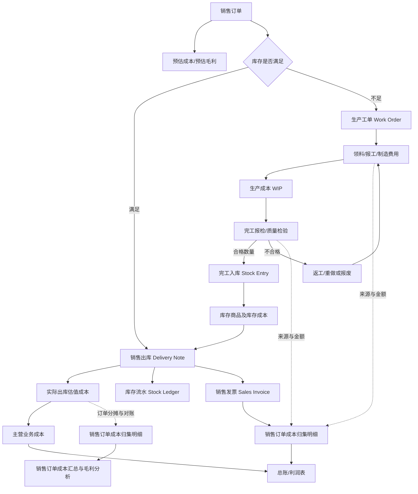

# 销售订单成本与毛利财务流转方案

## 1. 文档目的

本文用于定义销售订单、生产工单、库存和中国财务之间的成本与毛利数据流转方案。当前阶段只输出业务和系统设计，不修改代码、不创建数据库字段、不改变 ERPNext 标准库存估值和财务过账逻辑。

## 2. 设计结论

系统采用“两层口径、一个账务依据”的设计：

1. 销售订单可以展示预估成本和预估毛利，供报价、订单评审和业务分析使用；销售订单保存或提交本身不产生会计凭证。
2. 标准库存流水和总账凭证仍是财务最终依据：销售出库确认销售成本，销售发票确认收入、应收和销项税。
3. 新增“销售订单成本归集明细”和“销售订单成本汇总”管理层数据，用于按订单追溯生产成本、对账和统计，不替代 Stock Ledger、库存估值或 GL Entry。

## 3. 现行与目标数据流



## 4. 核心业务规则

### 4.1 预估成本与预估毛利

```text
预估收入 = 订单不含税单价 × 订单数量
预估成本 = 预估单位成本 × 订单数量
预估毛利 = 预估收入 - 预估成本
预估毛利率 = 预估毛利 ÷ 预估收入
```

预估单位成本可读取标准成本、最新库存成本或现有估值率，但必须标记成本来源和计算时间。预估数据不进入总账。

### 4.2 生产成本

```text
生产成本 = 直接材料 + 辅助材料 + 直接人工 + 制造费用
          + 返工/重做成本 + 适用的损耗成本 - 废料回收价值
```

材料成本沿用实际库存事务采用的估值金额；人工和制造费用沿用现有工时、成本中心和费用分摊设置。不得在新增台账中重新扣减库存或重复计算估值。

### 4.3 质量检验与入库门禁

生产工单完工后必须先报检。只有质量检验合格的数量才允许生成完工入库；未检验或不合格数量不得直接形成可销售库存。

```text
工单完工申报 → 质量检验
             ├─ 合格数量 → 完工入库 → 库存商品
             └─ 不合格数量 → 隔离、返工/重做或报废
```

质量记录至少包括工单、批次或序列号、报检数量、合格数量、不合格数量、检验结果、检验人、检验时间和不合格原因。部分合格时，只允许合格数量入库，剩余数量保持待处理状态。返工或重做产生的材料、人工和制造费用继续关联原销售订单；报废按现有库存及财务政策处理。质量检验本身不重复计成本，成本仍以实际消耗、返工、报废和入库来源单据为准。

### 4.3 财务实际销售成本和毛利

销售出库时读取现有库存估值成本：

```text
借：主营业务成本
贷：库存商品
```

销售发票确认收入、应收和销项税：

```text
借：应收账款
贷：主营业务收入
贷：应交税费-应交增值税（销项税额）
```

```text
财务实际毛利 = 已确认不含税收入 - 已结转销售成本
财务实际毛利率 = 财务实际毛利 ÷ 已确认不含税收入
```

当库存混池时，订单归集生产成本与财务销售出库成本必须分别展示，不能用某一张生产工单成本直接替换库存估值成本。

## 5. 建议新增的数据对象

### 5.1 销售订单成本归集明细

这是管理分析和财务追溯台账，不是第二套总账。

| 字段组 | 建议字段 |
|---|---|
| 订单关联 | 销售订单、销售订单行、客户、项目 |
| 来源关联 | 来源单据类型、来源单号、来源行、生产工单、库存事务、凭证号 |
| 物料维度 | 物料、仓库、批次/SN、单位 |
| 成本维度 | 直接材料、辅助材料、人工、制造费用、正常损耗、异常损耗、返工、废料回收、销售出库成本 |
| 金额维度 | 数量、单位成本、金额、币种、汇率、税前/含税标识 |
| 期间维度 | 成本日期、会计期间、成本中心、项目 |
| 状态维度 | 草稿、已确认、已冲销、已对账；关联冲销来源 |
| 审计字段 | 创建人、创建时间、修改人、修改时间、备注 |

幂等键建议为：`来源单据类型 + 来源单号 + 来源行 + 成本类型 + 订单行`。来源单据更正或取消时，原明细保留并生成反向/冲销明细，不直接删除历史记录。

### 5.2 销售订单成本汇总

汇总数据由明细重算，不允许前端直接编辑金额。建议字段：

```text
预估收入、预估成本、预估毛利
已归集生产成本
已发货销售成本
已确认销售收入
未发货订单金额、未发货归集成本
实际毛利、实际毛利率
成本状态、最后重算时间、对账状态
```

### 5.3 订单与生产关联快照

生产工单应支持可空的销售订单、订单行、目标合格数量和订单损耗率快照。旧工单没有订单关联时继续走原流程。

## 6. 单据与财务边界

| 单据/对象 | 业务作用 | 是否直接产生财务凭证 | 成本用途 |
|---|---|---:|---|
| 销售订单 | 需求、价格、交期 | 否 | 预估成本、预估毛利 |
| 生产工单 | 生产任务和成本归集载体 | 通常否 | 关联材料、人工、制造费用 |
| 生产领料 | 材料消耗 | 是/沿用标准库存过账 | 增加 WIP 或生产成本 |
| 完工报检/质量检验 | 判定合格、不合格和待处理数量 | 否 | 入库数量及返工/报废依据 |
| 完工入库 | 仅合格成品入库 | 是/沿用标准库存过账 | WIP 转库存商品 |
| 销售出库 | 发货和库存减少 | 是 | 库存商品转主营业务成本 |
| 销售发票 | 收入、应收、税额 | 是 | 确认销售收入 |
| 成本归集明细 | 订单分析和追溯 | 否 | 统计、对账、毛利分析 |

## 7. 财务统计和对账功能

首期建议提供以下报表：

1. 销售订单成本明细表：按订单、订单行、工单、物料和成本类型钻取来源。
2. 销售订单毛利表：订单收入、已发货销售成本、实际毛利和毛利率。
3. 生产工单成本表：材料、人工、制造费用、损耗、废料和完工数量。
4. 质量检验与入库对账表：报检数量、合格入库数量、不合格数量、返工数量和报废数量。
4. 订单成本与库存出库成本对账表：订单归集成本、库存估值成本、销售成本差异。
5. 月度成本结转表：按会计期间汇总新增、冲销、未对账和待处理数据。
6. 成本差异表：实际成本、标准成本、估值调整及已销售/期末库存分摊。

最低对账关系：

```text
生产领料成本 = WIP 增加
完工入库成本 = 库存商品增加
销售出库成本 = 主营业务成本增加
订单成本明细汇总 = 可追溯来源金额（管理口径）
```

## 8. 退货、红字和异常处理

- 销售退货必须引用原销售出库，生成反向库存和销售成本明细。
- 红字发票冲减收入、应收和销项税，并保留原发票关联。
- 生产退料、库存冲销和凭证调整均生成反向成本明细，不修改已发生历史金额。
- 异常损耗数量大于零时要求填写原因；是否单独映射“异常损失”科目由财务政策确定。
- 废料回收可按财务政策冲减生产成本或作为其他收入，但系统必须记录处理方式和金额。

## 9. 权限、期间和审计要求

1. 销售岗位只看授权的价格、订单预估毛利和必要库存数量，不开放采购价、估值率和成本明细。
2. 生产岗位可维护领料、报工、损耗和废料来源，但不能修改已确认金额。
3. 财务岗位可确认成本、重算汇总、执行对账和生成/审核会计凭证。
4. 已关闭会计期间禁止新增或修改过账数据；更正必须进入后续期间并关联原单据。
5. 所有成本明细必须保留来源单据、操作人、时间、冲销关系和凭证关联。

## 10. 分阶段实施建议

### 阶段一：只读统计和数据验证

- 梳理现有 Sales Order、Work Order、Stock Entry、Delivery Note、Sales Invoice 和 GL Entry 关联。
- 建立成本明细的数据字典和来源映射。
- 先以报表或查询验证订单关联、出库成本和收入口径，不自动生成凭证。

### 阶段二：订单关联和成本台账

- 增加可空的订单/订单行关联字段。
- 建立成本归集明细及幂等、冲销规则。
- 增加订单成本汇总和对账报表。

### 阶段三：财务确认和差异处理

- 接入人工、制造费用和标准成本差异。
- 增加期间控制、财务审核、凭证关联和月结流程。
- 完成退货、红字、部分完工、部分发货和期末分摊测试。

## 11. 实施前待确认事项

1. 当前生产工单、工序作业卡、人工和制造费用的实际 DocType 与字段路径。
2. 材料采用移动平均、FIFO 还是其他库存估值方式，以及历史数据的适用范围。
3. 损耗率采用投入加成率还是投入产出损耗率。
4. 废料回收价值的会计处理方式。
5. 异常损耗是否单独映射会计科目。
6. 订单成本必须细分到订单行的程度，以及库存混池时的分摊规则。
7. 中国财务模块现有凭证、期间、成本中心和辅助核算字段。

## 12. 验收标准

使用一张包含生产、损耗、废料和部分发货的销售订单验证：

- 销售订单保存/提交不产生凭证；
- 预估毛利和财务实际毛利口径分离；
- 质量检验合格数量才能完工入库，部分合格、不合格、返工和报废均可追溯；
- 生产领料、完工入库、销售出库和发票均可追溯；
- 材料成本只计入一次；
- 已发货部分才确认销售成本和财务毛利；
- 订单归集成本与库存估值销售成本分别展示并可对账；
- 退货、红字、冲销和重复事件不会重复计成本；
- 无订单关联的历史单据行为保持不变。

## 13. 明确不在本阶段实施的内容

- 不修改 ERPNext 核心库存估值算法；
- 不以管理成本明细替代 Stock Ledger 或 GL Entry；
- 不在销售订单保存时生成收入、成本或税务凭证；
- 不强制回填全部历史订单；
- 不自动改变异常损耗和废料的会计科目政策。
